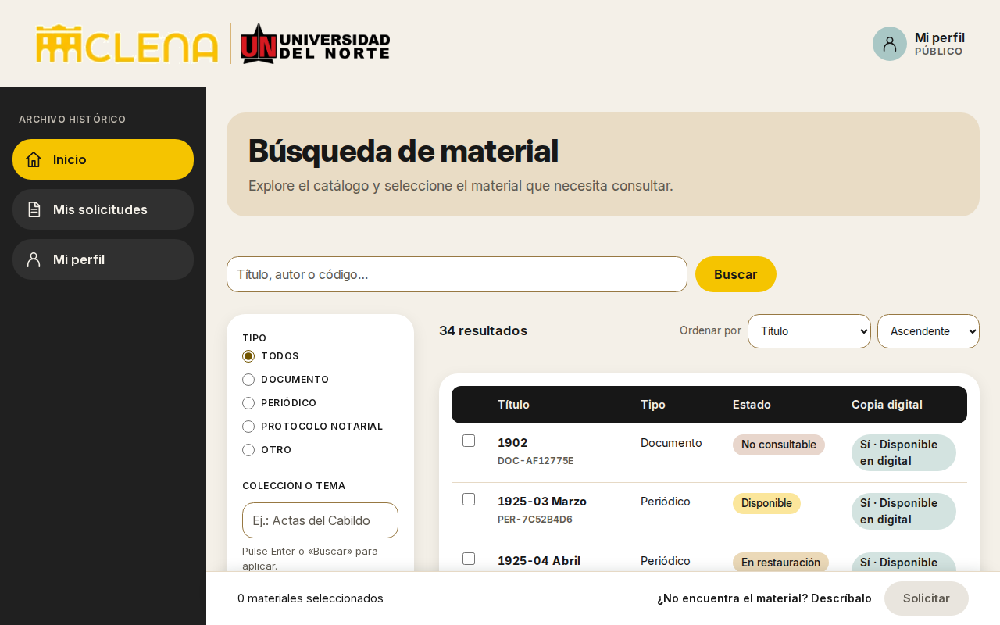
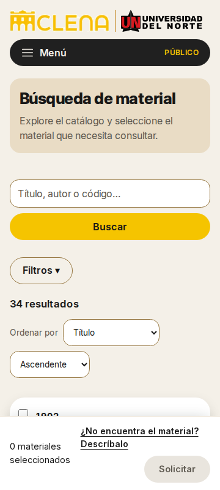
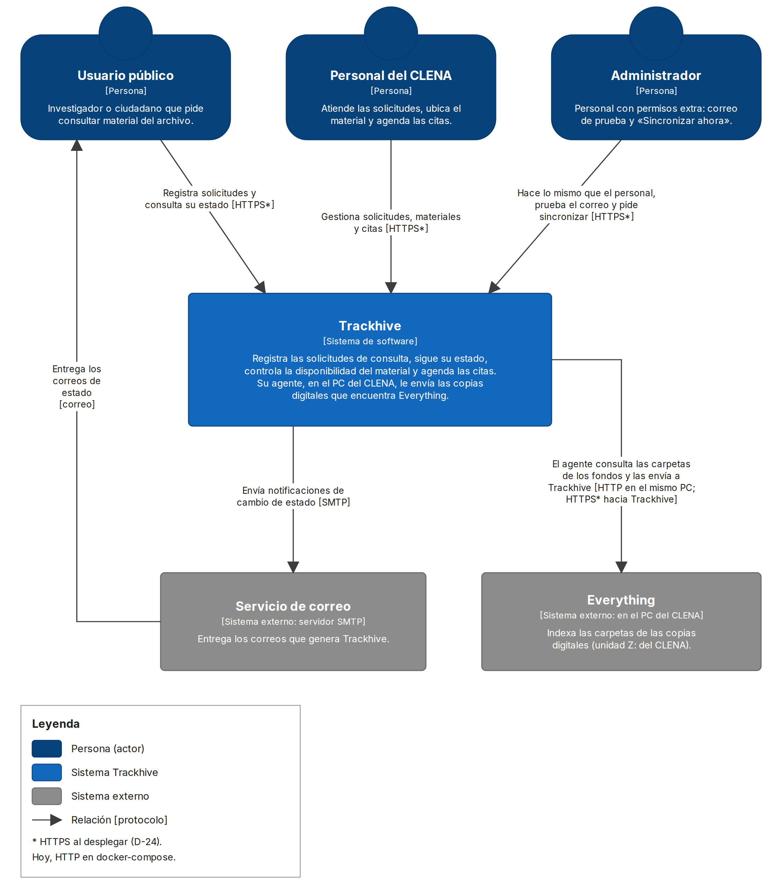
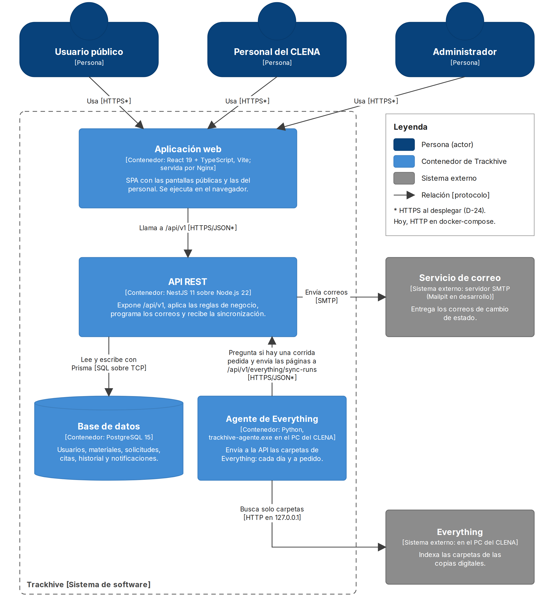
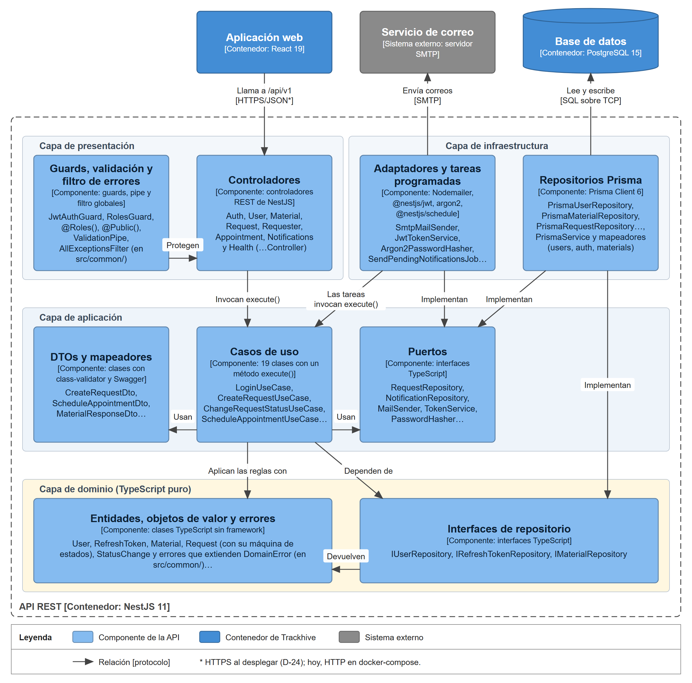

# Trackhive

**Sistema de consulta y seguimiento de solicitudes del archivo del CLENA.**

Trackhive es una aplicación web con la que el CLENA recibe las solicitudes de consulta de su archivo, sigue el estado de cada una, controla la disponibilidad del material y agenda las citas de consulta. Reúne en un solo lugar lo que antes se hacía por correo y en hojas de cálculo: el radicado, el historial de estados, el material solicitado, la cita y las notificaciones al solicitante.

| Escritorio (1280 px) | Móvil (360 px) |
|:---:|:---:|
|  |  |

---

## Tabla de contenido

- [¿Qué problema resuelve?](#qué-problema-resuelve)
- [Equipo de origen y roles Scrum](#equipo-de-origen-y-roles-scrum)
- [Funcionalidades principales](#funcionalidades-principales)
- [Arquitectura](#arquitectura)
- [Stack tecnológico](#stack-tecnológico)
- [Puesta en marcha con Docker](#puesta-en-marcha-con-docker)
- [URLs y usuarios de prueba](#urls-y-usuarios-de-prueba)
- [Variables de entorno](#variables-de-entorno)
- [Desarrollo local sin Docker](#desarrollo-local-sin-docker)
- [Pruebas y CI](#pruebas-y-ci)
- [Estructura del repositorio](#estructura-del-repositorio)
- [Documentación](#documentación)
- [Solución de problemas](#solución-de-problemas)

---

## ¿Qué problema resuelve?

El CLENA recibe solicitudes de consulta de material de archivo por correo. El personal las lee una por una, busca el material, responde al solicitante y anota por separado la disponibilidad y las citas. Ese flujo manual tiene varios problemas:

- No hay un estado único y visible para cada solicitud.
- Es fácil perder el hilo de quién pidió qué, cuándo y en qué quedó.
- La disponibilidad del material y las citas se cruzan a mano, lo que permite dobles reservas.
- El solicitante no tiene una forma directa de consultar el avance de su radicado.

Trackhive centraliza ese proceso. El usuario público se registra, busca material y radica su solicitud; el personal del CLENA atiende la bandeja, cambia el estado, controla la disponibilidad, agenda la cita y el sistema notifica al solicitante por correo. **Trackhive no almacena archivos**: solo gestiona las solicitudes; las copias digitales se entregan fuera del sistema, por correo.

## Equipo de origen y roles Scrum

Trackhive es el **Proyecto P4 — Curso Backend, Proyecto Final «Soluciones para el CLENA»**, desarrollado por el **Grupo 1**.

| Integrante | Rol Scrum | GitHub |
|---|---|---|
| Bryan Montoya | **Development Team** | [@bryanmg20](https://github.com/bryanmg20) |
| Samuel Ricardo | **Development Team** | [@SRicardo05](https://github.com/SRicardo05) |
| Alan García | **Development Team** | [@AlanSan25](https://github.com/AlanSan25) |
| Álvaro Jiménez | **Development Team** | [@doriada](https://github.com/doriada) |

Todo el grupo conforma el **Development Team**. Los cuatro integrantes participan en el desarrollo y en las ceremonias; no hay roles separados de Product Owner ni de Scrum Master.

El trabajo se organiza en sprints de dos semanas con el tablero [Trackhive - Tablero Scrum](https://github.com/users/bryanmg20/projects/2). Las ceremonias y sus evidencias se registran en [`docs/`](docs/).

## Funcionalidades principales

- **Registro e inicio de sesión** con JWT, refresh token y roles `PUBLICO`, `PERSONAL` y `ADMIN`.
- **Buscador de material** con filtros por título, autor, colección y tipo de material.
- **Solicitud pública** con código de radicado y seguimiento en «Mis solicitudes».
- **Bandeja del personal** para buscar, filtrar y atender solicitudes.
- **Registro de solicitud a nombre de un visitante** desde el mostrador.
- **Máquina de estados** con transiciones válidas, motivo de rechazo e historial de cambios.
- **Control de disponibilidad** y **agenda de citas** sin dobles reservas.
- **Notificaciones por correo** al solicitante en cada cambio de estado (Mailpit en desarrollo).
- **Sincronización con Everything:** un agente en el PC del CLENA envía las carpetas de las copias digitales. El administrador ve cómo terminó la última sincronización y pide «Sincronizar ahora».
- **Diseño responsive** usable a 360 px, con etiquetas accesibles y operación por teclado.

## Arquitectura

Trackhive se documenta con el modelo C4. La explicación completa, las decisiones de diseño y las leyendas están en [`docs/arquitectura.md`](docs/arquitectura.md) y en su versión PDF, [`docs/arquitectura.pdf`](docs/arquitectura.pdf).

### Nivel 1 · Contexto

Personas que usan el sistema y sistemas externos.



### Nivel 2 · Contenedores

Aplicación web, API REST, base de datos y servicio de correo, con su tecnología y protocolo.



### Nivel 3 · Componentes de la API

Controladores, casos de uso, puertos, entidades e implementaciones, con las dependencias apuntando hacia el dominio.



## Stack tecnológico

| Capa | Tecnologías |
|---|---|
| Frontend | React 19, TypeScript, Vite, React Router, React Hook Form, Zod. En producción lo sirve Nginx 1.27 como archivos estáticos. |
| Backend | NestJS 11 sobre Node.js 22, Prisma 6, JWT, `class-validator`, Nodemailer y Swagger. |
| Base de datos | PostgreSQL 15 con migraciones versionadas de Prisma. |
| Correo | Mailpit 1.32 en desarrollo (guarda los correos sin enviarlos); cualquier servidor SMTP en producción. |
| Pruebas | Jest y Supertest en el backend; Vitest, Testing Library y Playwright en el frontend. |
| DevOps | Docker Compose para el entorno completo y GitHub Actions para lint, pruebas y build en cada PR. |

## Puesta en marcha con Docker

Estas instrucciones están pensadas para un **clon limpio** del repositorio.

> **¿Un PC con Windows desde cero?** El [tutorial paso a paso](docs/tutorial-windows.md) va desde instalar las herramientas hasta sincronizar el catálogo con Everything (portable o instalado) a través del agente, incluido el script que genera las carpetas simuladas.

### Requisitos

- [Git](https://git-scm.com/).
- [Docker Desktop](https://www.docker.com/products/docker-desktop/) con Docker Compose **2.24 o superior** (el comando `docker compose`). En Windows o macOS, Docker Desktop debe estar iniciado.
- Puertos libres: `8080` (frontend), `3000` (API), `5432` (PostgreSQL), `8025` y `1025` (Mailpit). Si alguno está ocupado, se cambia en el `.env` (ver [Solución de problemas](#solución-de-problemas)).

No hace falta instalar Node.js, pnpm ni PostgreSQL para levantar el sistema con Docker.

### Pasos

```bash
# 1. Clona el repositorio
git clone https://github.com/bryanmg20/Trackhive.git
cd Trackhive
```

```bash
# 2. Crea tu archivo de entorno a partir de la plantilla
cp .env.example .env
```

En PowerShell de Windows el equivalente es:

```powershell
Copy-Item .env.example .env
```

```bash
# 3. Levanta backend, frontend, PostgreSQL y Mailpit.
#    La primera vez construye las imágenes y puede tardar varios minutos.
docker compose up --build
```

Añade `-d` (`docker compose up -d --build`) para dejarlos en segundo plano.

> **Producción y desarrollo (HU-42):** [`docker-compose.yml`](docker-compose.yml) es la configuración de **producción**: solo el frontend publica sus puertos (80, que redirige a HTTPS, y 443), y no se levantan Mailpit ni el mock de Everything. [`docker-compose.dev.yml`](docker-compose.dev.yml) le agrega lo de desarrollo: los puertos de depuración en `127.0.0.1` (PostgreSQL y la API), Mailpit, el mock de Everything y el frontend por HTTP en `FRONTEND_PORT`. El `.env` copiado de `.env.example` carga los dos con `COMPOSE_FILE=docker-compose.yml:docker-compose.dev.yml` (y `COMPOSE_PATH_SEPARATOR=:`), así que `docker compose up` levanta todo sin más. El despliegue en el servidor está en el [manual de operación](docs/manual-operacion.md). El comando antiguo `docker-compose` (v1) no entiende `docker-compose.dev.yml`.

Al arrancar, el contenedor del backend ejecuta automáticamente:

1. `prisma migrate deploy` — aplica las migraciones pendientes.
2. `prisma db seed` — carga datos ficticios de demostración si `RUN_SEED=true`.
3. `node dist/main` — crea el administrador inicial con `ADMIN_EMAIL` y `ADMIN_PASSWORD` si todavía no hay ningún `ADMIN`, e inicia la API.

### Verifica que todo quedó arriba

```bash
docker compose ps
```

Debes ver cuatro servicios: `postgres` y `mailpit` en estado `healthy`, y `backend` y `frontend` en `Up`.

```bash
# La API responde y la base de datos está disponible
curl http://localhost:3000/api/v1/health
# {"status":"ok","database":"up"}
```

También puedes abrir el frontend en <http://localhost:8080> y la documentación interactiva de la API (Swagger) en <http://localhost:3000/docs>.

### Detener y reiniciar

```bash
# Detiene los contenedores sin borrar los datos
docker compose down

# Detiene y borra también el volumen de PostgreSQL (reinicia la base desde cero)
docker compose down -v

# Reconstruye después de cambiar código o dependencias
docker compose up -d --build
```

## URLs y usuarios de prueba

| Servicio | URL local |
|---|---|
| Aplicación web | <http://localhost:8080> |
| API REST | <http://localhost:3000/api/v1> |
| Swagger / OpenAPI | <http://localhost:3000/docs> |
| Estado de la API | <http://localhost:3000/api/v1/health> |
| Mailpit (bandeja de correos de desarrollo) | <http://localhost:8025> |
| PostgreSQL | `localhost:5432` |

El frontend también reenvía `/api/`, `/docs` y `/docs-json` al backend, así que <http://localhost:8080/api/v1/health> y <http://localhost:8080/docs> funcionan igual.

El administrador inicial se crea siempre al arrancar el backend, con `RUN_SEED=true` o `false`, a partir de `ADMIN_EMAIL` y `ADMIN_PASSWORD` del `.env`, solo si no existe ningún `ADMIN`; en los arranques siguientes no se cambia su contraseña. Con la semilla de demostración (`RUN_SEED=true`) se crean además estos usuarios ficticios:

| Rol | Correos | Contraseña |
|---|---|---|
| `ADMIN` (administrador inicial) | `admin@example.com` (`ADMIN_EMAIL`) | `1` (`ADMIN_PASSWORD`) |
| `PERSONAL` | `personal1@example.com`, `personal2@example.com` | `1` (`SEED_DEMO_PASSWORD`) |
| `PUBLICO` | `publico1@example.com`, `publico2@example.com`, `publico3@example.com`, `publico4@example.com` | `1` (`SEED_DEMO_PASSWORD`) |

Son valores **solo para desarrollo**. En producción, `RUN_SEED=false` no carga datos de demostración y exige un `ADMIN_PASSWORD` de al menos 12 caracteres ([manual de operación](docs/manual-operacion.md#8-administrador-inicial-y-cambio-de-contraseñas)).

## Variables de entorno

El archivo `.env` se crea copiando [`.env.example`](.env.example) y **no se sube al repositorio**. Docker Compose lo lee de la raíz del proyecto y exige las variables marcadas como obligatorias.

| Variable | Descripción | Valor de ejemplo |
|---|---|---|
| `POSTGRES_DB` | Nombre de la base de datos | `trackhive` |
| `POSTGRES_USER` | Usuario de PostgreSQL | `user` |
| `POSTGRES_PASSWORD` | Contraseña de PostgreSQL | `1234` |
| `POSTGRES_PORT` | Puerto local de PostgreSQL | `5432` |
| `BACKEND_PORT` | Puerto local de la API | `3000` |
| `FRONTEND_PORT` | Puerto local de la aplicación web (solo desarrollo; en producción, 80 y 443) | `8080` |
| `COMPOSE_FILE` | Archivos de Docker Compose. En desarrollo, el de producción más `docker-compose.dev.yml`; en producción se quita | `docker-compose.yml:docker-compose.dev.yml` |
| `COMPOSE_PATH_SEPARATOR` | Separador de `COMPOSE_FILE`, igual en Linux, macOS y Windows | `:` |
| `RUN_SEED` | Carga la semilla de demostración al arrancar. En producción, `false` | `true` |
| `ADMIN_EMAIL` | Correo del administrador inicial, creado al arrancar si no hay ningún `ADMIN` | `admin@example.com` |
| `ADMIN_PASSWORD` | Contraseña del administrador inicial. Con `RUN_SEED=false`, al menos 12 caracteres | `1` |
| `SEED_DEMO_PASSWORD` | Contraseña de los usuarios de la semilla. No se exige con `RUN_SEED=false` | `1` |
| `JWT_SECRET` | Secreto para firmar el access token | `change-me-access-secret` |
| `JWT_REFRESH_SECRET` | Secreto para firmar el refresh token | `change-me-refresh-secret` |
| `SMTP_HOST` | Servidor de correo. En Docker, `mailpit` | `mailpit` |
| `SMTP_PORT` | Puerto SMTP. En Mailpit, `1025` | `1025` |
| `SMTP_USER` | Usuario SMTP. Vacío si el servidor no pide autenticación | *(vacío)* |
| `SMTP_PASSWORD` | Contraseña SMTP | *(vacío)* |
| `SMTP_FROM` | Remitente de los correos | `"Trackhive <no-reply@example.com>"` |
| `EVERYTHING_AGENT_TOKEN` | Token con el que el agente de Everything (HU-166) llama a los endpoints de ingesta (HU-137). Vacío: la sincronización está desactivada, esos endpoints responden 503 y la pantalla Sincronización lo indica (HU-138). Mínimo 32 caracteres (`openssl rand -hex 32`); nunca se sube al repositorio ([guía](docs/everything-desarrollo.md#7-sincronización-con-el-backend-hu-137)) | *(vacío)* |
| `EVERYTHING_RUN_TIMEOUT_MINUTES` | Minutos sin recibir páginas tras los que una corrida de sincronización vence con error | `30` |
| `EVERYTHING_USER` | Usuario del mock de Everything. El backend no lo usa; el agente (HU-166) lleva el de Everything en su `agente.toml` | `trackhive` |
| `EVERYTHING_PASSWORD` | Contraseña del mock de Everything. El backend no la usa; el agente lleva la suya en `agente.toml` | `trackhive-dev` |
| `EVERYTHING_MOCK_PORT` | Puerto local del mock de Everything | `8081` |
| `DATABASE_URL` | Conexión de Prisma cuando el backend corre fuera de Docker | `postgresql://...@localhost:5432/trackhive?schema=public` |

Las variables propias del servidor (`FRONTEND_TLS`, `TLS_CERT_DIR`) y los valores de producción están en el [manual de operación](docs/manual-operacion.md#3-variables-de-entorno).

## Desarrollo local sin Docker

Para trabajar en el código con recarga en caliente, levanta solo PostgreSQL y Mailpit con Docker y ejecuta backend y frontend con pnpm.

### Requisitos

- Node.js 24 y pnpm 11 (son las versiones del CI).
- Docker para PostgreSQL y Mailpit.

### Backend

```bash
# Desde la raíz: solo la base de datos y el servidor de correo
docker compose up -d postgres mailpit

cd backend
pnpm install
pnpm exec prisma generate
pnpm db:migrate
pnpm db:seed
pnpm start:dev
```

La API queda en <http://localhost:3000> y Swagger en <http://localhost:3000/docs>.

> Si ejecutas el backend fuera de Docker, cambia `SMTP_HOST=mailpit` por `SMTP_HOST=localhost` en el `.env`, porque `mailpit` solo resuelve dentro de la red de Docker.

### Frontend

```bash
cd frontend
pnpm install
pnpm dev
```

Vite queda en <http://localhost:5173> y reenvía las peticiones `/api` a `http://localhost:3000`.

## Pruebas y CI

El flujo de integración continua está en [`.github/workflows/ci.yml`](.github/workflows/ci.yml) y se ejecuta en cada PR hacia `main`: lint, pruebas y build de backend y frontend, más las pruebas e2e de responsive.

```bash
# Backend (desde la raíz)
cd backend
pnpm lint:check
pnpm test
pnpm test:e2e
pnpm build
```

```bash
# Frontend (desde la raíz)
cd frontend
pnpm lint
pnpm test
pnpm build
pnpm exec playwright install chromium   # una sola vez
pnpm test:e2e
```

Las pruebas e2e del backend necesitan PostgreSQL. Con `docker compose up -d postgres` basta: `pnpm test:e2e` usa la base `<POSTGRES_DB>_e2e` (con el `.env.example`, `trackhive_e2e`), la borra y le aplica las migraciones al empezar, y nunca toca la base de desarrollo. Para usar otra base, define `E2E_DATABASE_URL`; su nombre debe terminar en `_e2e`. Las pruebas de `backend/test/flows/` recorren contra esa base el registro e inicio de sesión, radicar una solicitud (HU-09), cambiar su estado (HU-15) y agendar una cita (HU-18). Solo el servidor de correo se reemplaza por un fake.

Las pruebas e2e del frontend abren cada ruta a 360 px y fallan si aparece desplazamiento horizontal. La Definition of Done completa está en la [plantilla de PR](.github/pull_request_template.md).

```bash
# Documentos simulados y mock de Everything (desde la raíz; Python 3.10+)
pip install -r dev/requirements.txt
python -m unittest discover -s dev/tests -t dev/tests
```

El CI las corre en Linux y en Windows: los dos deben generar el mismo árbol, y el mock debe responder igual que el Everything real ([guía](docs/everything-desarrollo.md)).

```bash
# Agente de sincronización con Everything (desde la raíz; Python 3.11+)
pip install -r dev/requirements.txt -r agent/requirements.txt
python -m unittest discover -s agent/tests -t agent
```

El CI también las corre en Linux y en Windows, contra el mock de Everything. En Windows construye `trackhive-agente.exe` con PyInstaller, lo prueba y lo publica como artefacto `trackhive-agente` ([docs/agente.md](docs/agente.md)).

## Estructura del repositorio

```text
Trackhive/
├── backend/                 # API REST en NestJS con Clean Architecture
│   ├── prisma/              # esquema, migraciones y semilla
│   ├── src/
│   │   ├── <módulo>/
│   │   │   ├── domain/          # entidades, reglas y puertos
│   │   │   ├── application/     # casos de uso y DTOs
│   │   │   ├── infrastructure/  # Prisma, correo y adaptadores
│   │   │   └── presentation/    # controladores HTTP
│   │   └── ...
│   └── test/                # pruebas e2e de la API
├── frontend/                # SPA en React + TypeScript + Vite
│   ├── src/features/        # pantallas y lógica por funcionalidad
│   ├── src/styles/          # tokens, breakpoints y estilos globales
│   ├── e2e/                 # pruebas Playwright
│   └── nginx/               # sitio HTTPS (producción) o HTTP (desarrollo) y proxy hacia la API
├── agent/                   # agente de sincronización con Everything del PC del CLENA (HU-166)
│   ├── trackhive_agent/     # dominio, aplicación, infraestructura y presentación
│   ├── agente.example.toml  # configuración de ejemplo (la real, agente.toml, no se sube)
│   └── instalar-tarea.ps1   # tarea diaria del Programador de tareas de Windows
├── dev/                     # entorno de Everything sin el CLENA (HU-133)
│   ├── simulador/           # convención y generador de docs_simulados y del manifiesto
│   ├── everything-mock/     # mock del servidor HTTP de Everything
│   ├── fixtures/            # respuestas reales de Everything
│   └── manifiesto.json      # lo que el parseo debe sacar de cada carpeta hoja
├── docs/                    # arquitectura, modelo de datos, manuales y Scrum
│   └── img/                 # imágenes incrustadas en este README y en los informes
├── deploy/                  # certificado TLS y webroot de certbot del servidor (HU-42; no se suben)
├── docker-compose.yml       # producción: PostgreSQL, backend y frontend con HTTPS
├── docker-compose.dev.yml   # desarrollo: puertos de depuración, Mailpit y el mock de Everything
├── .env.example             # plantilla del entorno local
└── README.md            # este archivo; el resto de la documentación está en docs/
```

## Documentación

El [mapa de pantallas y wireframes](docs/pantallas.md) incluye los roles,
la navegación y los wireframes aprobados (HU-46 / HU-152), en escritorio y móvil (360 px), con las diferencias entre los bocetos y la aplicación.

| Documento | Contenido |
|---|---|
| [`docs/tutorial-windows.md`](docs/tutorial-windows.md) | Tutorial: Trackhive desde cero en Windows, con el script de las carpetas simuladas, Everything portable o instalado y el agente de sincronización. |
| [`docs/arquitectura.md`](docs/arquitectura.md) / [`docs/arquitectura.pdf`](docs/arquitectura.pdf) | Arquitectura C4, estructura del código y decisiones técnicas. |
| [`docs/modelo-dominio.md`](docs/modelo-dominio.md) / [`docs/modelo-dominio.pdf`](docs/modelo-dominio.pdf) | Diagrama de clases, estados de la solicitud, reglas de negocio, glosario y casos de uso. |
| [`docs/modelo-datos.md`](docs/modelo-datos.md) / [`docs/modelo-datos.pdf`](docs/modelo-datos.pdf) | Diagrama entidad-relación, tablas, índices, migraciones y datos personales. |
| [`docs/manual-operacion.md`](docs/manual-operacion.md) | Operación, variables de entorno, correos, respaldos, diagnóstico e instalación del agente de Everything en el PC del CLENA (HU-166). |
| [`docs/everything-desarrollo.md`](docs/everything-desarrollo.md) | Entorno de Everything con documentos simulados: estructura del CLENA, Everything portable e instalado, fixtures, mock y sincronización con el backend (HU-137). |
| [`docs/manual-usuario.md`](docs/manual-usuario.md) | Guía de uso para el personal y el administrador del CLENA. |
| [`docs/sprint-planning.md`](docs/sprint-planning.md), [`docs/daily-scrum.md`](docs/daily-scrum.md), [`docs/sprint-review.md`](docs/sprint-review.md), [`docs/sprint-retrospective.md`](docs/sprint-retrospective.md) | Ceremonias y evidencias Scrum. |
| [`docs/evidencias.md`](docs/evidencias.md) | Grabaciones y material recibido de G6. |
| [`docs/automatizacion-tablero.md`](docs/automatizacion-tablero.md) | Automatización del tablero Scrum en GitHub. |
| [`docs/backend.md`](docs/backend.md) | API, formato de errores, Swagger, comandos y notas por HU del backend. |
| [`docs/frontend.md`](docs/frontend.md) | Rutas, pantallas, accesibilidad, responsive, pruebas y estructura del frontend. |
| [`docs/agente.md`](docs/agente.md) | Agente de sincronización con Everything: qué hace, cómo se prueba y cómo se construye el `.exe` (HU-166). |
| [`docs/pantallas.md`](docs/pantallas.md) | Mapa de pantallas, wireframes aprobados y diferencias con la aplicación. |
| [`docs/datos-personales.md`](docs/datos-personales.md) | Datos personales que se piden, su finalidad y quién los ve. |
| [`docs/inception.md`](docs/inception.md) / [`docs/inception.pdf`](docs/inception.pdf) | Acta de Inception. |

Los videos no se suben al repositorio: viven en SharePoint y se enlazan desde `evidencias.md` e `inception.md`.

## Solución de problemas

### Docker Compose se queja de una variable faltante

Mensaje similar a `Missing POSTGRES_DB in .env`. Falta el archivo `.env` o está incompleto.

```bash
cp .env.example .env
```

Si el `.env` es anterior a HU-42, el mensaje es `Missing ADMIN_EMAIL in .env` o Mailpit no se levanta: agrega `COMPOSE_FILE`, `COMPOSE_PATH_SEPARATOR`, `ADMIN_EMAIL` y `ADMIN_PASSWORD` como en `.env.example` y quita `SEED_ADMIN_PASSWORD`, que ya no se usa.

### Un puerto ya está en uso

Cambia el puerto en el `.env` y vuelve a levantar:

```bash
# En .env: por ejemplo, para usar el frontend en 8090
# FRONTEND_PORT=8090

# Vuelve a levantar con el nuevo puerto
docker compose up -d
```

### El backend no arranca o la API responde error

```bash
docker compose ps
docker compose logs --tail=100 backend
docker compose logs --tail=50 postgres
```

El backend espera a que PostgreSQL esté `healthy` antes de arrancar. Si cambiaste el esquema, reconstruye con `docker compose up -d --build`.

### Quiero empezar de cero con la base de datos

```bash
docker compose down -v
docker compose up -d --build
```

`-v` borra el volumen `postgres_data`; se pierden todos los datos y la semilla se vuelve a cargar.

### No llegan los correos

En desarrollo los correos no se envían de verdad: quedan en Mailpit, en <http://localhost:8025>. Si la bandeja está vacía, revisa los logs del backend y las variables `SMTP_*` en el `.env`. Para enviar correos reales, sigue la sección «Comprobar el envío de correos» de [`docs/manual-operacion.md`](docs/manual-operacion.md).

### Los cambios de código no aparecen

Las imágenes de Docker no se actualizan solas:

```bash
docker compose up -d --build
```
