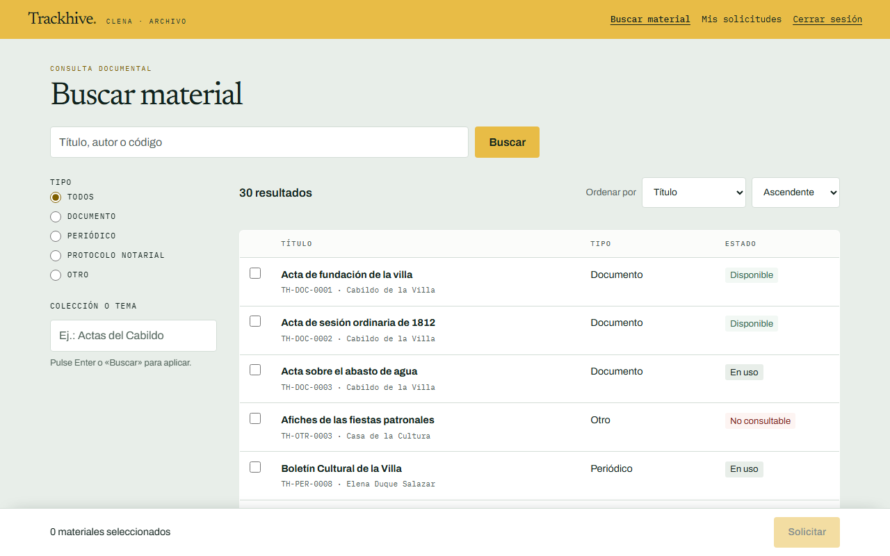
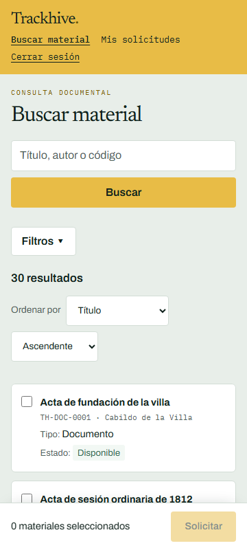
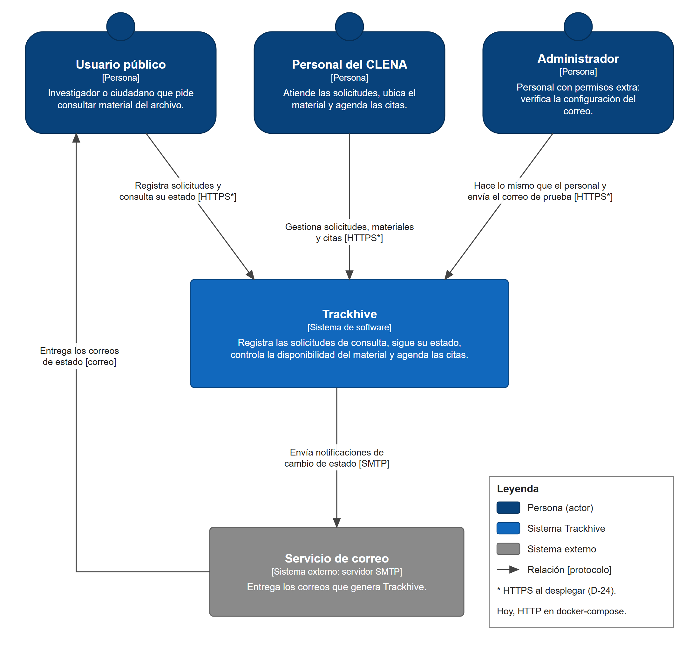
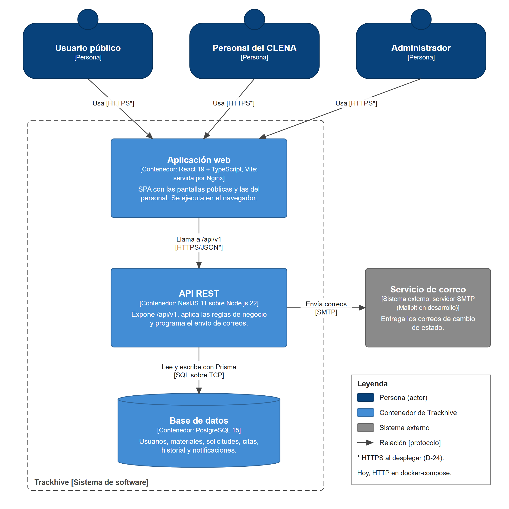
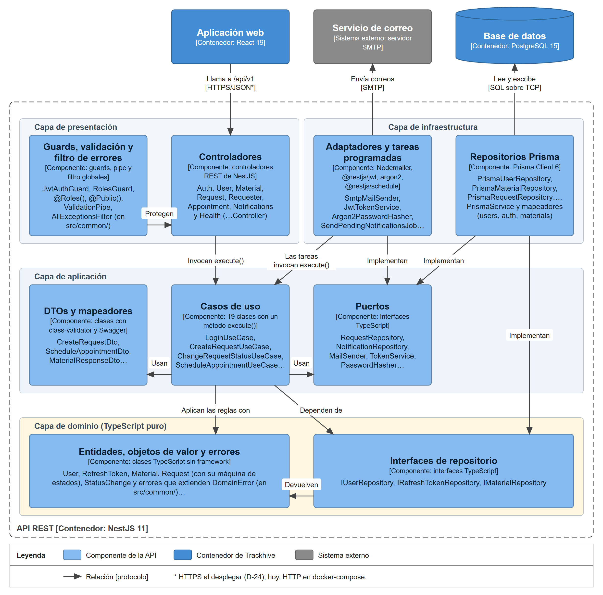

# Trackhive

**Sistema de consulta y seguimiento de solicitudes del archivo del CLENA.**

Trackhive es una aplicación web con la que el CLENA recibe las solicitudes de consulta de su archivo, sigue el estado de cada una, controla la disponibilidad del material y agenda las citas de consulta. Reúne en un solo lugar lo que antes se hacía por correo y en hojas de cálculo: el radicado, el historial de estados, el material solicitado, la cita y las notificaciones al solicitante.

| Escritorio (1280 px) | Móvil (360 px) |
|:---:|:---:|
|  |  |

---

## Tabla de contenido

- [¿Qué problema resuelve?](#qué-problema-resuelve)
- [Equipo de origen y roles Scrum](#equipo-de-origen-y-roles-scrum)
- [Funcionalidades principales](#funcionalidades-principales)
- [Arquitectura](#arquitectura)
- [Stack tecnológico](#stack-tecnológico)
- [Puesta en marcha con Docker](#puesta-en-marcha-con-docker)
- [URLs y usuarios de prueba](#urls-y-usuarios-de-prueba)
- [Variables de entorno](#variables-de-entorno)
- [Desarrollo local sin Docker](#desarrollo-local-sin-docker)
- [Pruebas y CI](#pruebas-y-ci)
- [Estructura del repositorio](#estructura-del-repositorio)
- [Documentación](#documentación)
- [Solución de problemas](#solución-de-problemas)
- [Contribuir](#contribuir)
- [Licencia y propiedad](#licencia-y-propiedad)

---

## ¿Qué problema resuelve?

El CLENA recibe solicitudes de consulta de material de archivo por correo. El personal las lee una por una, busca el material, responde al solicitante y anota por separado la disponibilidad y las citas. Ese flujo manual tiene varios problemas:

- No hay un estado único y visible para cada solicitud.
- Es fácil perder el hilo de quién pidió qué, cuándo y en qué quedó.
- La disponibilidad del material y las citas se cruzan a mano, lo que permite dobles reservas.
- El solicitante no tiene una forma directa de consultar el avance de su radicado.

Trackhive centraliza ese proceso. El usuario público se registra, busca material y radica su solicitud; el personal del CLENA atiende la bandeja, cambia el estado, controla la disponibilidad, agenda la cita y el sistema notifica al solicitante por correo. **Trackhive no almacena archivos**: solo gestiona las solicitudes; las copias digitales se entregan fuera del sistema, por correo.

## Equipo de origen y roles Scrum

Trackhive es el **Proyecto P4 — Curso Backend, Proyecto Final «Soluciones para el CLENA»**, desarrollado por el **Grupo 1**.

| Integrante | Rol Scrum | GitHub |
|---|---|---|
| Bryan Montoya | **Product Owner** (también participa en el desarrollo) | [@bryanmg20](https://github.com/bryanmg20) |
| Samuel Ricardo | **Scrum Master** (también participa en el desarrollo) | [@SRicardo05](https://github.com/SRicardo05) |
| Alan García | **Development Team** | [@AlanSan25](https://github.com/AlanSan25) |
| Álvaro Jiménez | **Development Team** | [@doriada](https://github.com/doriada) |

El trabajo se organiza en sprints de dos semanas con el tablero [Trackhive - Tablero Scrum](https://github.com/users/bryanmg20/projects/2). Las ceremonias y sus evidencias se registran en [`docs/`](docs/).

## Funcionalidades principales

- **Registro e inicio de sesión** con JWT, refresh token y roles `PUBLICO`, `PERSONAL` y `ADMIN`.
- **Buscador de material** con filtros por título, autor, colección y tipo de material.
- **Solicitud pública** con código de radicado y seguimiento en «Mis solicitudes».
- **Bandeja del personal** para buscar, filtrar y atender solicitudes.
- **Registro de solicitud a nombre de un visitante** desde el mostrador.
- **Máquina de estados** con transiciones válidas, motivo de rechazo e historial de cambios.
- **Control de disponibilidad** y **agenda de citas** sin dobles reservas.
- **Notificaciones por correo** al solicitante en cada cambio de estado (Mailpit en desarrollo).
- **Diseño responsive** usable a 360 px, con etiquetas accesibles y operación por teclado.

## Arquitectura

Trackhive se documenta con el modelo C4. La explicación completa, las decisiones de diseño y las leyendas están en [`docs/arquitectura.md`](docs/arquitectura.md) y en su versión PDF, [`docs/arquitectura.pdf`](docs/arquitectura.pdf).

### Nivel 1 · Contexto

Personas que usan el sistema y sistemas externos.



### Nivel 2 · Contenedores

Aplicación web, API REST, base de datos y servicio de correo, con su tecnología y protocolo.



### Nivel 3 · Componentes de la API

Controladores, casos de uso, puertos, entidades e implementaciones, con las dependencias apuntando hacia el dominio.



## Stack tecnológico

| Capa | Tecnologías |
|---|---|
| Frontend | React 19, TypeScript, Vite, React Router, React Hook Form, Zod. En producción lo sirve Nginx 1.27 como archivos estáticos. |
| Backend | NestJS 11 sobre Node.js 22, Prisma 6, JWT, `class-validator`, Nodemailer y Swagger. |
| Base de datos | PostgreSQL 15 con migraciones versionadas de Prisma. |
| Correo | Mailpit 1.32 en desarrollo (guarda los correos sin enviarlos); cualquier servidor SMTP en producción. |
| Pruebas | Jest y Supertest en el backend; Vitest, Testing Library y Playwright en el frontend. |
| DevOps | Docker Compose para el entorno completo y GitHub Actions para lint, pruebas y build en cada PR. |

## Puesta en marcha con Docker

Estas instrucciones están pensadas para un **clon limpio** del repositorio.

### Requisitos

- [Git](https://git-scm.com/).
- [Docker Desktop](https://www.docker.com/products/docker-desktop/) con Docker Compose. En Windows o macOS, Docker Desktop debe estar iniciado.
- Puertos libres: `8080` (frontend), `3000` (API), `5432` (PostgreSQL), `8025` y `1025` (Mailpit). Si alguno está ocupado, se cambia en el `.env` (ver [Solución de problemas](#solución-de-problemas)).

No hace falta instalar Node.js, pnpm ni PostgreSQL para levantar el sistema con Docker.

### Pasos

```bash
# 1. Clona el repositorio
git clone https://github.com/bryanmg20/Trackhive.git
cd Trackhive
```

```bash
# 2. Crea tu archivo de entorno a partir de la plantilla
cp .env.example .env
```

En PowerShell de Windows el equivalente es:

```powershell
Copy-Item .env.example .env
```

```bash
# 3. Levanta backend, frontend, PostgreSQL y Mailpit.
#    La primera vez construye las imágenes y puede tardar varios minutos.
docker-compose up --build
```

> **Docker Compose v2:** si tu instalación solo tiene el comando moderno, usa `docker compose up --build`. El comando clásico `docker-compose up` también funciona: construye las imágenes si no existen y deja los contenedores en primer plano. Añade `-d` (`docker compose up -d --build`) para ejecutarlos en segundo plano.

Al arrancar, el contenedor del backend ejecuta automáticamente:

1. `prisma migrate deploy` — aplica las migraciones pendientes.
2. `prisma db seed` — carga datos ficticios de demostración si `RUN_SEED=true`.
3. `node dist/main` — inicia la API.

### Verifica que todo quedó arriba

```bash
docker compose ps
```

Debes ver cuatro servicios: `postgres` y `mailpit` en estado `healthy`, y `backend` y `frontend` en `Up`.

```bash
# La API responde y la base de datos está disponible
curl http://localhost:3000/api/v1/health
# {"status":"ok","database":"up"}
```

También puedes abrir el frontend en <http://localhost:8080> y la documentación interactiva de la API (Swagger) en <http://localhost:3000/docs>.

### Detener y reiniciar

```bash
# Detiene los contenedores sin borrar los datos
docker compose down

# Detiene y borra también el volumen de PostgreSQL (reinicia la base desde cero)
docker compose down -v

# Reconstruye después de cambiar código o dependencias
docker compose up -d --build
```

## URLs y usuarios de prueba

| Servicio | URL local |
|---|---|
| Aplicación web | <http://localhost:8080> |
| API REST | <http://localhost:3000/api/v1> |
| Swagger / OpenAPI | <http://localhost:3000/docs> |
| Estado de la API | <http://localhost:3000/api/v1/health> |
| Mailpit (bandeja de correos de desarrollo) | <http://localhost:8025> |
| PostgreSQL | `localhost:5432` |

El frontend también reenvía `/api/`, `/docs` y `/docs-json` al backend, así que <http://localhost:8080/api/v1/health> y <http://localhost:8080/docs> funcionan igual.

Con la semilla de demostración (`RUN_SEED=true`) se crean estos usuarios ficticios:

| Rol | Correos | Contraseña |
|---|---|---|
| `ADMIN` | `admin@example.com` | `1` |
| `PERSONAL` | `personal1@example.com`, `personal2@example.com` | `1` |
| `PUBLICO` | `publico1@example.com`, `publico2@example.com`, `publico3@example.com`, `publico4@example.com` | `1` |

Las contraseñas salen de `SEED_ADMIN_PASSWORD` y `SEED_DEMO_PASSWORD` en el `.env`. Son valores **solo para desarrollo**: cámbialos antes de cualquier despliegue real. Para arrancar sin datos de demostración, usa `RUN_SEED=false`.

## Variables de entorno

El archivo `.env` se crea copiando [`.env.example`](.env.example) y **no se sube al repositorio**. Docker Compose lo lee de la raíz del proyecto y exige las variables marcadas como obligatorias.

| Variable | Descripción | Valor de ejemplo |
|---|---|---|
| `POSTGRES_DB` | Nombre de la base de datos | `trackhive` |
| `POSTGRES_USER` | Usuario de PostgreSQL | `user` |
| `POSTGRES_PASSWORD` | Contraseña de PostgreSQL | `1234` |
| `POSTGRES_PORT` | Puerto local de PostgreSQL | `5432` |
| `BACKEND_PORT` | Puerto local de la API | `3000` |
| `FRONTEND_PORT` | Puerto local de la aplicación web | `8080` |
| `RUN_SEED` | Carga la semilla de demostración al arrancar | `true` |
| `SEED_ADMIN_PASSWORD` | Contraseña del usuario administrador de la semilla | `1` |
| `SEED_DEMO_PASSWORD` | Contraseña de los demás usuarios de la semilla | `1` |
| `JWT_SECRET` | Secreto para firmar el access token | `change-me-access-secret` |
| `JWT_REFRESH_SECRET` | Secreto para firmar el refresh token | `change-me-refresh-secret` |
| `SMTP_HOST` | Servidor de correo. En Docker, `mailpit` | `mailpit` |
| `SMTP_PORT` | Puerto SMTP. En Mailpit, `1025` | `1025` |
| `SMTP_USER` | Usuario SMTP. Vacío si el servidor no pide autenticación | *(vacío)* |
| `SMTP_PASSWORD` | Contraseña SMTP | *(vacío)* |
| `SMTP_FROM` | Remitente de los correos | `"Trackhive <no-reply@example.com>"` |
| `DATABASE_URL` | Conexión de Prisma cuando el backend corre fuera de Docker | `postgresql://...@localhost:5432/trackhive?schema=public` |

## Desarrollo local sin Docker

Para trabajar en el código con recarga en caliente, levanta solo PostgreSQL y Mailpit con Docker y ejecuta backend y frontend con pnpm.

### Requisitos

- Node.js 24 y pnpm 11 (son las versiones del CI).
- Docker para PostgreSQL y Mailpit.

### Backend

```bash
# Desde la raíz: solo la base de datos y el servidor de correo
docker compose up -d postgres mailpit

cd backend
pnpm install
pnpm exec prisma generate
pnpm db:migrate
pnpm db:seed
pnpm start:dev
```

La API queda en <http://localhost:3000> y Swagger en <http://localhost:3000/docs>.

> Si ejecutas el backend fuera de Docker, cambia `SMTP_HOST=mailpit` por `SMTP_HOST=localhost` en el `.env`, porque `mailpit` solo resuelve dentro de la red de Docker.

### Frontend

```bash
cd frontend
pnpm install
pnpm dev
```

Vite queda en <http://localhost:5173> y reenvía las peticiones `/api` a `http://localhost:3000`.

## Pruebas y CI

El flujo de integración continua está en [`.github/workflows/ci.yml`](.github/workflows/ci.yml) y se ejecuta en cada PR hacia `main`: lint, pruebas y build de backend y frontend, más las pruebas e2e de responsive.

```bash
# Backend (desde la raíz)
cd backend
pnpm lint:check
pnpm test
pnpm test:e2e
pnpm build
```

```bash
# Frontend (desde la raíz)
cd frontend
pnpm lint
pnpm test
pnpm build
pnpm exec playwright install chromium   # una sola vez
pnpm test:e2e
```

Las pruebas e2e del frontend abren cada ruta a 360 px y fallan si aparece desplazamiento horizontal. La Definition of Done completa está en la [plantilla de PR](.github/pull_request_template.md).

## Estructura del repositorio

```text
Trackhive/
├── backend/                 # API REST en NestJS con Clean Architecture
│   ├── prisma/              # esquema, migraciones y semilla
│   ├── src/
│   │   ├── <módulo>/
│   │   │   ├── domain/          # entidades, reglas y puertos
│   │   │   ├── application/     # casos de uso y DTOs
│   │   │   ├── infrastructure/  # Prisma, correo y adaptadores
│   │   │   └── presentation/    # controladores HTTP
│   │   └── ...
│   └── test/                # pruebas e2e de la API
├── frontend/                # SPA en React + TypeScript + Vite
│   ├── src/features/        # pantallas y lógica por funcionalidad
│   ├── src/styles/          # tokens, breakpoints y estilos globales
│   ├── e2e/                 # pruebas Playwright
│   └── nginx.conf           # servidor estático y proxy hacia la API
├── docs/                    # arquitectura, modelo de datos, manuales y Scrum
│   └── img/                 # imágenes incrustadas en este README y en los informes
├── docker-compose.yml       # PostgreSQL, backend, frontend y Mailpit
├── .env.example             # plantilla del entorno local
└── README.md
```

## Documentación

| Documento | Contenido |
|---|---|
| [`docs/arquitectura.md`](docs/arquitectura.md) / [`docs/arquitectura.pdf`](docs/arquitectura.pdf) | Arquitectura C4, estructura del código y decisiones técnicas. |
| [`docs/modelo-datos.md`](docs/modelo-datos.md) | Modelo de dominio, diagrama entidad-relación, índices y datos personales. |
| [`docs/manual-operacion.md`](docs/manual-operacion.md) | Operación, variables de entorno, correos, respaldos y diagnóstico. |
| [`docs/manual-usuario.md`](docs/manual-usuario.md) | Guía del personal del CLENA (en elaboración). |
| [`docs/sprint-planning.md`](docs/sprint-planning.md), [`docs/daily-scrum.md`](docs/daily-scrum.md), [`docs/sprint-review.md`](docs/sprint-review.md), [`docs/sprint-retrospective.md`](docs/sprint-retrospective.md) | Ceremonias y evidencias Scrum. |
| [`docs/evidencias.md`](docs/evidencias.md) | Grabaciones y material recibido de G6. |
| [`docs/automatizacion-tablero.md`](docs/automatizacion-tablero.md) | Automatización del tablero Scrum en GitHub. |
| [`backend/README.md`](backend/README.md) | API, Swagger, pruebas y comandos del backend. |
| [`frontend/README.md`](frontend/README.md) | Rutas, pantallas, accesibilidad, responsive y pruebas del frontend. |

## Solución de problemas

### Docker Compose se queja de una variable faltante

Mensaje similar a `Missing POSTGRES_DB in .env`. Falta el archivo `.env` o está incompleto.

```bash
cp .env.example .env
```

### Un puerto ya está en uso

Cambia el puerto en el `.env` y vuelve a levantar:

```bash
# En .env: por ejemplo, para usar el frontend en 8090
# FRONTEND_PORT=8090

# Vuelve a levantar con el nuevo puerto
docker compose up -d
```

### El backend no arranca o la API responde error

```bash
docker compose ps
docker compose logs --tail=100 backend
docker compose logs --tail=50 postgres
```

El backend espera a que PostgreSQL esté `healthy` antes de arrancar. Si cambiaste el esquema, reconstruye con `docker compose up -d --build`.

### Quiero empezar de cero con la base de datos

```bash
docker compose down -v
docker compose up -d --build
```

`-v` borra el volumen `postgres_data`; se pierden todos los datos y la semilla se vuelve a cargar.

### No llegan los correos

En desarrollo los correos no se envían de verdad: quedan en Mailpit, en <http://localhost:8025>. Si la bandeja está vacía, revisa los logs del backend y las variables `SMTP_*` en el `.env`. Para enviar correos reales, sigue la sección «Comprobar el envío de correos» de [`docs/manual-operacion.md`](docs/manual-operacion.md).

### Los cambios de código no aparecen

Las imágenes de Docker no se actualizan solas:

```bash
docker compose up -d --build
```

## Contribuir

1. Crea una rama desde `main` con el número del issue:
   - `feat/<issue>-descripcion`
   - `fix/<issue>-descripcion`
   - `docs/<issue>-descripcion`
2. Haz commits claros y enlaza el issue en el PR (`Closes #<issue>`).
3. Antes de pedir revisión, ejecuta lint, pruebas y build del paquete que cambiaste.
4. Abre el PR con la [plantilla del repositorio](.github/pull_request_template.md). Se requiere CI en verde y al menos una aprobación.
5. Al crear la rama, la Action del tablero mueve el issue a **In Progress**; al abrir el PR, a **In review**; al fusionarlo, a **Done**.

## Licencia y propiedad

Proyecto académico del Grupo 1 para el curso Backend (Proyecto P4, «Soluciones para el CLENA»). La licencia y la propiedad del código están pendientes de definir con el CLENA y la universidad; hasta entonces, el repositorio se usa con fines educativos y de demostración.
