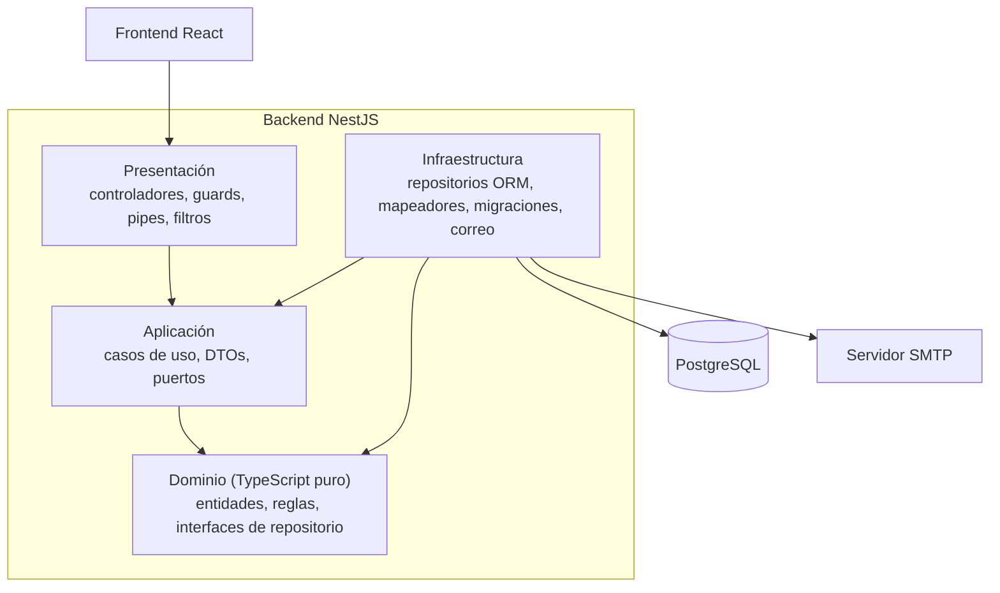

## 1. Vista de capas

**Regla de dependencia:** las flechas apuntan hacia el dominio. El dominio no importa NestJS, el ORM ni librerías de infraestructura. Presentación solo invoca casos de uso. Infraestructura implementa las interfaces que el núcleo declara.

| Capa | Contiene | No puede importar |
|---|---|---|
| Dominio | `Solicitud` (con su máquina de estados), `Cita`, `MaterialSolicitado`, `Solicitante`, errores de dominio, interfaces de repositorio | NestJS, ORM, librerías externas |
| Aplicación | Un caso de uso por acción de negocio, DTOs de entrada y salida, puertos (`NotificadorPort`, `RelojPort`) | ORM, controladores |
| Infraestructura | Entidades de persistencia, mapeadores, repositorios, migraciones, seeds, cliente SMTP | Controladores |
| Presentación | Controladores `/api/v1`, guards JWT y de roles, pipes de validación, filtro global de excepciones | Repositorios (solo casos de uso) |

## 3. Resumen de decisiones

| ID | Decisión | Estado |
|---|---|---|
| D-01 | Clean Architecture con regla de dependencia estricta | Requerida |
| D-02 | Monorepo con `backend/`, `frontend/` y `docs/` | Propuesta |
| D-03 | Un caso de uso por clase, con método `execute` | Propuesta |
| D-04 | Inyección de dependencias por tokens | Propuesta |
| D-05 | Entidades de persistencia separadas de las de dominio, con mapeadores | Propuesta |
| D-06 | TypeORM como ORM | **Por ratificar** |
| D-07 | La máquina de estados vive en la entidad `Solicitud` | Propuesta |
| D-08 | Historial de estados en tabla propia, solo de inserción | Propuesta |
| D-09 | Choques de agenda controlados con restricción de exclusión en PostgreSQL | Propuesta |
| D-10 | Notificaciones por puerto, con tabla de salida y reintentos | Propuesta |
| D-11 | JWT (access y refresh) con rotación y contraseñas con argon2 | Propuesta |
| D-12 | Autorización por roles con guards globales; propiedad de datos en casos de uso | Propuesta |
| D-13 | Validación en dos niveles: forma en presentación, reglas en dominio | Propuesta |
| D-14 | Errores de dominio traducidos por un filtro global | Propuesta |
| D-15 | API REST versionada con OpenAPI; paginación por página y límite | Propuesta |
| D-16 | Búsqueda de material con `pg_trgm`, sin motor de búsqueda externo | Propuesta |
| D-17 | Sin integración automática con *Everything* ni lectura de buzón IMAP | Propuesta |
| D-18 | Fechas en UTC (`timestamptz`) y presentación en `America/Bogota` | Propuesta |
| D-19 | Cumplimiento de la Ley 1581: consentimiento versionado y anonimización | **Validar con el CLENA** |
| D-20 | Frontend con Vite, React Query y React Hook Form; sesión con refresh en cookie | Propuesta |
| D-21 | Pruebas: fakes en memoria para unitarias y PostgreSQL real para e2e | Propuesta |
| D-22 | Docker, docker-compose y GitHub Actions | Requerida |
| D-23 | Configuración por entorno validada al arrancar y logs estructurados | Propuesta |
| D-24 | Plataforma de despliegue | **Pendiente** |

---

## 4. Decisiones detalladas

### D-01. Clean Architecture con regla de dependencia estricta

- **Decisión:** el backend se organiza en dominio, aplicación, infraestructura y presentación; las dependencias apuntan siempre hacia el dominio.
- **Alternativas:** arquitectura en capas clásica de NestJS (controlador → servicio → repositorio); modular por funcionalidad sin capas explícitas.
- **Justificación:** es un requisito del curso y se evalúa de forma directa (15 % de la nota). Además aporta valor real: las reglas de estados y de agenda son lo más delicado del sistema y quedan aisladas del framework y de la base de datos, de modo que se prueban sin levantar nada.
- **Consecuencias:** más archivos y más mapeos que en un CRUD directo. A cambio, el CLENA podría cambiar la base de datos o el proveedor de correo sin tocar las reglas de negocio.

### D-02. Monorepo con `backend/`, `frontend/` y `docs/`

- **Decisión:** un único repositorio de GitHub.
- **Alternativas:** dos repositorios independientes.
- **Justificación:** las reglas de evidencia de Scrum se verifican sobre un solo historial de commits, issues y PRs. Un monorepo facilita que un mismo PR cubra backend y frontend de una historia de usuario, y que un único `docker-compose` levante todo.
- **Consecuencias:** el pipeline de CI debe ejecutar tareas distintas por carpeta; se resuelve con jobs separados.

### D-03. Un caso de uso por clase, con método `execute`

- **Decisión:** cada acción de negocio es una clase (`RegistrarSolicitud`, `AgendarCita`, `CambiarEstadoSolicitud`...), con un único método público.
- **Alternativas:** servicios grandes agrupados por entidad (`SolicitudesService`).
- **Justificación:** el enunciado pide "casos de uso claros", y las clases pequeñas son fáciles de probar, de revisar en un PR y de asignar entre integrantes sin conflictos.
- **Consecuencias:** muchas clases pequeñas. Se mitiga con una carpeta por módulo funcional dentro de `application/use-cases/`.

### D-04. Inyección de dependencias por tokens

- **Decisión:** las interfaces de repositorio y los puertos se identifican con tokens (por ejemplo, un `Symbol` exportado desde el dominio o la aplicación). El módulo de NestJS enlaza cada token con su implementación de infraestructura.
- **Alternativas:** inyectar clases concretas; usar clases abstractas como tokens.
- **Justificación:** TypeScript borra las interfaces en tiempo de ejecución, así que se necesita un token para que NestJS pueda resolverlas. Con tokens el caso de uso depende solo de la abstracción, y en las pruebas se inyecta un fake sin tocar el contenedor real.
- **Consecuencias:** el enlace vive en un solo lugar (los módulos). Un token olvidado falla al arrancar, no en producción.

### D-05. Entidades de persistencia separadas de las de dominio, con mapeadores

- **Decisión:** las entidades del ORM viven en infraestructura y nunca salen de ella; los repositorios las convierten a entidades de dominio con mapeadores explícitos.
- **Alternativas:** usar una sola clase que sea a la vez entidad de dominio y del ORM.
- **Justificación:** una clase única obligaría al dominio a importar decoradores del ORM, lo que rompe la regla de dependencia (y es motivo de descalificación del criterio de Arquitectura). Separarlas también permite que el modelo de tablas evolucione sin arrastrar a las reglas de negocio.
- **Consecuencias:** código de mapeo adicional que se cubre con pruebas. Es el precio de un dominio puro.

### D-06. TypeORM como ORM *(por ratificar)*

- **Decisión:** TypeORM con migraciones en SQL versionadas.
- **Alternativas:** Prisma.
- **Justificación:** tiene integración directa con NestJS (`@nestjs/typeorm`), las entidades se escriben como clases (fáciles de aislar tras mapeadores) y las migraciones admiten SQL arbitrario, que necesitamos para la restricción de exclusión de la agenda (D-09) y los índices `pg_trgm` (D-16). Prisma ofrece mejor ayuda de tipos, pero su esquema no expresa esas restricciones y habría que recurrir igualmente a SQL manual.
- **Consecuencias:** hay que desactivar `synchronize` fuera del desarrollo local (requisito del curso) y revisar las migraciones generadas antes de fusionarlas. Si el equipo domina más Prisma, la decisión es reversible porque el ORM queda confinado a infraestructura.

### D-07. La máquina de estados vive en la entidad `Solicitud`

- **Decisión:** las transiciones (`RECIBIDA → EN_BUSQUEDA → DISPONIBLE → AGENDADA → ATENDIDA → CERRADA`, y `RECHAZADA` desde cualquier estado previo a `ATENDIDA`) se implementan como métodos de la entidad (`iniciarBusqueda()`, `agendar(cita)`, `rechazar(motivo)`...) que lanzan `TransicionEstadoInvalidaError` ante un cambio no permitido.
- **Alternativas:** validar las transiciones en el controlador, en el caso de uso o con una tabla de reglas en la base de datos.
- **Justificación:** es la regla de negocio central y no debe poder eludirse desde ninguna otra capa. En el dominio se prueba con pruebas unitarias rápidas y sin infraestructura. Rechazar exige un motivo, y se modela como parámetro obligatorio del método.
- **Consecuencias:** cualquier cambio de estado pasa por la entidad. Las reglas exactas se validan con el equipo de Introducción en la fase de Inception.

### D-08. Historial de estados en tabla propia, solo de inserción

- **Decisión:** cada transición inserta una fila en `historial_estados` (estado anterior, nuevo, usuario, fecha, observación). Nunca se actualiza ni se borra.
- **Alternativas:** guardar solo el estado actual; guardar las fechas de cada estado como columnas de `solicitudes`.
- **Justificación:** el requisito de reportes (tiempos de atención) solo es calculable si se conoce cuándo ocurrió cada transición. Además da trazabilidad: se puede responder quién cambió qué y cuándo, algo valioso para un archivo patrimonial.
- **Consecuencias:** la inserción del historial y la actualización de la solicitud ocurren en una misma transacción, coordinada desde el repositorio.

### D-09. Choques de agenda con restricción de exclusión en PostgreSQL

- **Decisión:** la tabla `citas` lleva una restricción `EXCLUDE USING gist (material_id WITH =, tstzrange(inicio, fin) WITH &&) WHERE (estado <> 'CANCELADA')`, con la extensión `btree_gist`. Además, el caso de uso `AgendarCita` consulta la disponibilidad antes de insertar para devolver un mensaje claro; si la base rechaza la inserción por una carrera, el repositorio lo traduce a `ChoqueDeAgendaError`.
- **Alternativas:** solo verificar en el código antes de insertar; bloqueos explícitos a nivel de fila.
- **Justificación:** la verificación en código sola es vulnerable a condiciones de carrera (dos funcionarios agendando el mismo material a la vez). La restricción de la base de datos garantiza la integridad sin importar cuántas instancias de la API corran.
- **Consecuencias:** la regla vive en una migración SQL y en el dominio (que expresa el concepto), y debe documentarse en `docs/modelo-datos.md`. La combinación de verificación previa y restricción es deliberada: la primera da buena experiencia y la segunda da seguridad.

### D-10. Notificaciones por puerto, con tabla de salida y reintentos

- **Decisión:** `CambiarEstadoSolicitud` no envía correos: registra una fila en `notificaciones` (estado `PENDIENTE`) dentro de la misma transacción del cambio de estado. Un proceso programado (`@nestjs/schedule`) la envía a través del `NotificadorPort`, implementado con SMTP (Nodemailer), y marca `ENVIADA` o `FALLIDA` con un contador de reintentos.
- **Alternativas:** enviar el correo de forma síncrona dentro del caso de uso; usar una cola externa (Redis, RabbitMQ).
- **Justificación:** una caída del servidor SMTP no debe impedir ni revertir un cambio de estado legítimo. Una tabla de salida da fiabilidad sin sumar infraestructura nueva, algo importante porque el CLENA debe poder operarlo. Una cola externa se descarta por exceso de complejidad para este volumen.
- **Consecuencias:** el correo no es instantáneo (llega en el siguiente ciclo del proceso, de segundos a un par de minutos). En desarrollo se usa Mailpit para inspeccionar correos sin enviarlos.

### D-11. JWT (access y refresh) con rotación y argon2

- **Decisión:** token de acceso de vida corta (por ejemplo, 15 minutos) y token de refresco de vida larga, con rotación en cada uso; se guarda en base de datos solo el hash del refresh token. Las contraseñas se almacenan con argon2.
- **Alternativas:** sesiones con cookies en servidor; bcrypt; refresh token sin rotación.
- **Justificación:** JWT con refresh es requisito del curso. La rotación limita el daño de un refresh robado, y guardar solo su hash evita que una filtración de la base entregue sesiones válidas. Argon2 resiste mejor ataques por GPU que bcrypt.
- **Consecuencias:** hay que implementar la revocación (cierre de sesión e invalidación de la familia de tokens ante un reuso detectado).

### D-12. Autorización por roles con guards globales; propiedad en casos de uso

- **Decisión:** `JwtAuthGuard` y `RolesGuard` se registran como guards globales; los endpoints declaran sus roles con `@Roles()` y los públicos con `@Public()`. Reglas como "un usuario público solo ve sus propias solicitudes" se implementan en el caso de uso, que recibe el identificador del usuario.
- **Alternativas:** aplicar guards endpoint por endpoint; resolver la propiedad en el guard.
- **Justificación:** con guards globales ningún endpoint queda desprotegido por olvido. La propiedad de los datos es una regla de negocio, así que no corresponde a presentación.
- **Consecuencias:** los endpoints sin `@Roles()` exigen al menos autenticación; solo `@Public()` los abre.

### D-13. Validación en dos niveles

- **Decisión:** los DTOs de petición (en presentación, con `class-validator`) validan forma y tipos, con `whitelist` y `forbidNonWhitelisted` activos. Las reglas de negocio (transiciones, fechas coherentes, disponibilidad) se validan en dominio y aplicación.
- **Alternativas:** validar todo en los DTOs; validar todo en el dominio.
- **Justificación:** los decoradores de validación son dependencias de framework, así que no pueden estar en el dominio. Cada nivel responde a una pregunta distinta: "¿la petición está bien formada?" y "¿la operación está permitida?".
- **Consecuencias:** los DTOs de entrada y salida de los casos de uso son interfaces o clases simples, sin decoradores; el controlador convierte el DTO de petición en el input del caso de uso.

### D-14. Errores de dominio traducidos por un filtro global

- **Decisión:** el dominio y la aplicación lanzan excepciones propias (`TransicionEstadoInvalidaError`, `ChoqueDeAgendaError`, `SolicitudNoEncontradaError`...). Un filtro global en presentación las traduce a códigos HTTP y a un formato de error uniforme con un `code` estable.
- **Alternativas:** lanzar `HttpException` desde los casos de uso.
- **Justificación:** las `HttpException` pertenecen a NestJS y contaminarían el núcleo. Un `code` estable permite al frontend reaccionar por tipo de error sin depender del texto del mensaje.
- **Consecuencias:** cada error nuevo requiere una línea en el mapeo; un error sin mapear devuelve 500 y se registra en logs.

### D-15. API REST versionada con OpenAPI

- **Decisión:** prefijo `/api/v1` con versionado por URI; documentación Swagger en `/docs`; listados con paginación por `page` y `limit`, filtros y ordenamiento.
- **Alternativas:** GraphQL; paginación por cursor.
- **Justificación:** REST con OpenAPI es requisito. La paginación por página es suficiente para el volumen esperado y es más sencilla para una tabla de bandeja con saltos de página. La especificación OpenAPI permite generar el cliente del frontend y evita desajustes de tipos.
- **Consecuencias:** si el volumen crece mucho, habrá que migrar a paginación por cursor; no es una necesidad actual.

### D-16. Búsqueda de material con `pg_trgm`

- **Decisión:** índices GIN con `pg_trgm` sobre las columnas de texto de búsqueda (descripción del material, nombre del solicitante, radicado).
- **Alternativas:** `LIKE` sin índice; Elasticsearch o similar.
- **Justificación:** `pg_trgm` da búsqueda tolerante a errores de escritura dentro de PostgreSQL, sin un servicio extra que el CLENA tendría que operar. Un motor de búsqueda dedicado es desproporcionado para este volumen.
- **Consecuencias:** requiere la extensión habilitada en la migración inicial. La búsqueda descriptiva dentro del contenido de los documentos queda fuera de alcance (ver D-17).

### D-17. Sin integración automática con *Everything* ni lectura de buzón IMAP

- **Decisión:** el personal busca en *Everything* como hoy y registra el resultado (disponibilidad y ubicación) en Trackhive. Las solicitudes entran por un formulario web público o las registra el personal; no se lee el buzón `labdigital@clena.org` de forma automática.
- **Alternativas:** integrar con *Everything*; procesar correos entrantes por IMAP.
- **Justificación:** no hay evidencia de que *Everything* ofrezca una API, ni acceso a ella dentro del alcance del proyecto; el enunciado tampoco lo exige. Leer el buzón añade riesgo (credenciales institucionales, correos con formato libre, datos personales no controlados) para un beneficio que el formulario público ya cubre.
- **Consecuencias:** se documenta como mejora futura. El formulario web es la vía que reduce la lectura manual de correos que describió el personal.

### D-18. Fechas en UTC y presentación en `America/Bogota`

- **Decisión:** todas las columnas de fecha y hora son `timestamptz` y se almacenan en UTC; la API devuelve ISO 8601 y el frontend las muestra en `America/Bogota`. El caso de uso obtiene la hora a través de un `RelojPort`.
- **Alternativas:** guardar hora local sin zona.
- **Justificación:** evita errores en reportes y citas ante cambios de servidor o despliegue. El `RelojPort` permite probar reglas dependientes del tiempo con una hora fija.
- **Consecuencias:** el frontend es responsable de la conversión; las fechas "solo día" (fecha deseada) se tratan como tipo `date`.

### D-19. Cumplimiento de la Ley 1581: consentimiento y anonimización *(validar con el CLENA)*

- **Decisión:** se recogen solo los datos mínimos necesarios; el formulario público exige aceptar el aviso de privacidad, y cada aceptación se guarda con fecha y versión del texto en la tabla `consentimientos`. La eliminación de cuenta anonimiza los datos personales del solicitante (nombre, correo, teléfono) y conserva las solicitudes y el historial sin datos personales, para no romper los reportes.
- **Alternativas:** borrado físico en cascada.
- **Justificación:** el borrado en cascada destruiría el historial y los indicadores de atención, y sería incompatible con la trazabilidad de un archivo. La anonimización cumple con la supresión del dato personal sin perder la información agregada.
- **Consecuencias:** el equipo debe confirmar con el CLENA si existen obligaciones de conservación que exijan otro tratamiento. No se usan datos reales sin autorización escrita; las semillas son ficticias.

### D-20. Frontend: Vite, React Query y React Hook Form; sesión con refresh en cookie

- **Decisión:** React con TypeScript sobre Vite. React Query para los datos del servidor, React Hook Form (con validación por esquema) para formularios, React Router con rutas protegidas por rol y FullCalendar para la agenda. El access token se mantiene en memoria y el refresh token en una cookie `httpOnly` con `SameSite`.
- **Alternativas:** guardar los tokens en `localStorage`; Redux para todo el estado.
- **Justificación:** casi todo el estado de la aplicación es estado del servidor, que React Query gestiona (caché, reintentos, invalidación) sin código adicional. Guardar el token en `localStorage` lo expone a robo por XSS; en memoria más cookie `httpOnly` reduce ese riesgo. FullCalendar evita construir desde cero la vista de calendario, que es la parte de interfaz más costosa.
- **Consecuencias:** requiere configurar CORS con credenciales y atributos de cookie coherentes entre entornos. La accesibilidad (contraste, etiquetas, teclado, textos escalables) se trata como criterio de revisión en cada PR.

### D-21. Pruebas: fakes en memoria para unitarias y PostgreSQL real para e2e

- **Decisión:** las pruebas unitarias del dominio y de los casos de uso usan repositorios fake en memoria. Las pruebas e2e de la API se ejecutan contra un PostgreSQL real (servicio en GitHub Actions y en docker-compose), con migraciones aplicadas.
- **Alternativas:** mocks de librería en todas partes; SQLite en memoria para e2e.
- **Justificación:** los fakes aprovechan que los casos de uso dependen solo de interfaces y mantienen las pruebas rápidas y legibles. Las e2e necesitan PostgreSQL real porque la restricción de exclusión (D-09) y `pg_trgm` (D-16) no existen en SQLite.
- **Consecuencias:** el CI es algo más lento, y la cobertura mínima de 70 % se mide sobre las capas de dominio y aplicación.

### D-22. Docker, docker-compose y GitHub Actions

- **Decisión:** `docker-compose up` levanta backend, frontend y PostgreSQL sin pasos manuales (aplica migraciones y semillas de demostración). Cada Pull Request ejecuta lint, pruebas y build en GitHub Actions; `main` queda protegida y requiere CI en verde y una aprobación.
- **Alternativas:** instalación manual en el servidor del CLENA.
- **Justificación:** es requisito y, además, es lo que permite que el CLENA opere el sistema sin el equipo. Un despliegue reproducible reduce el riesgo de que "funcione solo en una máquina".
- **Consecuencias:** `docs/manual-operacion.md` debe cubrir variables de entorno, despliegue y respaldo de la base de datos.

### D-23. Configuración por entorno y logs estructurados

- **Decisión:** `@nestjs/config` con validación de las variables al arrancar (la aplicación falla si falta alguna); `.env.example` en el repositorio y ningún secreto en el código. Logs en formato JSON (por ejemplo, con `nestjs-pino`) y endpoint `/health`.
- **Alternativas:** leer `process.env` directamente; logs de texto libre.
- **Justificación:** fallar pronto ante una configuración incompleta evita errores difíciles de rastrear en producción. Los logs estructurados se pueden filtrar y consultar, y `/health` permite monitoreo y verificaciones del despliegue.
- **Consecuencias:** hay que evitar registrar datos personales en los logs.

### D-24. Plataforma de despliegue *(pendiente)*

- **Decisión:** pendiente de definir.
- **Opciones:** un servicio gestionado con contenedores (Render, Railway, Fly.io) o un VPS con docker-compose.
- **Criterios:** costo (idealmente gratuito o muy bajo para la demo), soporte de PostgreSQL 15+, URL pública estable y facilidad para que el CLENA lo mantenga.
- **Consecuencias:** debe resolverse antes del Sprint 3. Cualquier opción debe poder reproducirse a partir del `docker-compose` del repositorio.

backend/src/
├── domain/            # TypeScript puro, sin NestJS ni ORM
│   ├── entities/  value-objects/  errors/
│   └── repositories/  (interfaces: SolicitudRepository, CitaRepository...)
├── application/
│   ├── use-cases/     # uno por acción de negocio
│   ├── dto/
│   └── ports/         # NotificadorPort, RelojPort
├── infrastructure/
│   ├── persistence/   # TypeORM o Prisma, mappers, migraciones, seeds
│   ├── mail/          # implementación SMTP del NotificadorPort
│   └── config/
└── presentation/
    ├── controllers/  guards/  pipes/  filters/