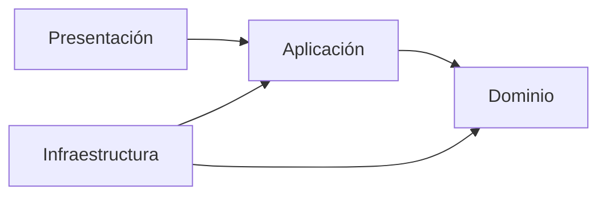

# Arquitectura

> Estado: pendiente (Hito 1 – Inception)

## 1. Visión general

(Qué hace el sistema Trackhive y cómo se divide: backend, frontend, base de datos.)

## 2. Diagrama de capas

(Insertar imagen o diagrama Mermaid. Las dependencias apuntan siempre hacia el dominio.)

## 3. Capas

| Capa | Contenido | Prohibido |
|---|---|---|
| Dominio | Entidades, objetos de valor, reglas, interfaces de repositorio | Importar NestJS, ORM o librerías de infraestructura |
| Aplicación | Casos de uso, DTOs, puertos | Conocer controladores o el ORM |
| Infraestructura | Repositorios con ORM, migraciones, correo, archivos | Exponer entidades del ORM fuera de la capa |
| Presentación | Controladores REST, guards, pipes, filtros | Lógica de negocio (solo invoca casos de uso) |

## 4. Estructura de carpetas

(Árbol de carpetas de `backend/` y `frontend/`.)

## 5. Decisiones técnicas

| # | Decisión | Alternativas consideradas | Justificación | Fecha | Issue/PR |
|---|---|---|---|---|---|
| 1 | | | | AAAA-MM-DD | # |

## 6. Casos de uso principales

(Lista: RegistrarSolicitud, CambiarEstadoSolicitud, AgendarCita, etc.)

## 7. Seguridad

(JWT access/refresh, hash de contraseñas, roles, manejo de secretos.)

## 8. Decisiones pendientes

- Licencia y propiedad del código (definir con el CLENA y la universidad antes del Sprint 1).
