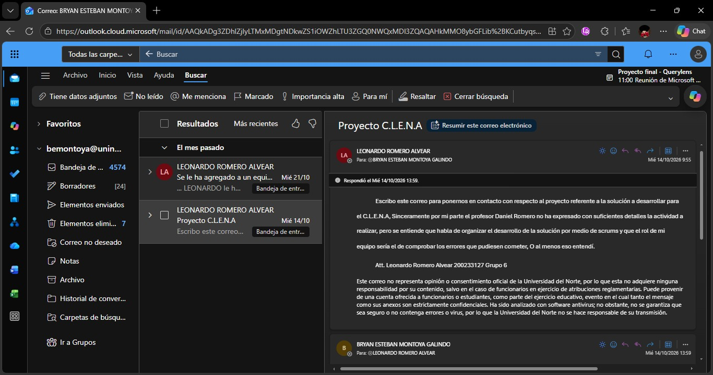
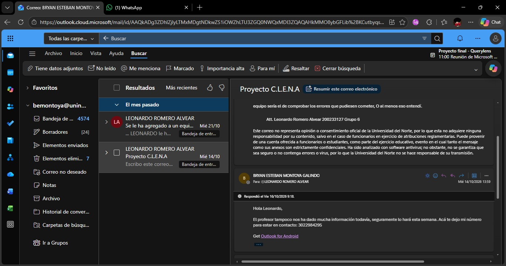
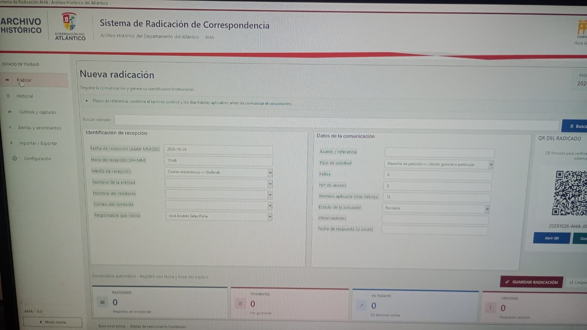

# Acta de Inception

Reunión de arranque del proyecto **Trackhive**, sistema de gestión de solicitudes y citas del **CLENA**, realizada con el equipo de Introducción (G6). El acta registra el contexto recibido, los problemas confirmados, las decisiones de alcance y la validación del Product Backlog.

## 1. Datos de la reunión

| Campo | Valor |
|---|---|
| Fecha | 2026-10-28 |
| Modalidad | Microsoft Teams |
| Objetivo | Conocer el proceso actual del CLENA y acordar el alcance del primer incremento |
| Grabación | [Reunión inicial con G6](https://uninorte-my.sharepoint.com/:v:/g/personal/sdricardo_uninorte_edu_co/IQAPT1bjPG6iS5qzZ-p361TjAdQxAtizY0W8F_lSoA6xnFk?nav=eyJyZWZlcnJhbEluZm8iOnsicmVmZXJyYWxBcHAiOiJPbmVEcml2ZUZvckJ1c2luZXNzIiwicmVmZXJyYWxBcHBQbGF0Zm9ybSI6IldlYiIsInJlZmVycmFsTW9kZSI6InZpZXciLCJyZWZlcnJhbFZpZXciOiJNeUZpbGVzTGlua0NvcHkifX0&e=GEebUB) |
| Coordinación previa | Correos del 14 y 21 de octubre de 2026 (ver figuras 1 y 2); el resto de la coordinación se hizo por Microsoft Teams |

### Asistentes

| Equipo | Integrantes |
|---|---|
| Trackhive | Samuel Ricardo, Bryan Montoya, Alan Garcia, Alvaro Jimenez |
| G6 (Introducción) | Alejandro Suarez, Leonardo Romero, Angelo Foliaco, Santiago Hernandez |

### Coordinación por correo

La reunión se coordinó con el equipo G6 por correo electrónico, con copia a `djromero@uninorte.edu.co`. El envío lo hizo Bryan Montoya (`bemontoya@uninorte.edu.co`) a Leonardo Romero Alvear (G6); las comunicaciones siguientes se hicieron por Microsoft Teams.

<figure>

<figcaption>Figura 1. Correo de coordinación con G6 del 14 de octubre de 2026.</figcaption>
</figure>

<figure>

<figcaption>Figura 2. Correo de coordinación con G6 del 21 de octubre de 2026.</figcaption>
</figure>

## 2. Contexto recibido

El equipo G6 visitó el CLENA y entregó un informe con los procesos observados. Ese informe es la principal fuente de contexto del proyecto.

| Material | Fecha | Enlace |
|---|---|---|
| Informe final de la visita al CLENA | 2026-10-30 | [Informe Final Equipo 6 CLENA](https://uninorte-my.sharepoint.com/:b:/g/personal/sdricardo_uninorte_edu_co/IQBM9byALHfTQ6kVF5vY8bkEASzBFEJ2XoA7RwOHic0m0yc?e=8WB0FS) |
| Fotos de la visita | 2026-10-30 | [Carpeta de fotos en SharePoint](https://uninorte-my.sharepoint.com/:f:/g/personal/sdricardo_uninorte_edu_co/IgBH9k1CmqF_TZ6L9f6QoNotAdy_DkdXA04Yq9Cg1ZMhwck?e=yjdJf5) |
| Grabación de la reunión | 2026-10-28 | [Video de Teams](https://uninorte-my.sharepoint.com/:v:/g/personal/sdricardo_uninorte_edu_co/IQAPT1bjPG6iS5qzZ-p361TjAdQxAtizY0W8F_lSoA6xnFk?nav=eyJyZWZlcnJhbEluZm8iOnsicmVmZXJyYWxBcHAiOiJPbmVEcml2ZUZvckJ1c2luZXNzIiwicmVmZXJyYWxBcHBQbGF0Zm9ybSI6IldlYiIsInJlZmVycmFsTW9kZSI6InZpZXciLCJyZWZlcnJhbFZpZXciOiJNeUZpbGVzTGlua0NvcHkifX0&e=GEebUB) |

Figura 3. Sistema de radicación de correspondencia que usa el CLENA para recibir solicitudes.

<figure>

<figcaption>Figura 3. Sistema de radicación de correspondencia con el que el CLENA recibe las solicitudes; las fotos de la visita están en la carpeta de SharePoint.</figcaption>
</figure>

## 3. Problemas confirmados

1. Las solicitudes llegan por correo y se registran a mano, sin un historial de estados que se pueda consultar.
2. El usuario público no tiene autoservicio: depende del personal para radicar una solicitud.
3. No hay control de disponibilidad del material, así que dos solicitudes pueden reservar el mismo material el mismo día.
4. Las citas de consulta se agendan sin un calendario compartido.
5. El solicitante no recibe avisos automáticos cuando su solicitud cambia de estado.
6. No hay reportes de uso: material más solicitado y tiempos de atención.
7. Los datos personales se capturan sin aviso de privacidad ni consentimiento.

## 4. Decisiones de alcance

| ID | Decisión |
|---|---|
| A-01 | El CLENA recibe solicitudes por correo y el personal las registra en el sistema. |
| A-02 | El usuario público también puede radicar solicitudes por la página, con su propia cuenta. |
| A-03 | Tres roles: administrador, personal del CLENA y usuario público; el acceso se controla por rol. |
| A-04 | La reserva es por día completo, sin franja horaria, y no se admiten dobles reservas del mismo material el mismo día. |
| A-05 | El solicitante recibe un correo en cada cambio de estado de su solicitud. |
| A-06 | No se integra lectura automática del buzón: el correo sigue siendo el canal de entrada y el personal lo transcribe. |
| A-07 | Los reportes se consultan dentro del sistema; la exportación queda para sprints posteriores. |
| A-08 | El primer incremento cubre autenticación, material, solicitudes, citas, notificaciones y la base de despliegue. |

### Fuera de alcance para el primer incremento

- Aplicación móvil nativa.
- Firma digital de documentos.
- Integración con el buscador *Everything* o con un motor de búsqueda externo.
- Pagos o facturación.
- Uso de datos reales del CLENA sin autorización escrita; las semillas son ficticias.

## 5. Validación del Product Backlog (requisito E2)

- G6 revisó el Product Backlog y los criterios de aceptación de cada historia.
- El equipo G6 aprobó los avances y estuvo de acuerdo con los alcances planteados en la reunión y con la demostración del primer MVP de la solución (confirmado en la Review del 2026-11-10).
- Queda registrada la validación del backlog por los cuatro integrantes de G6. La aprobación del PR #128 por parte de G6 se toma como firma del acta y como validación del backlog (requisito E2).

## 6. Evidencia audiovisual

| Fecha | Reunión | Enlace |
|---|---|---|
| 2026-10-28 | Reunión inicial con G6 | [Grabación](https://uninorte-my.sharepoint.com/:v:/g/personal/sdricardo_uninorte_edu_co/IQAPT1bjPG6iS5qzZ-p361TjAdQxAtizY0W8F_lSoA6xnFk?nav=eyJyZWZlcnJhbEluZm8iOnsicmVmZXJyYWxBcHAiOiJPbmVEcml2ZUZvckJ1c2luZXNzIiwicmVmZXJyYWxBcHBQbGF0Zm9ybSI6IldlYiIsInJlZmVycmFsTW9kZSI6InZpZXciLCJyZWZlcnJhbFZpZXciOiJNeUZpbGVzTGlua0NvcHkifX0&e=GEebUB) |
| 2026-11-01 | Planning Meeting, Sprint 1 | [Grabación](https://uninorte-my.sharepoint.com/:v:/g/personal/sdricardo_uninorte_edu_co/IQCLgimGSgZgQKnMHfuxC-5XAZvnr5xnOyg06BmRGS7fokw?nav=eyJyZWZlcnJhbEluZm8iOnsicmVmZXJyYWxBcHAiOiJPbmVEcml2ZUZvckJ1c2luZXNzIiwicmVmZXJyYWxBcHBQbGF0Zm9ybSI6IldlYiIsInJlZmVycmFsTW9kZSI6InZpZXciLCJyZWZlcnJhbFZpZXciOiJNeUZpbGVzTGlua0NvcHkifX0&e=uA4Ejf) |
| 2026-11-04 | Daily Scrum | [Grabación](https://uninorte-my.sharepoint.com/:v:/g/personal/sdricardo_uninorte_edu_co/IQDI7pqrEcYHRYknhNkzp58jAchJzvEFC3WD9fnfOlrMgYE?nav=eyJyZWZlcnJhbEluZm8iOnsicmVmZXJyYWxBcHAiOiJPbmVEcml2ZUZvckJ1c2luZXNzIiwicmVmZXJyYWxBcHBQbGF0Zm9ybSI6IldlYiIsInJlZmVycmFsTW9kZSI6InZpZXciLCJyZWZlcnJhbFZpZXciOiJNeUZpbGVzTGlua0NvcHkifX0&e=goBOwp) |
| 2026-11-10 | Review Sprint 1 | [Grabación](https://uninorte-my.sharepoint.com/:v:/g/personal/sdricardo_uninorte_edu_co/IQDLIWBA53e0Q7S9-GSQtJKMASQ0e6i5CyGhjkFx0o4xG50?nav=eyJyZWZlcnJhbEluZm8iOnsicmVmZXJyYWxBcHAiOiJPbmVEcml2ZUZvckJ1c2luZXNzIiwicmVmZXJyYWxBcHBQbGF0Zm9ybSI6IldlYiIsInJlZmVycmFsTW9kZSI6InZpZXciLCJyZWZlcnJhbFZpZXciOiJNeUZpbGVzTGlua0NvcHkifX0&e=5VMHMF) |

Los videos no se suben al repositorio. El detalle de todas las grabaciones está en [`docs/evidencias.md`](evidencias.md).

## 7. Compromisos y próximos pasos

| Compromiso | Responsable | Fecha |
|---|---|---|
| Entregar el Product Backlog con criterios de aceptación, puntos y prioridad | Trackhive | 2026-10-29 |
| Validar el backlog y el acta | G6 | 2026-11-10 |
| Documentar arquitectura, modelo de dominio y modelo de datos | Trackhive | 2026-10-30 |
| Ejecutar el Sprint 1 con autenticación, material, solicitudes y citas | Trackhive | 2026-11-10 |

## 8. Aprobación

| Parte | Nombre | Estado |
|---|---|---|
| Trackhive | Samuel Ricardo, Bryan Montoya, Alan Garcia, Alvaro Jimenez | Documento elaborado |
| G6 (Introducción) | Alejandro Suarez, Leonardo Romero, Angelo Foliaco, Santiago Hernandez | Backlog y alcance aprobados; aprobación registrada en el PR #128 |
