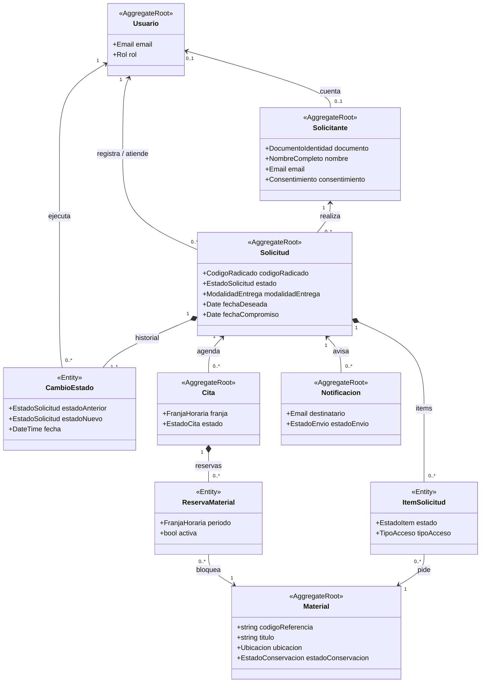
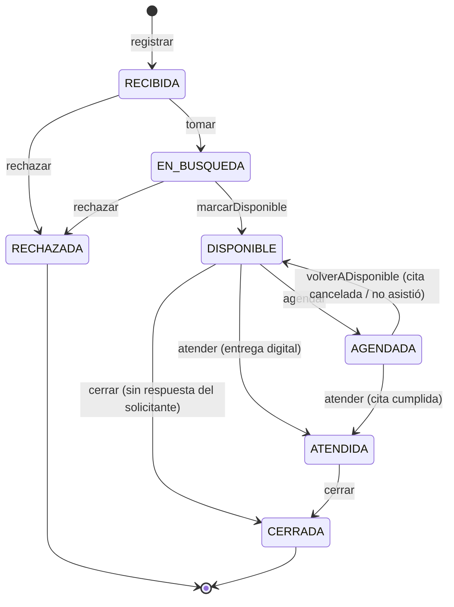
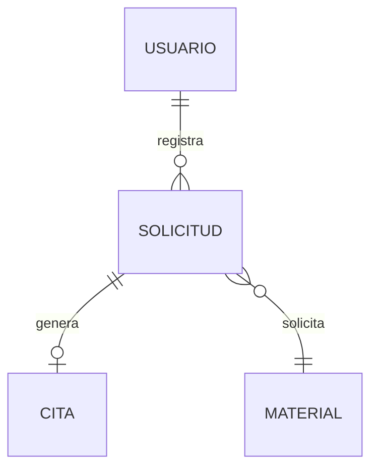

# Modelo de datos

## 1. Modelo de dominio

Lenguaje común y reglas de negocio del módulo. Es la base de la capa de dominio del backend. Las secciones 2 a 6 describen cómo se guarda en PostgreSQL.

### 1.1 Entidades y objetos de valor

Notación: `<<AggregateRoot>>` es la raíz de un agregado (se guarda completa) y `<<Entity>>` es una parte interna. El rombo indica composición y la flecha, una referencia por id. Solo se muestran los atributos clave.

| Entidad | Qué es | Tabla(s) |
|---|---|---|
| **Solicitud** | Pedido de consulta, búsqueda o copia, identificado por un radicado. Contiene sus **ítems** (materiales pedidos y el resultado de buscarlos) y su **historial** de cambios de estado. | `solicitud`, `item_solicitud`, `historial_estado` |
| **Solicitante** | Persona que pide. Puede no tener cuenta, si la solicitud la registró el personal. | `solicitante` |
| **Material** | Pieza del acervo (documento, expediente, periódico, fotografía…) con ubicación física y estado de conservación. | `material` |
| **Cita** | Franja para consultar el material en la sala. Contiene las **reservas** de cada material físico. | `cita`, `reserva_material` |
| **Usuario** | Cuenta con rol `ADMIN`, `PERSONAL` o `PUBLICO`. | `usuario`, `token_refresco` |
| **Notificación** | Correo que recibe el solicitante en cada cambio de estado. | `notificacion` |
| *(configuración)* | Horario de atención y cupos de la sala. | `horario_atencion` |

| Objeto de valor | Regla |
|---|---|
| `CodigoRadicado` | Formato `SOL-AAAA-NNNNN`. Lo genera el sistema y no cambia. |
| `FranjaHoraria` | `fin > inicio`. Dos franjas chocan si `a.inicio < b.fin` y `b.inicio < a.fin`. |
| `Ubicacion` | Depósito, estantería y caja. |
| `DocumentoIdentidad` | Tipo (CC, CE, TI, PAS, NIT) más número. Único por persona. |
| `NombreCompleto`, `Email` | Nombre no vacío y correo con formato válido. |
| `Consentimiento` | Aceptación del aviso de privacidad, con fecha y versión (Ley 1581). |

### 1.2 Relaciones

| Relación | Cardinalidad |
|---|---|
| Solicitante – Solicitud | 1 : N |
| Solicitud – Material (a través de los ítems) | N : M |
| Solicitud – CambioEstado | 1 : N (siempre al menos uno) |
| Solicitud – Cita | 1 : N (solo una cita `PROGRAMADA` a la vez) |
| Cita – Material (a través de las reservas) | N : M |
| Solicitud – Notificación | 1 : N |
| Usuario – Solicitud | 1 : N (quién la registra y quién es el responsable) |
| Usuario – CambioEstado / Cita | 1 : N (quién ejecuta el cambio y quién agenda la cita) |
| Usuario – Solicitante | 0..1 : 0..1 |

### 1.3 Estados de la solicitud y transiciones

| Transición | Condición |
|---|---|
| → `RECIBIDA` | El solicitante dio su consentimiento. La fecha deseada es ≥ hoy + el plazo mínimo. |
| `RECIBIDA` → `EN_BUSQUEDA` | Se asignan un responsable y una fecha compromiso. |
| `RECIBIDA` / `EN_BUSQUEDA` → `RECHAZADA` | Motivo obligatorio. |
| `EN_BUSQUEDA` → `DISPONIBLE` | Al menos un material, y todos localizados. |
| `DISPONIBLE` → `AGENDADA` | La entrega es presencial y hay una cita programada. |
| `DISPONIBLE` → `ATENDIDA` | La entrega es digital. |
| `AGENDADA` → `ATENDIDA` | La cita se cumplió. |
| `AGENDADA` → `DISPONIBLE` | La cita se canceló o el solicitante no asistió. Se liberan las reservas. |
| `DISPONIBLE` / `ATENDIDA` → `CERRADA` | Cierre manual, o automático después de N días. |

- Cualquier otra transición se rechaza (HTTP 409). `CERRADA` y `RECHAZADA` son estados finales.
- Cada transición deja un **cambio de estado inmutable** (quién, cuándo y comentario) y genera una **notificación** al solicitante.

### 1.4 Sin dobles reservas de material

Un material físico **no puede tener dos reservas activas con franjas que se solapen**. Se controla en tres niveles:

1. **Dominio:** `FranjaHoraria.seSolapaCon()` define qué es un choque.
2. **Caso de uso `AgendarCita`:** antes de guardar, revisa las reservas existentes. Si hay choque, lanza `MaterialNoDisponible` (HTTP 409).
3. **Base de datos:** `EXCLUDE USING gist (material_id WITH =, periodo WITH &&) WHERE (activa)` frena las peticiones simultáneas.

Además:

- Solo se reserva el material de acceso físico.
- No se reserva material restringido ni en estado `CRITICO`.
- Cancelar la cita o registrar una inasistencia libera las reservas.

### 1.5 Otras reglas

- Las citas deben caer dentro del horario de atención y no pueden superar los cupos de la sala.
- Los datos de una solicitud solo se pueden editar mientras está en `RECIBIDA`.
- Una solicitud está **vencida** si pasó su fecha compromiso y no está atendida, cerrada ni rechazada.
- El usuario público solo ve sus propias solicitudes.
- El solicitante debe tener correo **o** teléfono. Eliminar su cuenta anonimiza sus datos, pero no borra sus solicitudes.

## 2. Diagrama entidad-relación

(Reemplazar por el diagrama real.)

## 3. Descripción de tablas

### nombre_tabla

| Columna | Tipo | Restricciones | Descripción |
|---|---|---|---|
| id | uuid | PK | |

## 4. Índices

| Tabla | Columna(s) | Motivo (búsqueda, filtro, etc.) |
|---|---|---|

## 5. Migraciones y datos semilla

- Migraciones: ubicación y convención de nombres.
- Semillas: datos **ficticios**. No usar datos reales del CLENA sin autorización escrita.

## 6. Datos personales (Ley 1581 de 2012)

(Qué datos personales se guardan, por qué son necesarios y cómo se elimina una cuenta.)
