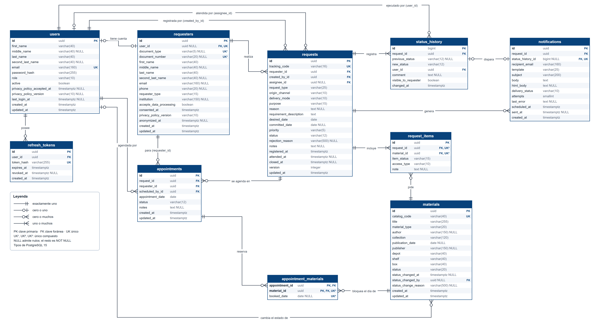

# Modelo de datos

> La versión entregable de este documento es `docs/modelo-datos.pdf`, con portada, índice y páginas numeradas. Las entidades, las reglas de negocio, el glosario y los casos de uso están en `docs/modelo-dominio.md`.

## 1. Introducción

Este documento describe cómo se guarda en PostgreSQL 15 el modelo de dominio de Trackhive: el diagrama entidad-relación, cada tabla con sus columnas, los índices y por qué existen, las migraciones y los datos semilla, y los datos personales con su justificación (Ley 1581 de 2012).

Describe el esquema que existe hoy, es decir, el de `backend/prisma/schema.prisma` y las migraciones de `backend/prisma/migrations/`. Lo que aún no tiene tabla se indica como previsto.

## 2. Diagrama entidad-relación

**Figura 1.** Diagrama entidad-relación de la base de datos de Trackhive.

Leyenda: cada recuadro es una tabla con sus columnas y su tipo de PostgreSQL. `PK` clave primaria, `FK` clave foránea, `UK` valor único; `UK¹`, `UK²` y `UK³` marcan las columnas que forman juntas un único compuesto. `NULL` indica que la columna admite nulos; el resto es `NOT NULL`. Las líneas usan la notación de pata de gallo: dos rayas, exactamente uno; círculo y raya, cero o uno; círculo y pata, cero o muchos; raya y pata, uno o muchos. Cada línea une la tabla padre (lado de la clave primaria) con la tabla hija (lado de la clave foránea); la tabla siguiente indica la columna de cada relación. Ninguna línea se cruza con otra.

| Relación | Cardinalidad | Clave foránea |
|---|---|---|
| users – refresh_tokens | 1 : 0..N | `refresh_tokens.user_id` |
| users – requesters | 0..1 : 0..1 | `requesters.user_id` (única) |
| users – materials | 0..1 : 0..N | `materials.status_changed_by` |
| requesters – requests | 1 : 0..N | `requests.requester_id` |
| users – requests | 1 : 0..N (registrada por) y 0..1 : 0..N (atendida por) | `requests.created_by_id`, `requests.assignee_id` |
| requests – request_items | 1 : 1..N | `request_items.request_id` |
| materials – request_items | 1 : 0..N | `request_items.material_id` |
| requests – status_history | 1 : 1..N | `status_history.request_id` |
| users – status_history | 1 : 0..N | `status_history.user_id` |
| requests – appointments | 1 : 0..N | `appointments.request_id` |
| requesters – appointments | 1 : 0..N | `appointments.requester_id` |
| users – appointments | 1 : 0..N | `appointments.scheduled_by_id` |
| appointments – appointment_materials | 1 : 0..N | `appointment_materials.appointment_id` |
| materials – appointment_materials | 1 : 0..N | `appointment_materials.material_id` |
| requests – notifications | 1 : 0..N | `notifications.request_id` |
| status_history – notifications | 0..1 : 0..1 | `notifications.status_history_id` (única) |

Decisiones principales:

- Las enumeraciones son `varchar` con `CHECK`. Las PK son `uuid`, salvo el historial, que usa `bigint` con identidad.
- `status_history` solo admite `INSERT`: un trigger rechaza `UPDATE`, `DELETE` y `TRUNCATE`. Es la auditoría y la base del reporte de tiempos de atención.
- `appointment_materials` tiene el índice único `(material_id, booked_date)`, así que la base de datos impide reservar el mismo material dos veces el mismo día (HU-20).
- Ninguna FK borra en cascada: todas son `RESTRICT`, salvo `materials.status_changed_by`, que es `SET NULL` (si se borrara el usuario, el material pierde solo el responsable del último cambio). Las solicitudes nunca se borran; los datos personales se anonimizan (§6).
- No hay tabla de horario ni de capacidad de la sala. El horario de atención (lunes a viernes de 8:00 a 17:00, sábados de 9:00 a 13:00) está en el dominio (`backend/src/requests/domain/appointment-date.ts`). La capacidad diaria configurable llega con HU-20.1.

## 3. Descripción de tablas

Todas las columnas son `NOT NULL` salvo las marcadas `NULL`. Las fechas con hora son `timestamptz` y `created_at` y `updated_at` tienen `DEFAULT now()`.

### users

Creada en HU-01 (migración `20261104224647_create_users`).

| Columna | Tipo | Restricciones | Descripción |
|---|---|---|---|
| id | uuid | PK | |
| first_name | varchar(40) | | Primer nombre |
| middle_name | varchar(40) | NULL | Segundo nombre |
| last_name | varchar(40) | | Primer apellido |
| second_last_name | varchar(40) | NULL | Segundo apellido |
| email | varchar(160) | UK | Correo de inicio de sesión |
| password_hash | varchar(255) | | Hash argon2, nunca la contraseña |
| role | varchar(10) | CHECK | `ADMIN`, `PERSONAL`, `PUBLICO` |
| active | boolean | DEFAULT true | `false` = cuenta desactivada |
| privacy_policy_accepted_at | timestamptz | NULL, CHECK con la versión | Fecha en que la persona aceptó el aviso; se llena en los registros públicos |
| privacy_policy_version | varchar(10) | NULL, CHECK con la fecha | Versión del aviso aceptado. Las dos columnas van juntas: ambas con valor o ambas `NULL` |
| last_login_at | timestamptz | NULL | |
| created_at, updated_at | timestamptz | | |

### refresh_tokens

Creada en HU-03 (migración `20261108000152_create_refresh_tokens`).

| Columna | Tipo | Restricciones | Descripción |
|---|---|---|---|
| id | uuid | PK | |
| user_id | uuid | FK → users, IDX | |
| token_hash | varchar(255) | UK | Hash SHA-256 del refresh token, nunca el token en claro |
| expires_at | timestamptz | | Las filas vencidas se borran cada día (HU-3.1) |
| revoked_at | timestamptz | NULL | `NULL` = vigente |
| created_at | timestamptz | | |

### requesters

Creada en HU-09 (migración `20261109000000_create_requests`).

| Columna | Tipo | Restricciones | Descripción |
|---|---|---|---|
| id | uuid | PK | |
| user_id | uuid | FK → users, UK, NULL | Cuenta, si tiene |
| document_type | varchar(5) | NULL, CHECK, UK con document_number | `CC`, `CE`, `TI`, `PAS`, `NIT` |
| document_number | varchar(20) | NULL, UK con document_type, IDX | Sin puntos ni espacios |
| first_name | varchar(40) | IDX trigram | Primer nombre |
| middle_name | varchar(40) | NULL, IDX trigram | Segundo nombre |
| last_name | varchar(40) | IDX trigram | Primer apellido |
| second_last_name | varchar(40) | NULL, IDX trigram | Segundo apellido |
| email | varchar(160) | NULL, IDX | Para las notificaciones |
| phone | varchar(20) | NULL | `CHECK (email IS NOT NULL OR phone IS NOT NULL)` |
| requester_type | varchar(15) | CHECK | `INVESTIGADOR`, `ESTUDIANTE`, `DOCENTE`, `CIUDADANO`, `ENTIDAD` |
| institution | varchar(150) | NULL | |
| accepts_data_processing | boolean | CHECK = true | Consentimiento (Ley 1581) |
| consented_at | timestamptz | | |
| privacy_policy_version | varchar(10) | | Versión del aviso aceptado |
| anonymized_at | timestamptz | NULL | Fecha en que se anonimizó (§6) |
| created_at, updated_at | timestamptz | | |

### materials

Creada en HU-07 (migración `20261108035559_create_materials`). HU-08 agregó las tres columnas `status_change*`.

| Columna | Tipo | Restricciones | Descripción |
|---|---|---|---|
| id | uuid | PK | |
| catalog_code | varchar(40) | UK | Código de catalogación único |
| title | varchar(255) | IDX trigram | |
| material_type | varchar(20) | CHECK, IDX | `DOCUMENTO`, `PERIODICO`, `PROTOCOLO_NOTARIAL`, `OTRO` |
| author | varchar(150) | NULL, IDX trigram | |
| collection | varchar(120) | IDX trigram | Colección o tema |
| publication_date | date | NULL | Solo periódicos |
| publisher | varchar(150) | NULL | Empresa editora; solo periódicos |
| depot, shelf, box | varchar(40) | | Ubicación física. Nunca se muestra al rol `PUBLICO` |
| status | varchar(20) | CHECK | `DISPONIBLE`, `EN_USO`, `EN_RESTAURACION`, `NO_CONSULTABLE` |
| status_changed_at | timestamptz | NULL | Fecha del último cambio de estado. `NULL` si nunca se cambió |
| status_changed_by | uuid | FK → users, NULL | Responsable del último cambio de estado |
| status_change_reason | varchar(500) | NULL | Motivo opcional del último cambio de estado |
| created_at, updated_at | timestamptz | | |

### requests

Creada en HU-09 (migración `20261109000000_create_requests`).

| Columna | Tipo | Restricciones | Descripción |
|---|---|---|---|
| id | uuid | PK | |
| tracking_code | varchar(16) | UK | Radicado `SOL-AAAA-NNNNN` |
| requester_id | uuid | FK → requesters, IDX | |
| created_by_id | uuid | FK → users, IDX | Quién la registró |
| assignee_id | uuid | FK → users, NULL, IDX | Funcionario asignado |
| request_type | varchar(25) | CHECK | `CONSULTA_SALA`, `BUSQUEDA_INFORMACION`, `REPRODUCCION` |
| origin_channel | varchar(10) | CHECK | `WEB`, `PRESENCIAL`, `CORREO` |
| delivery_mode | varchar(10) | CHECK | `PRESENCIAL`, `DIGITAL` |
| purpose | varchar(15) | CHECK | `INVESTIGACION`, `ACADEMICO`, `TRAMITE`, `GENEALOGIA`, `OTRO` |
| reason | text | NULL | |
| requirement_description | text | | Lo que busca, en palabras del solicitante |
| desired_date | date | | |
| committed_date | date | NULL, IDX con status | La fija el personal |
| priority | varchar(5) | CHECK, DEFAULT `MEDIA` | `BAJA`, `MEDIA`, `ALTA` |
| status | varchar(12) | CHECK, DEFAULT `RECIBIDA`, IDX con committed_date | `RECIBIDA` … `RECHAZADA` (figura 2 de `docs/modelo-dominio.md`) |
| rejection_reason | varchar(500) | NULL, CHECK | Motivo del rechazo que lee el solicitante. Obligatorio y no vacío solo si `status = 'RECHAZADA'` (HU-16) |
| notes | text | NULL | Notas internas |
| registered_at | timestamptz | IDX | Fecha de radicación |
| attended_at, closed_at | timestamptz | NULL | |
| version | integer | DEFAULT 1 | Bloqueo optimista |
| updated_at | timestamptz | | |

### request_items

Creada en HU-09 (migración `20261109000000_create_requests`).

| Columna | Tipo | Restricciones | Descripción |
|---|---|---|---|
| id | uuid | PK | |
| request_id | uuid | FK → requests, UK con material_id | Un material no se repite en la misma solicitud |
| material_id | uuid | FK → materials, IDX | Base del reporte de material más solicitado |
| item_status | varchar(15) | CHECK, DEFAULT `PENDIENTE` | `PENDIENTE`, `LOCALIZADO`, `NO_LOCALIZADO`, `NO_APTO` |
| access_type | varchar(10) | CHECK, DEFAULT `FISICO` | `FISICO`, `DIGITAL` |
| note | text | NULL | |

### status_history

Creada en HU-15 (migración `20261111000000_create_status_history`). Una fila por cada cambio de estado.

| Columna | Tipo | Restricciones | Descripción |
|---|---|---|---|
| id | bigint | PK (autoincremental) | |
| request_id | uuid | FK → requests, IDX con changed_at | |
| previous_status | varchar(12) | NULL, CHECK | `NULL` en la fila de creación. Distinto de `new_status` (CHECK) |
| new_status | varchar(12) | CHECK | |
| user_id | uuid | FK → users, IDX | Quién hizo el cambio |
| comment | text | NULL | Obligatorio al rechazar: es el motivo |
| visible_to_requester | boolean | DEFAULT true | |
| changed_at | timestamptz | DEFAULT now() | |

### appointments

Creada en HU-18 (migración `20261112100000_create_appointments`). La cita es por día, sin hora.

| Columna | Tipo | Restricciones | Descripción |
|---|---|---|---|
| id | uuid | PK | |
| request_id | uuid | FK → requests, IDX | |
| requester_id | uuid | FK → requesters, IDX | Solicitante de la cita |
| scheduled_by_id | uuid | FK → users, IDX | Quién la agendó |
| appointment_date | date | IDX, CHECK no domingo | |
| status | varchar(12) | CHECK, DEFAULT `PROGRAMADA` | `PROGRAMADA`, `CUMPLIDA`, `CANCELADA`, `NO_ASISTIO` |
| notes | text | NULL | |
| created_at, updated_at | timestamptz | | |

### appointment_materials

Creada en HU-18. La migración `20261114100000_material_day_booking` (HU-20) agregó `booked_date` y el índice único que impide las dobles reservas.

| Columna | Tipo | Restricciones | Descripción |
|---|---|---|---|
| appointment_id | uuid | PK con material_id, FK → appointments | |
| material_id | uuid | PK con appointment_id, FK → materials, IDX | El material reservado |
| booked_date | date | NULL, UK con material_id | El día reservado, mientras la cita está `PROGRAMADA`. Al cumplirse, registrar la inasistencia o cancelarse pasa a `NULL` y libera el día: un `NULL` nunca choca en el índice único |

### notifications

Creada en HU-23 (migración `20261113000000_create_notifications`). Es la tabla de salida de los correos (D-10): cada cambio de estado inserta aquí el correo en la misma transacción, y un proceso programado lo envía cada 10 segundos.

| Columna | Tipo | Restricciones | Descripción |
|---|---|---|---|
| id | uuid | PK | |
| request_id | uuid | FK → requests, IDX | |
| status_history_id | bigint | FK → status_history, UK, NULL | Cambio que la disparó |
| recipient_email | varchar(160) | CHECK no vacío | Correo del solicitante en el momento del cambio |
| template | varchar(25) | CHECK | `CAMBIO_ESTADO` |
| subject | varchar(200) | | Asunto, con el radicado y el nuevo estado |
| body | text | | Texto plano |
| html_body | text | NULL | El mismo contenido en HTML |
| delivery_status | varchar(10) | CHECK, DEFAULT `PENDIENTE`, IDX con scheduled_at | `PENDIENTE`, `ENVIADA`, `FALLIDA` |
| attempts | smallint | DEFAULT 0, CHECK ≥ 0 | Intentos de envío. Al quinto fallo pasa a `FALLIDA` |
| last_error | text | NULL | Último error del servidor de correo, sin direcciones de correo |
| scheduled_at | timestamptz | | Cuándo se puede enviar o reintentar |
| sent_at | timestamptz | NULL, CHECK | Tiene valor si, y solo si, `delivery_status = 'ENVIADA'` |
| created_at | timestamptz | | |

## 4. Índices

Las PK y las UK crean su índice automáticamente. Las FK se indexan a mano, porque PostgreSQL no lo hace. Los índices GIN trigram usan la extensión `pg_trgm` y permiten buscar con `ILIKE '%texto%'` sin recorrer toda la tabla (D-16).

| Tabla | Columna(s) | Justificación |
|---|---|---|
| users | email (UK) | Inicio de sesión por correo y que no haya dos cuentas con el mismo correo |
| refresh_tokens | token_hash (UK) | Encontrar la sesión al renovar el token |
| refresh_tokens | user_id | Revocar todas las sesiones de un usuario |
| requesters | user_id (UK) | Encontrar el solicitante de la cuenta que inició sesión; una cuenta tiene a lo sumo un solicitante |
| requesters | (document_type, document_number) (UK), document_number | No duplicar a la persona y buscarla por su documento |
| requesters | email | Buscar al solicitante por correo antes de registrar a su nombre (HU-10) |
| requesters | GIN trigram (first_name, middle_name, last_name, second_last_name) | Búsqueda por nombre que tolera errores de escritura |
| materials | catalog_code (UK) | Código de catalogación único |
| materials | GIN trigram (title), (author), (collection) | Búsqueda de material por texto (HU-07) |
| materials | material_type | Filtro por tipo en la búsqueda |
| requests | tracking_code (UK) | Consulta por radicado |
| requests | (status, committed_date) | Bandeja del personal filtrada por estado y solicitudes vencidas |
| requests | requester_id | «Mis solicitudes» (HU-11) |
| requests | assignee_id, created_by_id | Solicitudes asignadas a un funcionario o registradas por él |
| requests | registered_at | Listados y reportes por periodo |
| request_items | (request_id, material_id) (UK) | Un material no se repite en una solicitud |
| request_items | material_id | Reporte de material más solicitado y filtro de la bandeja por material |
| status_history | (request_id, changed_at) | Línea de tiempo de una solicitud y tiempos de atención |
| status_history | user_id | Cambios hechos por un funcionario |
| appointments | appointment_date | Calendario por rango de fechas (HU-19) |
| appointments | request_id, requester_id, scheduled_by_id | Citas de una solicitud, de un solicitante o de quien agendó |
| appointment_materials | material_id | Citas de un material y filtro del calendario por material |
| appointment_materials | Único (material_id, booked_date) | Un material no se reserva dos veces el mismo día, incluso si dos funcionarios agendan a la vez (HU-20) |
| notifications | (delivery_status, scheduled_at) | El proceso de envío busca los correos pendientes cuya hora llegó |
| notifications | request_id | Correos de una solicitud |
| notifications | status_history_id (UK) | Un cambio de estado dispara a lo sumo un correo |

## 5. Migraciones y datos semilla

**Migraciones:**

- Van en `backend/prisma/migrations/` (Prisma Migrate). En desarrollo se crean con `pnpm db:migrate:dev` y fuera de local se aplican con `pnpm db:migrate`. El contenedor del backend las aplica al arrancar.
- `prisma db push` no se usa fuera del entorno local. Una migración que ya está en `main` no se edita: se crea otra.
- Lo que el esquema de Prisma no expresa (`CHECK`, trigger, índices trigram) se agrega a mano en el SQL, creando la migración con `--create-only`.

| Migración | HU | Qué hace |
|---|---|---|
| `20261104224647_create_users` | HU-01 | Tabla `users` |
| `20261108000152_create_refresh_tokens` | HU-03 | Tabla `refresh_tokens` |
| `20261108035559_create_materials` | HU-07 | Extensión `pg_trgm` y tabla `materials` |
| `20261109000000_create_requests` | HU-09 | Tablas `requesters`, `requests` y `request_items`, y la secuencia `request_tracking_seq` que numera los radicados |
| `20261109200235_split_person_names` | #96 | Separa nombres y apellidos en cuatro columnas en `users` y `requesters` |
| `20261110000000_add_material_status_change` | HU-08 | Columnas del último cambio de estado del material |
| `20261110120000_add_user_privacy_consent` | HU-31 | Consentimiento en `users` |
| `20261111000000_create_status_history` | HU-15 | Tabla `status_history` y su trigger de solo inserción |
| `20261112000000_widen_rejection_reason` | HU-16 | Motivo de rechazo de hasta 500 caracteres y su `CHECK` |
| `20261112100000_create_appointments` | HU-18 | Tablas `appointments` y `appointment_materials` |
| `20261113000000_create_notifications` | HU-23 | Tabla `notifications` |
| `20261114100000_material_day_booking` | HU-20 | `booked_date` y el índice único contra dobles reservas |

**Semillas:**

- Van en `backend/prisma/seed.ts` y se ejecutan con `pnpm db:seed`. Son idempotentes.
- Contenido: 7 usuarios (1 administrador, 2 funcionarios y 4 usuarios públicos), 30 materiales, 12 solicitudes repartidas en los 7 estados y 4 citas.
- Las contraseñas salen de variables de entorno (`SEED_ADMIN_PASSWORD`, `SEED_DEMO_PASSWORD`).
- Datos **ficticios**, con correos `@example.com`. No se usan datos reales del CLENA sin autorización escrita.

## 6. Datos personales (Ley 1581 de 2012)

| Dato | Dónde | Por qué se guarda |
|---|---|---|
| Documento (tipo y número) | `requesters` | Identificar a la persona en la atención presencial y evitar duplicados. Es opcional |
| Nombres y apellidos | `users`, `requesters` | Atender al solicitante y saber qué funcionario hizo cada acción |
| Correo | `users`, `requesters`, `notifications` | Iniciar sesión y avisar cada cambio de estado |
| Teléfono | `requesters` | Contactar a quien no tiene correo (se exige correo o teléfono) |
| Tipo de solicitante e institución | `requesters` | Estadísticas del servicio. La institución es opcional |
| Contraseña (solo el hash) | `users` | Acceso al sistema |
| Consentimiento (fecha y versión del aviso) | `users`, `requesters` | Prueba de la autorización del titular |

No se piden datos sensibles.

**Protección:**

- Aviso de privacidad y casilla de aceptación sin marcar al crear la cuenta (HU-31). Cuando el personal registra a un solicitante sin cuenta, hoy el sistema llena `accepts_data_processing`, `consented_at` y `privacy_policy_version` sin preguntarle; recoger esa aceptación sigue pendiente.
- Acceso según el rol: el usuario público solo ve sus solicitudes.
- Contraseñas y refresh tokens guardados como hash.
- `last_error` de `notifications` y los logs no guardan direcciones de correo.
- HTTPS al desplegar (D-24); hoy el entorno local usa HTTP.

**Eliminar la cuenta (prevista, HU-33):** anonimizará en una sola transacción:

1. Cerrar las solicitudes en curso y liberar sus reservas.
2. Reemplazar nombre, documento, correo y teléfono por valores neutros y marcar `anonymized_at`.
3. Desactivar el usuario y revocar sus tokens.
4. Borrar el correo y el cuerpo de sus notificaciones.

Las solicitudes se conservan sin datos que identifiquen a la persona, para no perder las estadísticas.
