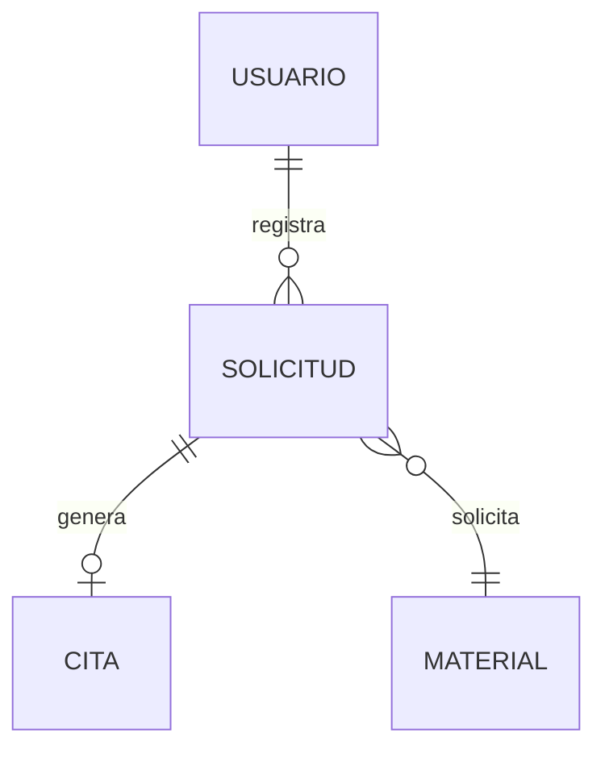

# Modelo de datos

> Estado: pendiente (Hito 1 – Inception)

## 1. Modelo de dominio

(Entidades principales y relaciones: Solicitud, Solicitante, Material, Cita, Usuario, etc.)

## 2. Diagrama entidad-relación

(Reemplazar por el diagrama real.)

## 3. Descripción de tablas

### nombre_tabla

| Columna | Tipo | Restricciones | Descripción |
|---|---|---|---|
| id | uuid | PK | |

## 4. Índices

| Tabla | Columna(s) | Motivo (búsqueda, filtro, etc.) |
|---|---|---|

## 5. Migraciones y datos semilla

- Migraciones: ubicación y convención de nombres.
- Semillas: datos **ficticios**. No usar datos reales del CLENA sin autorización escrita.

## 6. Datos personales (Ley 1581 de 2012)

(Qué datos personales se guardan, por qué son necesarios y cómo se elimina una cuenta.)
