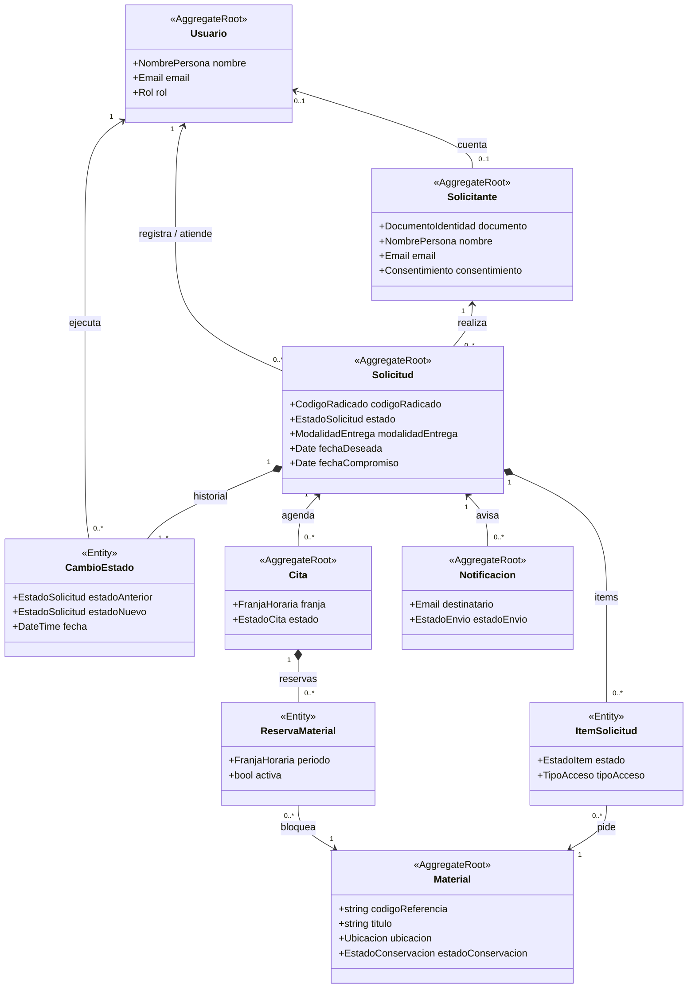
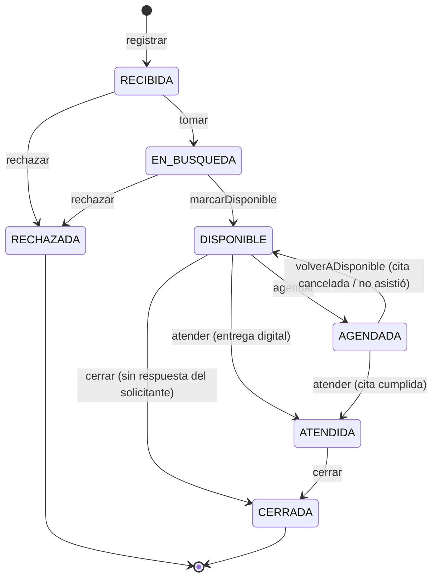
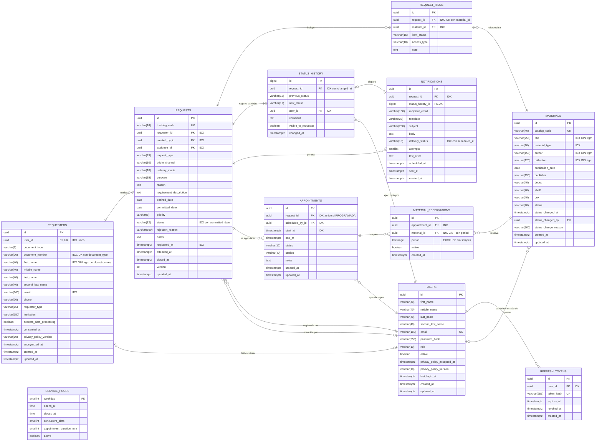

# Modelo de datos

## 1. Modelo de dominio

Lenguaje común y reglas de negocio del módulo. Es la base de la capa de dominio del backend. Las secciones 2 a 6 describen cómo se guarda en PostgreSQL.

### 1.1 Entidades y objetos de valor

Notación: `<<AggregateRoot>>` es la raíz de un agregado (se guarda completa) y `<<Entity>>` es una parte interna. El rombo indica composición y la flecha, una referencia por id. Solo se muestran los atributos clave.

| Entidad | Qué es | Tabla(s) |
|---|---|---|
| **Solicitud** | Pedido de consulta, búsqueda o copia, identificado por un radicado. Contiene sus **ítems** (materiales pedidos y el resultado de buscarlos) y su **historial** de cambios de estado. | `requests`, `request_items`, `status_history` |
| **Solicitante** | Persona que pide. Puede no tener cuenta, si la solicitud la registró el personal. | `requesters` |
| **Material** | Pieza del acervo (documento, expediente, periódico, fotografía…) con ubicación física y estado de conservación. | `materials` |
| **Cita** | Franja para consultar el material en la sala. Contiene las **reservas** de cada material físico. | `appointments`, `material_reservations` |
| **Usuario** | Cuenta con rol `ADMIN`, `PERSONAL` o `PUBLICO`. | `users`, `refresh_tokens` |
| **Notificación** | Correo que recibe el solicitante en cada cambio de estado. | `notifications` |
| *(configuración)* | Horario de atención y cupos de la sala. | `service_hours` |

| Objeto de valor | Regla |
|---|---|
| `CodigoRadicado` | Formato `SOL-AAAA-NNNNN`. Lo genera el sistema y no cambia. |
| `FranjaHoraria` | `fin > inicio`. Dos franjas chocan si `a.inicio < b.fin` y `b.inicio < a.fin`. |
| `Ubicacion` | Depósito, estantería y caja. |
| `DocumentoIdentidad` | Tipo (CC, CE, TI, PAS, NIT) más número. Único por persona. |
| `NombrePersona` | Primer nombre y primer apellido obligatorios; segundo nombre y segundo apellido opcionales. Máximo 40 caracteres cada uno. Igual en `Usuario` y `Solicitante`. |
| `Email` | Correo con formato válido. |
| `Consentimiento` | Aceptación del aviso de privacidad, con fecha y versión (Ley 1581). |

### 1.2 Relaciones

| Relación | Cardinalidad |
|---|---|
| Solicitante – Solicitud | 1 : N |
| Solicitud – Material (a través de los ítems) | N : M |
| Solicitud – CambioEstado | 1 : N (siempre al menos uno) |
| Solicitud – Cita | 1 : N (solo una cita `PROGRAMADA` a la vez) |
| Cita – Material (a través de las reservas) | N : M |
| Solicitud – Notificación | 1 : N |
| Usuario – Solicitud | 1 : N (quién la registra y quién es el responsable) |
| Usuario – CambioEstado / Cita | 1 : N (quién ejecuta el cambio y quién agenda la cita) |
| Usuario – Solicitante | 0..1 : 0..1 |

### 1.3 Estados de la solicitud y transiciones

| Transición | Condición |
|---|---|
| → `RECIBIDA` | El solicitante dio su consentimiento. La fecha deseada es ≥ hoy + el plazo mínimo. |
| `RECIBIDA` → `EN_BUSQUEDA` | Se asignan un responsable y una fecha compromiso. |
| `RECIBIDA` / `EN_BUSQUEDA` → `RECHAZADA` | Motivo obligatorio. |
| `EN_BUSQUEDA` → `DISPONIBLE` | Al menos un material, y todos localizados. |
| `DISPONIBLE` → `AGENDADA` | La entrega es presencial y hay una cita programada. |
| `DISPONIBLE` → `ATENDIDA` | La entrega es digital. |
| `AGENDADA` → `ATENDIDA` | La cita se cumplió. |
| `AGENDADA` → `DISPONIBLE` | La cita se canceló o el solicitante no asistió. Se liberan las reservas. |
| `DISPONIBLE` / `ATENDIDA` → `CERRADA` | Cierre manual, o automático después de N días. |

- Cualquier otra transición se rechaza (HTTP 409). `CERRADA` y `RECHAZADA` son estados finales.
- Cada transición deja un **cambio de estado inmutable** (quién, cuándo y comentario) y genera una **notificación** al solicitante.

### 1.4 Sin dobles reservas de material

Un material físico **no puede tener dos reservas activas con franjas que se solapen**. Se controla en tres niveles:

1. **Dominio:** `FranjaHoraria.seSolapaCon()` define qué es un choque.
2. **Caso de uso `AgendarCita`:** antes de guardar, revisa las reservas existentes. Si hay choque, lanza `MaterialNoDisponible` (HTTP 409).
3. **Base de datos:** `EXCLUDE USING gist (material_id WITH =, period WITH &&) WHERE (active)` frena las peticiones simultáneas.

Además:

- Solo se reserva el material de acceso físico.
- No se reserva material restringido ni en estado `CRITICO`.
- Cancelar la cita o registrar una inasistencia libera las reservas.

### 1.5 Otras reglas

- Las citas deben caer dentro del horario de atención y no pueden superar los cupos de la sala.
- Los datos de una solicitud solo se pueden editar mientras está en `RECIBIDA`.
- Una solicitud está **vencida** si pasó su fecha compromiso y no está atendida, cerrada ni rechazada.
- El usuario público solo ve sus propias solicitudes.
- El solicitante debe tener correo **o** teléfono. Eliminar su cuenta anonimiza sus datos, pero no borra sus solicitudes.

## 2. Diagrama entidad-relación

Leyenda: `PK` clave primaria · `FK` clave foránea · `UK` valor único · `IDX` columna con índice (ver §4).

Decisiones principales:

- Las enumeraciones son `varchar` con `CHECK`. Las PK son `uuid`, salvo el historial, que usa `bigint`.
- `status_history` solo admite `INSERT` (un trigger rechaza `UPDATE`, `DELETE` y `TRUNCATE`). Es la auditoría y la base del reporte de tiempos de atención.
- `material_reservations.period` tiene una restricción `EXCLUDE USING gist`, así que la base de datos impide las dobles reservas.
- Ninguna FK borra en cascada. Las solicitudes nunca se borran; los datos personales se anonimizan (§6).

## 3. Descripción de tablas

Todas las columnas son `NOT NULL` salvo las marcadas `NULL`. Las tablas de negocio tienen además `created_at` y `updated_at` (`timestamptz DEFAULT now()`), que no se listan.

### users

| Columna | Tipo | Restricciones | Descripción |
|---|---|---|---|
| id | uuid | PK | |
| first_name | varchar(40) | | Primer nombre |
| middle_name | varchar(40) | NULL | Segundo nombre |
| last_name | varchar(40) | | Primer apellido |
| second_last_name | varchar(40) | NULL | Segundo apellido |
| email | varchar(160) | UK | Correo de inicio de sesión |
| password_hash | varchar(255) | | Hash argon2 |
| role | varchar(10) | CHECK | `ADMIN`, `PERSONAL`, `PUBLICO` |
| active | boolean | DEFAULT true | `false` = cuenta desactivada o eliminada |
| privacy_policy_accepted_at | timestamptz | NULL, CHECK con la versión | Fecha en que la persona aceptó el aviso; se llena en los registros públicos |
| privacy_policy_version | varchar(10) | NULL, CHECK con la fecha | Versión del aviso aceptado (Ley 1581) |
| last_login_at | timestamptz | NULL | |

### refresh_tokens

| Columna | Tipo | Restricciones | Descripción |
|---|---|---|---|
| id | uuid | PK | |
| user_id | uuid | FK → users, IDX | |
| token_hash | varchar(255) | UK | Hash SHA-256 del refresh token, nunca el token en claro |
| expires_at | timestamptz | | Las filas vencidas se borran cada día (HU-3.1) |
| revoked_at | timestamptz | NULL | `NULL` = vigente |

### requesters

| Columna | Tipo | Restricciones | Descripción |
|---|---|---|---|
| id | uuid | PK | |
| user_id | uuid | FK → users, UK, NULL | Cuenta, si tiene |
| document_type | varchar(5) | CHECK, UK con document_number | `CC`, `CE`, `TI`, `PAS`, `NIT` |
| document_number | varchar(20) | UK con document_type, IDX | Sin puntos ni espacios |
| first_name | varchar(40) | IDX trigram | Primer nombre |
| middle_name | varchar(40) | NULL, IDX trigram | Segundo nombre |
| last_name | varchar(40) | IDX trigram | Primer apellido |
| second_last_name | varchar(40) | NULL, IDX trigram | Segundo apellido |
| email | varchar(160) | NULL, IDX | Para las notificaciones |
| phone | varchar(20) | NULL | `CHECK (email IS NOT NULL OR phone IS NOT NULL)` |
| requester_type | varchar(15) | CHECK | `INVESTIGADOR`, `ESTUDIANTE`, `DOCENTE`, `CIUDADANO`, `ENTIDAD` |
| institution | varchar(150) | NULL | |
| accepts_data_processing | boolean | CHECK = true | Consentimiento (Ley 1581) |
| consented_at | timestamptz | | |
| privacy_policy_version | varchar(10) | | Versión del aviso aceptado |
| anonymized_at | timestamptz | NULL | Fecha en que se anonimizó (§6) |

### materials

Campos según HU-06, HU-07 y HU-20.

| Columna | Tipo | Restricciones | Descripción |
|---|---|---|---|
| id | uuid | PK | |
| catalog_code | varchar(40) | UK | Código de catalogación único |
| title | varchar(255) | IDX trigram | |
| material_type | varchar(20) | CHECK, IDX | `DOCUMENTO`, `PERIODICO`, `PROTOCOLO_NOTARIAL`, `OTRO` |
| author | varchar(150) | NULL, IDX trigram | Opcional |
| collection | varchar(120) | IDX trigram | Colección o tema |
| publication_date | date | NULL | Solo periódicos |
| publisher | varchar(150) | NULL | Empresa editora; solo periódicos |
| depot, shelf, box | varchar(40) | | Ubicación física. Nunca se muestra al rol `PUBLICO` |
| status | varchar(20) | CHECK | `DISPONIBLE`, `EN_USO`, `EN_RESTAURACION`, `NO_CONSULTABLE` |
| status_changed_at | timestamptz | NULL | Fecha del último cambio de estado (HU-08). Vacío si nunca se cambió |
| status_changed_by | uuid | FK → users, NULL | Responsable del último cambio de estado (HU-08) |
| status_change_reason | varchar(500) | NULL | Motivo opcional del último cambio de estado (HU-08) |
| created_at, updated_at | timestamptz | | |

### requests

| Columna | Tipo | Restricciones | Descripción |
|---|---|---|---|
| id | uuid | PK | |
| tracking_code | varchar(16) | UK | `SOL-AAAA-NNNNN` |
| requester_id | uuid | FK → requesters, IDX | |
| created_by_id | uuid | FK → users, IDX | Quién la registró |
| assignee_id | uuid | FK → users, NULL, IDX | Funcionario asignado |
| request_type | varchar(25) | CHECK | `CONSULTA_SALA`, `BUSQUEDA_INFORMACION`, `REPRODUCCION` |
| origin_channel | varchar(10) | CHECK | `WEB`, `PRESENCIAL`, `CORREO` |
| delivery_mode | varchar(10) | CHECK | `PRESENCIAL`, `DIGITAL` |
| purpose | varchar(15) | CHECK | Investigación, académico, trámite, genealogía… |
| reason | text | NULL | |
| requirement_description | text | | Lo que busca, en palabras del solicitante |
| desired_date | date | | |
| committed_date | date | NULL, IDX con status | La fija el personal |
| priority | varchar(5) | CHECK, DEFAULT 'MEDIA' | `BAJA`, `MEDIA`, `ALTA` |
| status | varchar(12) | CHECK, IDX con committed_date | `RECIBIDA` … `RECHAZADA` (ver §1.3) |
| rejection_reason | varchar(500) | NULL, CHECK | Motivo del rechazo, en texto libre; lo ve el solicitante en «Mis solicitudes». Obligatorio y no vacío solo si `status = 'RECHAZADA'` (HU-16, migración `20261112000000_widen_rejection_reason`) |
| notes | text | NULL | Notas internas |
| registered_at | timestamptz | IDX | Fecha de radicación |
| attended_at, closed_at | timestamptz | NULL | |
| version | int | DEFAULT 1 | Bloqueo optimista |

### request_items

| Columna | Tipo | Restricciones | Descripción |
|---|---|---|---|
| id | uuid | PK | |
| request_id | uuid | FK → requests, UK con material_id | |
| material_id | uuid | FK → materials, IDX | Base del reporte de material más solicitado |
| item_status | varchar(15) | CHECK | `PENDIENTE`, `LOCALIZADO`, `NO_LOCALIZADO`, `NO_APTO` |
| access_type | varchar(10) | CHECK | `FISICO`, `DIGITAL` (solo `FISICO` se reserva) |
| note | text | NULL | |

### status_history

Creada en HU-15 (migración `20261111000000_create_status_history`). Una fila por cada cambio de estado; el personal la genera desde la acción «Cambiar estado» del detalle de la solicitud.

| Columna | Tipo | Restricciones | Descripción |
|---|---|---|---|
| id | bigint | PK (identity) | |
| request_id | uuid | FK → requests, IDX con changed_at | |
| previous_status | varchar(12) | NULL, CHECK | `NULL` en la creación. Distinto de `new_status` (CHECK) |
| new_status | varchar(12) | CHECK | |
| user_id | uuid | FK → users, IDX | Quién hizo el cambio |
| comment | text | NULL | Obligatorio al rechazar |
| visible_to_requester | boolean | DEFAULT true | |
| changed_at | timestamptz | DEFAULT now() | |

### appointments

| Columna | Tipo | Restricciones | Descripción |
|---|---|---|---|
| id | uuid | PK | |
| request_id | uuid | FK → requests, IDX | Único entre las citas `PROGRAMADA` |
| scheduled_by_id | uuid | FK → users, IDX | |
| start_at | timestamptz | IDX | Vista de calendario |
| end_at | timestamptz | CHECK end_at > start_at | |
| status | varchar(12) | CHECK | `PROGRAMADA`, `CUMPLIDA`, `CANCELADA`, `NO_ASISTIO` |
| station, notes | varchar / text | NULL | |

### material_reservations

| Columna | Tipo | Restricciones | Descripción |
|---|---|---|---|
| id | uuid | PK | |
| appointment_id | uuid | FK → appointments, IDX | |
| material_id | uuid | FK → materials | |
| period | tstzrange | EXCLUDE gist con material_id | Franja de la cita. **Impide las dobles reservas** |
| active | boolean | DEFAULT true | `false` al cancelar la cita o si el solicitante no asiste |

### notifications

| Columna | Tipo | Restricciones | Descripción |
|---|---|---|---|
| id | uuid | PK | |
| request_id | uuid | FK → requests, IDX | |
| status_history_id | bigint | FK → status_history, UK, NULL | Cambio que la disparó |
| recipient_email | varchar(160) | | |
| template, subject, body | varchar / text | | Contenido del correo |
| delivery_status | varchar(10) | CHECK, IDX con scheduled_at | `PENDIENTE`, `ENVIADA`, `FALLIDA` |
| attempts | smallint | DEFAULT 0 | Reintentos |
| last_error | text | NULL | |
| scheduled_at | timestamptz | | |
| sent_at | timestamptz | NULL | |

### service_hours

| Columna | Tipo | Restricciones | Descripción |
|---|---|---|---|
| weekday | smallint | PK, CHECK 1–7 | 1 = lunes |
| opens_at, closes_at | time | CHECK closes_at > opens_at | |
| concurrent_slots | smallint | CHECK > 0 | Citas a la misma hora |
| appointment_duration_min | smallint | DEFAULT 60 | |
| active | boolean | DEFAULT true | |

## 4. Índices

Las PK y las UK crean su índice automáticamente. Las FK se indexan a mano.

| Tabla | Columna(s) | Motivo (búsqueda, filtro, etc.) |
|---|---|---|
| users | email (UK) | Inicio de sesión |
| refresh_tokens | user_id | Revocar las sesiones de un usuario |
| requesters | (document_type, document_number) (UK), document_number, email | Buscar a la persona en el registro asistido sin duplicarla |
| requesters | GIN trigram (first_name, middle_name, last_name, second_last_name) | Búsqueda por nombre con errores de escritura |
| materials | catalog_code (UK), GIN trigram (title, author, collection), material_type | Listar y buscar material (HU-07) y agregarlo a una solicitud |
| requests | tracking_code (UK) | Consulta por radicado |
| requests | (status, committed_date) | Bandeja de trabajo y solicitudes vencidas |
| requests | requester_id, assignee_id, created_by_id | «Mis solicitudes», «asignadas a mí» |
| requests | registered_at | Listados y reportes por periodo |
| request_items | material_id | Reporte de material más solicitado |
| status_history | (request_id, changed_at), user_id | Línea de tiempo y tiempos de atención |
| appointments | start_at | Calendario por rango de fechas |
| appointments | request_id (único parcial `WHERE status = 'PROGRAMADA'`), scheduled_by_id | Una sola cita vigente por solicitud |
| material_reservations | GiST (material_id, period), appointment_id | Disponibilidad del material y liberar reservas |
| notifications | (delivery_status, scheduled_at), request_id | Proceso de envío de correos |

## 5. Migraciones y datos semilla

- **Migraciones:**
  - Van en `backend/prisma/migrations/` (Prisma Migrate). En desarrollo se crean con `pnpm db:migrate:dev` y fuera de local se aplican con `pnpm db:migrate`.
  - `prisma db push` no se usa fuera del entorno local. Una migración que ya está en `main` no se edita: se crea otra.
  - Lo que el esquema de Prisma no expresa (`CHECK`, `EXCLUDE`, índices trigram) se agrega a mano en el SQL, creando la migración con `--create-only`.
  - El contenedor del backend corre `pnpm db:migrate` al arrancar.
  - Orden: extensiones → users y refresh_tokens → requesters → materials → requests y request_items → status_history → appointments y material_reservations → notifications → service_hours → vistas de reportes.
- **Semillas:**
  - Van en `backend/prisma/seed.ts` y se ejecutan con `pnpm db:seed`. Son idempotentes.
  - Contenido actual: 1 admin, 2 funcionarios y 4 usuarios públicos.
  - Contenido previsto, a medida que cada HU agregue sus tablas: 10 solicitantes, 30 materiales, 20 solicitudes repartidas en todos los estados y 8 citas.
  - Las contraseñas salen de variables de entorno (`SEED_ADMIN_PASSWORD`, `SEED_DEMO_PASSWORD`).
  - Datos **ficticios**, con correos `@example.com`. No usar datos reales del CLENA sin autorización escrita.

## 6. Datos personales (Ley 1581 de 2012)

| Dato | Por qué se guarda |
|---|---|
| Documento (tipo y número) | Identificar a la persona en la atención presencial y evitar duplicados |
| Nombres y apellidos | Atender al solicitante |
| Correo **o** teléfono (al menos uno) | Avisar los cambios de estado y contactar a la persona |
| Tipo de solicitante e institución | Estadísticas del servicio (la institución es opcional) |
| Contraseña (solo el hash) | Acceso al sistema |
| Consentimiento (fecha y versión) | Prueba de la autorización del titular |

No se piden datos sensibles.

**Protección:**

- Aviso de privacidad y casilla de aceptación sin marcar.
- Acceso según el rol.
- Contraseñas y tokens guardados como hash.
- Logs sin datos personales.
- HTTPS.

**Eliminar la cuenta:** `DELETE /api/v1/me` anonimiza en una sola transacción:

1. Cierra las solicitudes en curso y libera sus reservas.
2. Reemplaza nombre, documento, correo y teléfono por valores neutros y marca `anonymized_at`.
3. Desactiva el usuario y revoca sus tokens.
4. Borra el correo y el cuerpo de sus notificaciones.

Las solicitudes se conservan sin datos que identifiquen a la persona, para no perder las estadísticas.
