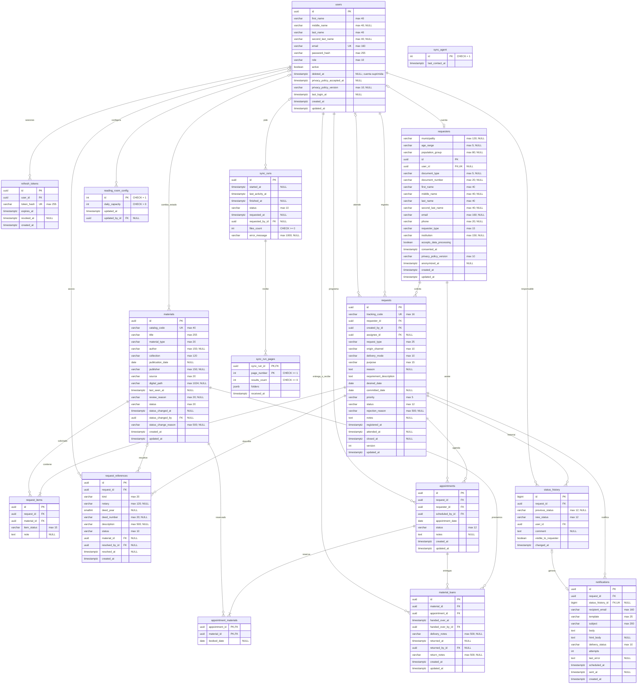

# Modelo de datos

> La versión entregable de este documento es `docs/modelo-datos.pdf`, con portada, índice y páginas numeradas. Las entidades, las reglas de negocio, el glosario y los casos de uso están en `docs/modelo-dominio.md`.

## 1. Introducción

Este documento describe cómo se guarda en PostgreSQL 15 el modelo de dominio de Trackhive: el diagrama entidad-relación, cada tabla con sus columnas, los índices y por qué existen, las migraciones y los datos semilla, y los datos personales con su justificación (Ley 1581 de 2012).

Describe el esquema que existe hoy, es decir, el de `backend/prisma/schema.prisma` y las migraciones de `backend/prisma/migrations/`. Lo que aún no tiene tabla se indica como previsto.

## 2. Diagrama entidad-relación

**Figura 1.** Diagrama ER actualizado para HU-138, generado a partir del esquema Prisma. PK: clave primaria; FK: clave foránea; UK: valor único; NULL: campo opcional en persistencia. Las tablas siguientes detallan los CHECK e índices compuestos. La imagen y el PDF históricos corresponden a la entrega previa a HU-73.

| Relación | Cardinalidad | Clave foránea |
|---|---|---|
| users – refresh_tokens | 1 : 0..N | `refresh_tokens.user_id` |
| users – requesters | 0..1 : 0..1 | `requesters.user_id` (única) |
| users – materials | 0..1 : 0..N | `materials.status_changed_by` |
| requesters – requests | 1 : 0..N | `requests.requester_id` |
| users – requests | 1 : 0..N (registrada por) y 0..1 : 0..N (atendida por) | `requests.created_by_id`, `requests.assignee_id` |
| requests – request_items | 1 : 0..N (sin ítems solo si trae referencias, RN-04) | `request_items.request_id` |
| materials – request_items | 1 : 0..N | `request_items.material_id` |
| requests – request_references | 1 : 0..N | `request_references.request_id` |
| materials – request_references | 0..1 : 0..N | `request_references.material_id` |
| users – request_references | 0..1 : 0..N | `request_references.resolved_by_id` |
| requests – status_history | 1 : 1..N | `status_history.request_id` |
| users – status_history | 1 : 0..N | `status_history.user_id` |
| requests – appointments | 1 : 0..N | `appointments.request_id` |
| requesters – appointments | 1 : 0..N | `appointments.requester_id` |
| users – appointments | 1 : 0..N | `appointments.scheduled_by_id` |
| appointments – appointment_materials | 1 : 0..N | `appointment_materials.appointment_id` |
| materials – appointment_materials | 1 : 0..N | `appointment_materials.material_id` |
| requests – notifications | 1 : 0..N | `notifications.request_id` |
| status_history – notifications | 0..1 : 0..1 | `notifications.status_history_id` (única) |
| users – reading_room_config | 0..1 : 0..N | `reading_room_config.updated_by_id` |
| materials – material_loans | 1 : 0..N | `material_loans.material_id` |
| appointments – material_loans | 1 : 0..N | `material_loans.appointment_id` |
| users – material_loans | 1 : 0..N (entrega) y 0..1 : 0..N (devolución) | `material_loans.handed_over_by_id`, `material_loans.returned_by_id` |
| sync_runs – sync_run_pages | 1 : 0..N (solo mientras la corrida está en curso) | `sync_run_pages.sync_run_id` (`ON DELETE CASCADE`) |
| users – sync_runs | 0..1 : 0..N (el administrador que pidió «Sincronizar ahora», HU-138) | `sync_runs.requested_by_id` |

Decisiones principales:

- Las enumeraciones son `varchar` con `CHECK`. Las PK son `uuid`, salvo el historial, que usa `bigint` con identidad.
- `status_history` conserva eventos inmutables: rechaza cambios de estados, fechas, actor, DELETE y TRUNCATE. HU-33 permite únicamente poner comentarios a NULL dentro de la transacción de supresión del titular; el trigger verifica su alcance. Sigue siendo la base del reporte de tiempos.
- `appointment_materials` tiene el índice único `(material_id, booked_date)`, así que la base de datos impide reservar el mismo material dos veces el mismo día (HU-20).
- Ninguna FK borra en cascada: todas son `RESTRICT`, salvo `materials.status_changed_by`, que es `SET NULL` (si se borrara el usuario, el material pierde solo el responsable del último cambio). Las solicitudes nunca se borran; los datos personales se anonimizan (§6).
- No hay tabla de horario. El horario de atención (lunes a viernes de 8:00 a 17:00, sábados de 9:00 a 13:00) está en el dominio (`backend/src/requests/domain/value-objects/appointment-date.ts`). La capacidad diaria configurable de la sala se guarda en `reading_room_config` (HU-20.1; por defecto 15 citas/día si no hay fila).

## 3. Descripción de tablas

Todas las columnas son `NOT NULL` salvo las marcadas `NULL`. Las fechas con hora son `timestamptz` y `created_at` y `updated_at` tienen `DEFAULT now()`.

### users

Creada en HU-01 (migración `20261104224647_create_users`).

| Columna | Tipo | Restricciones | Descripción |
|---|---|---|---|
| id | uuid | PK | |
| first_name | varchar(40) | | Primer nombre |
| middle_name | varchar(40) | NULL | Segundo nombre |
| last_name | varchar(40) | | Primer apellido |
| second_last_name | varchar(40) | NULL | Segundo apellido |
| email | varchar(160) | UK | Correo de inicio de sesión |
| password_hash | varchar(255) | | Hash argon2, nunca la contraseña |
| role | varchar(10) | CHECK | `ADMIN`, `PERSONAL`, `PUBLICO` |
| active | boolean | DEFAULT true | `false` = cuenta desactivada |
| deleted_at | timestamptz | NULL; CHECK exige `active = false` al suprimir | Marca de supresión irreversible (HU-33); el repositorio excluye estas cuentas y un trigger impide restaurarlas |
| privacy_policy_accepted_at | timestamptz | NULL, CHECK con la versión | Fecha en que la persona aceptó el aviso; se llena en los registros públicos |
| privacy_policy_version | varchar(10) | NULL, CHECK con la fecha | Versión del aviso aceptado. Las dos columnas van juntas: ambas con valor o ambas `NULL` |
| last_login_at | timestamptz | NULL | |
| created_at, updated_at | timestamptz | | |

### refresh_tokens

Creada en HU-03 (migración `20261108000152_create_refresh_tokens`).

| Columna | Tipo | Restricciones | Descripción |
|---|---|---|---|
| id | uuid | PK | |
| user_id | uuid | FK → users, IDX | |
| token_hash | varchar(255) | UK | Hash SHA-256 del refresh token, nunca el token en claro |
| expires_at | timestamptz | | Las filas vencidas se borran cada día (HU-3.1) |
| revoked_at | timestamptz | NULL | `NULL` = vigente |
| created_at | timestamptz | | |

### requesters

Creada en HU-09 (migración `20261109000000_create_requests`).

| Columna | Tipo | Restricciones | Descripción |
|---|---|---|---|
| id | uuid | PK | |
| user_id | uuid | FK → users, UK, NULL | Cuenta, si tiene |
| document_type | varchar(5) | NULL, CHECK, UK con document_number | `CC`, `CE`, `TI`, `PAS`, `NIT` |
| document_number | varchar(20) | NULL, UK con document_type, IDX | Sin puntos ni espacios |
| first_name | varchar(40) | IDX trigram | Primer nombre |
| middle_name | varchar(40) | NULL, IDX trigram | Segundo nombre |
| last_name | varchar(40) | IDX trigram | Primer apellido |
| second_last_name | varchar(40) | NULL, IDX trigram | Segundo apellido |
| email | varchar(160) | NULL, IDX | Para las notificaciones |
| phone | varchar(20) | NULL | El CHECK exige correo o teléfono mientras `anonymized_at IS NULL`; tras la supresión ambos quedan NULL |
| requester_type | varchar(15) | CHECK | `INVESTIGADOR`, `ESTUDIANTE`, `DOCENTE`, `CIUDADANO`, `ENTIDAD` |
| institution | varchar(150) | NULL | |
| municipality | varchar(120) | NULL, CHECK no vacío | Municipio o distrito; obligatorio para registros nuevos (HU-73) |
| age_range | varchar(5) | NULL, CHECK | `0-5`, `6-11`, `12-17`, `18-28`, `29-59`, `60+` (HU-73) |
| population_group | varchar(80) | NULL, CHECK | Opción del formato de asistencia o `PREFIERO_NO_RESPONDER`; opcional (HU-73) |
| accepts_data_processing | boolean | CHECK = true salvo fila anonimizada | Constancia histórica del flujo; HU-33 la establece en false al suprimir, sin inventar una aceptación nueva |
| consented_at | timestamptz | | |
| privacy_policy_version | varchar(10) | | Versión del aviso aceptado |
| anonymized_at | timestamptz | NULL | Fecha en que se anonimizó (§6) |
| created_at, updated_at | timestamptz | | |

HU-73 agrega la migración `20261116150000_requester_characterization`. Los
solicitantes previos conservan `NULL` en los tres campos; la aplicación exige
municipio y rango de edad al registrar personas nuevas. La justificación,
catálogo y finalidades pendientes se documentan en [datos-personales.md](datos-personales.md).

### materials

Creada en HU-07 (migración `20261108035559_create_materials`). HU-08 agregó las tres columnas `status_change*`. HU-134 (migración `20261118120000_material_digital_copy`) volvió opcional la ubicación física y agregó `source`, `digital_path` y `last_seen_at` para la copia digital que trae la sincronización con Everything. HU-165 (migración `20261120180000_drop_material_location_and_access_type`) quitó la ubicación física (`depot`, `shelf`, `box` y `materials_location_check`): el catálogo solo crece por la sincronización y el original se ubica por la convención de su código de catalogación (notaría, año y rango de escrituras). HU-137 (migración `20261123000000_everything_sync_ingest`) agregó `review_reason`. La sincronización reconoce el material por `catalog_code`, nunca por la ruta, y no borra ninguno.

| Columna | Tipo | Restricciones | Descripción |
|---|---|---|---|
| id | uuid | PK | |
| catalog_code | varchar(40) | UK | Código de catalogación único |
| title | varchar(255) | IDX trigram | |
| material_type | varchar(20) | CHECK, IDX | `DOCUMENTO`, `PERIODICO`, `PROTOCOLO_NOTARIAL`, `OTRO` |
| author | varchar(150) | NULL, IDX trigram | |
| collection | varchar(120) | IDX trigram | Colección o tema |
| publication_date | date | NULL | Solo periódicos |
| publisher | varchar(150) | NULL | Empresa editora; solo periódicos |
| source | varchar(20) | CHECK, DEFAULT `MANUAL` | `MANUAL` (registrado por el personal) o `EVERYTHING` (traído por la sincronización, HU-137). Los materiales previos a HU-134 quedaron en `MANUAL` |
| digital_path | varchar(1024) | NULL, CHECK no vacío | Ruta completa de la copia digital (la carpeta hoja), tal como la da Everything. Uso interno: la API nunca la envía. `NULL` = sin copia digital; en un material de Everything, «copia digital no encontrada»: una sincronización completa no vio su carpeta (HU-137) |
| last_seen_at | timestamptz | NULL | Última vez que una sincronización vio el archivo. `NULL` si nunca lo vio |
| review_reason | varchar(20) | NULL, CHECK | Por qué el personal debe revisar el código (HU-137): `NO_PATTERN` (la carpeta no sigue la convención de su fondo) o `DUPLICATE_CODE` (otra carpeta da el mismo código). En los dos casos el código sale de la ruta de la carpeta. `NULL` = nada que revisar |
| status | varchar(20) | CHECK | `DISPONIBLE`, `EN_USO`, `EN_RESTAURACION`, `NO_CONSULTABLE` |
| status_changed_at | timestamptz | NULL | Fecha del último cambio de estado. `NULL` si nunca se cambió |
| status_changed_by | uuid | FK → users, NULL | Responsable del último cambio de estado |
| status_change_reason | varchar(500) | NULL | Motivo opcional del último cambio de estado |
| created_at, updated_at | timestamptz | | |

### requests

Creada en HU-09 (migración `20261109000000_create_requests`).

| Columna | Tipo | Restricciones | Descripción |
|---|---|---|---|
| id | uuid | PK | |
| tracking_code | varchar(16) | UK | Radicado `SOL-AAAA-NNNNN` |
| requester_id | uuid | FK → requesters, IDX | |
| created_by_id | uuid | FK → users, IDX | Quién la registró |
| assignee_id | uuid | FK → users, NULL, IDX | Funcionario asignado |
| request_type | varchar(25) | CHECK | `CONSULTA_SALA`, `BUSQUEDA_INFORMACION`, `REPRODUCCION` |
| origin_channel | varchar(10) | CHECK | `WEB`, `PRESENCIAL`, `CORREO` |
| delivery_mode | varchar(10) | CHECK | `PRESENCIAL`, `DIGITAL` |
| purpose | varchar(15) | CHECK | `INVESTIGACION`, `ACADEMICO`, `TRAMITE`, `GENEALOGIA`, `OTRO` |
| reason | text | NULL | |
| requirement_description | text | | Lo que busca, en palabras del solicitante |
| desired_date | date | | |
| committed_date | date | NULL, IDX con status | La fija el personal |
| priority | varchar(5) | CHECK, DEFAULT `MEDIA` | `BAJA`, `MEDIA`, `ALTA` |
| status | varchar(12) | CHECK, DEFAULT `RECIBIDA`, IDX con committed_date | `RECIBIDA` … `RECHAZADA` (figura 2 de `docs/modelo-dominio.md`) |
| rejection_reason | varchar(500) | NULL, CHECK | Motivo del rechazo que lee el solicitante. Obligatorio y no vacío solo si `status = 'RECHAZADA'` (HU-16) |
| notes | text | NULL | Notas internas |
| registered_at | timestamptz | IDX | Fecha de radicación |
| attended_at, closed_at | timestamptz | NULL | |
| version | integer | DEFAULT 1 | Bloqueo optimista |
| updated_at | timestamptz | | |

### request_items

Creada en HU-09 (migración `20261109000000_create_requests`). HU-165 quitó `access_type`: siempre valía `FISICO` y nada la leía; la modalidad de entrega está en `requests.delivery_mode`.

| Columna | Tipo | Restricciones | Descripción |
|---|---|---|---|
| id | uuid | PK | |
| request_id | uuid | FK → requests, UK con material_id | Un material no se repite en la misma solicitud |
| material_id | uuid | FK → materials, IDX | Base del reporte de material más solicitado |
| item_status | varchar(15) | CHECK, DEFAULT `PENDIENTE` | `PENDIENTE`, `LOCALIZADO`, `NO_LOCALIZADO`, `NO_APTO` |
| note | text | NULL | |

### request_references

Creada en HU-09.2 (migración `20261120120000_create_request_references`). Un material que todavía no está en el catálogo, descrito por escrito. RN-04: una solicitud pide al menos un material del catálogo (`request_items`) o una referencia; la regla vive en la entidad `Request`.

| Columna | Tipo | Restricciones | Descripción |
|---|---|---|---|
| id | uuid | PK | |
| request_id | uuid | FK → requests, IDX | |
| kind | varchar(20) | CHECK | `PROTOCOLO_NOTARIAL` o `TEXTO_LIBRE`. Un CHECK deja solo las columnas de su tipo, sin texto en blanco |
| notary | varchar(120) | NULL | Notaría; solo protocolo notarial |
| deed_year | smallint | NULL | Año de la escritura; solo protocolo notarial |
| deed_number | varchar(20) | NULL | Número de escritura; solo protocolo notarial |
| description | varchar(500) | NULL | Texto libre (p. ej. «El Heraldo, 15-03-1950»); solo `TEXTO_LIBRE` |
| status | varchar(10) | CHECK, DEFAULT `PENDIENTE` | `PENDIENTE` o `RESUELTA`. Un CHECK exige que `RESUELTA` lleve `material_id`, `resolved_by_id` y `resolved_at`, y que `PENDIENTE` no lleve ninguno |
| material_id | uuid | FK → materials, NULL, IDX | Material del catálogo asociado por el personal |
| resolved_by_id | uuid | FK → users, NULL, IDX | Quién lo asoció |
| resolved_at | timestamptz | NULL | Cuándo |
| created_at | timestamptz | DEFAULT now() | |

Asociar el material es opcional: una referencia puede quedar `PENDIENTE` para siempre si la solicitud se entregó sin él (el comentario del cambio a Disponible explica cómo). Al asociar el material, en una sola transacción: la referencia pasa a `RESUELTA`, el material se agrega a `request_items` (si no estaba) para que la cita lo reserve y el reporte de material más solicitado lo cuente, y se inserta una fila en `status_history` con el mismo estado y un comentario que nombra la referencia y el material. Las referencias no cuentan en el reporte de material más solicitado (HU-26): solo cuenta `request_items`.

El rango de escrituras de los tomos (`deed_from`/`deed_to`) no existe todavía en `materials`; cuando exista, al asociar una referencia notarial se podrá sugerir el tomo cuyo rango contiene la escritura (mejora pendiente).

### status_history

Creada en HU-15 (migración `20261111000000_create_status_history`). Una fila por cada cambio de estado. Desde HU-17 la primera fila de cada solicitud es su registro (`previous_status` NULL, `RECIBIDA`, quien la registró), insertada junto con la solicitud; la migración `20261116000000_backfill_status_history_creation` la agregó a las solicitudes que ya existían, con su `registered_at`.

| Columna | Tipo | Restricciones | Descripción |
|---|---|---|---|
| id | bigint | PK (autoincremental) | |
| request_id | uuid | FK → requests, IDX con changed_at | |
| previous_status | varchar(12) | NULL, CHECK | `NULL` en la fila de creación. Distinto de `new_status` (CHECK), salvo `AGENDADA → AGENDADA` (reprogramar, HU-21) y `RECIBIDA → RECIBIDA` o `EN_BUSQUEDA → EN_BUSQUEDA` (asociar el material de una referencia, HU-09.2) |
| new_status | varchar(12) | CHECK | |
| user_id | uuid | FK → users, IDX | Quién hizo el cambio |
| comment | text | NULL | Obligatorio al rechazar: es el motivo |
| visible_to_requester | boolean | DEFAULT true | |
| changed_at | timestamptz | DEFAULT now() | |

### appointments

Creada en HU-18 (migración `20261112100000_create_appointments`). La cita es por día, sin hora.

| Columna | Tipo | Restricciones | Descripción |
|---|---|---|---|
| id | uuid | PK | |
| request_id | uuid | FK → requests, IDX | |
| requester_id | uuid | FK → requesters, IDX | Solicitante de la cita |
| scheduled_by_id | uuid | FK → users, IDX | Quién la agendó |
| appointment_date | date | IDX, CHECK no domingo | |
| status | varchar(12) | CHECK, DEFAULT `PROGRAMADA` | `PROGRAMADA`, `CUMPLIDA`, `CANCELADA`, `NO_ASISTIO` |
| notes | text | NULL | |
| created_at, updated_at | timestamptz | | |

### appointment_materials

Creada en HU-18. La migración `20261114100000_material_day_booking` (HU-20) agregó `booked_date` y el índice único que impide las dobles reservas.

| Columna | Tipo | Restricciones | Descripción |
|---|---|---|---|
| appointment_id | uuid | PK con material_id, FK → appointments | |
| material_id | uuid | PK con appointment_id, FK → materials, IDX | El material reservado |
| booked_date | date | NULL, UK con material_id | El día reservado, mientras la cita está `PROGRAMADA`. Al cumplirse, registrar la inasistencia o cancelarse pasa a `NULL` y libera el día: un `NULL` nunca choca en el índice único |

### notifications

Creada en HU-23 (migración `20261113000000_create_notifications`) y ampliada en HU-24 (migración `20261121000000_add_notification_templates`) con plantillas por estado y eventos de cita. Es la tabla de salida de los correos (D-10): cada cambio de estado, reprogramación o cancelación de cita inserta aquí el correo en la misma transacción, y un proceso programado lo envía cada 10 segundos.

| Columna | Tipo | Restricciones | Descripción |
|---|---|---|---|
| id | uuid | PK | |
| request_id | uuid | FK → requests, IDX | |
| status_history_id | bigint | FK → status_history, UK, NULL | Cambio que la disparó |
| recipient_email | varchar(160) | CHECK no vacío | Correo del solicitante en el momento del cambio |
| template | varchar(25) | CHECK | `SOLICITUD_RECIBIDA`, `SOLICITUD_EN_BUSQUEDA`, `SOLICITUD_DISPONIBLE`, `SOLICITUD_AGENDADA`, `SOLICITUD_ATENDIDA`, `SOLICITUD_CERRADA`, `SOLICITUD_RECHAZADA`, `CITA_REPROGRAMADA`, `CITA_CANCELADA`, y el valor heredado `CAMBIO_ESTADO` (HU-23) |
| subject | varchar(200) | | Asunto de la plantilla con el radicado de la solicitud |
| body | text | | Texto plano |
| html_body | text | NULL | El mismo contenido en HTML |
| delivery_status | varchar(10) | CHECK, DEFAULT `PENDIENTE`, IDX con scheduled_at | `PENDIENTE`, `ENVIADA`, `FALLIDA` |
| attempts | smallint | DEFAULT 0, CHECK ≥ 0 | Intentos de envío. Al quinto fallo pasa a `FALLIDA` |
| last_error | text | NULL | Último error del servidor de correo, sin direcciones de correo |
| scheduled_at | timestamptz | | Cuándo se puede enviar o reintentar |
| sent_at | timestamptz | NULL, CHECK | Tiene valor si, y solo si, `delivery_status = 'ENVIADA'` |
| created_at | timestamptz | | |

### sync_runs

Creada en HU-134 (migración `20261118120000_material_digital_copy`). Cada fila es una corrida de la sincronización con Everything (HU-137), que inicia, alimenta y cierra el agente (HU-166) por los endpoints de ingesta, una vez al día o cuando un administrador pide «Sincronizar ahora» (HU-138). HU-137 agregó `last_activity_at`. HU-138 (migración `20261124000000_everything_sync_now`) agregó el estado `PEDIDA`, `requested_at` y `requested_by_id`, y dejó `started_at` en `NULL` mientras la corrida espera al agente.

| Columna | Tipo | Restricciones | Descripción |
|---|---|---|---|
| id | uuid | PK | |
| started_at | timestamptz | NULL, DEFAULT now(), CHECK, IDX | Inicio de la corrida. `NULL` si, y solo si, está `PEDIDA`: el agente todavía no la tomó |
| last_activity_at | timestamptz | DEFAULT now() | Inicio o última página recibida; mientras está `PEDIDA`, el momento de la petición. Una corrida `EN_CURSO` sin actividad por más de `EVERYTHING_RUN_TIMEOUT_MINUTES` vence: al iniciar otra, o al pedir «Sincronizar ahora», queda en `ERROR` sin marcar nada como no encontrado. Una `PEDIDA` nunca vence |
| finished_at | timestamptz | NULL, CHECK | Fin. `NULL` si, y solo si, la corrida está `PEDIDA` o `EN_CURSO`; nunca antes de `started_at` |
| status | varchar(10) | CHECK, DEFAULT `EN_CURSO` | `PEDIDA` (espera al agente, HU-138), `EN_CURSO`, `OK`, `ERROR` |
| requested_at | timestamptz | NULL, CHECK | Cuándo la pidió un administrador con «Sincronizar ahora» (HU-138). `NULL` en las que el agente inicia por su cuenta (la corrida diaria). Se conserva cuando el agente la toma |
| requested_by_id | uuid | FK → users, NULL, CHECK | Quién la pidió. Tiene valor si, y solo si, `requested_at` lo tiene; una corrida `PEDIDA` siempre los tiene |
| files_count | int | DEFAULT 0, CHECK ≥ 0 | Resultados que devolvió Everything en las páginas de la corrida (una página reenviada cuenta una vez). El agente solo pide carpetas, así que es el número de carpetas recibidas que muestra la pantalla de la sincronización |
| error_message | varchar(1000) | NULL, CHECK | Motivo del error. Tiene valor si, y solo si, `status = 'ERROR'` |

Un índice único parcial (`sync_runs_single_open_idx`, sobre `status IN ('PEDIDA', 'EN_CURSO')`, en lugar del `sync_runs_single_running_idx` de HU-137) impide que haya dos corridas pedidas o en curso a la vez, aunque un administrador pida una mientras el agente inicia su corrida diaria o dos instancias del backend las reciban al mismo tiempo: la segunda responde 409. El agente toma la corrida `PEDIDA` al iniciar (`PEDIDA → EN_CURSO`, la misma fila).

### sync_agent

Creada en HU-138 (migración `20261124000000_everything_sync_now`). Tabla de una sola fila con el último contacto del agente del CLENA (HU-166). Se actualiza en cada llamada del agente que pasa su token: la pregunta por una corrida pedida y los endpoints de ingesta. La pantalla de la sincronización la muestra para saber si el PC del CLENA está encendido.

| Columna | Tipo | Restricciones | Descripción |
|---|---|---|---|
| id | int | PK, CHECK = 1, DEFAULT 1 | Una sola fila |
| last_contact_at | timestamptz | | Última vez que el agente llamó a Trackhive con su token |

### sync_run_pages

Creada en HU-137 (migración `20261123000000_everything_sync_ingest`). Guarda las páginas que el agente envía en una corrida hasta que la cierra. Los materiales se crean o actualizan al cerrar la corrida completa, porque las carpetas hoja y los códigos repetidos solo se conocen con todas las páginas (HU-136). Al cerrar la corrida, con cualquier resultado, o al vencer, se borran sus páginas.

| Columna | Tipo | Restricciones | Descripción |
|---|---|---|---|
| sync_run_id | uuid | PK, FK → sync_runs (`ON DELETE CASCADE`) | Corrida |
| page_number | int | PK, CHECK ≥ 1 | Número de la página que da el agente. Reenviar el mismo número la reemplaza |
| results_count | int | CHECK ≥ 0 | Resultados de Everything en la página, carpetas y archivos |
| folders | jsonb | CHECK es una lista | Las carpetas de la página ya mapeadas (HU-135): `[{ "fullPath", "modifiedAt" }]`. Nunca el JSON de Everything |
| received_at | timestamptz | DEFAULT now() | Cuándo llegó |

### material_loans

Creada en HU-72 (migración `20261119140000_create_material_loans`). Registra cada entrega física de un material durante una cita en sala y su posterior devolución. Permite múltiples préstamos del mismo material en la misma cita tras haber sido devuelto, mientras un índice único parcial impide dos préstamos abiertos a la vez sobre el mismo material.

| Columna | Tipo | Restricciones | Descripción |
|---|---|---|---|
| id | uuid | PK | |
| material_id | uuid | FK → materials, IDX con handed_over_at DESC, UK parcial (`returned_at IS NULL`) | Material entregado |
| appointment_id | uuid | FK → appointments, IDX con material_id | Cita del día en la que se entregó |
| handed_over_at | timestamptz | DEFAULT now() | Fecha y hora de entrega |
| handed_over_by_id | uuid | FK → users, IDX | Funcionario que entregó el material |
| delivery_notes | varchar(500) | NULL | Observaciones opcionales de la entrega |
| returned_at | timestamptz | NULL, CHECK con returned_by_id y `>= handed_over_at` | Fecha y hora de devolución; `NULL` mientras el material sigue `EN_USO` |
| returned_by_id | uuid | FK → users, NULL, IDX | Funcionario que recibió la devolución |
| return_notes | varchar(500) | NULL, CHECK solo si `returned_at IS NOT NULL` | Observaciones opcionales de la devolución |
| created_at, updated_at | timestamptz | | |

## 4. Índices

Las PK y las UK crean su índice automáticamente. Las FK se indexan a mano, porque PostgreSQL no lo hace. Los índices GIN trigram usan la extensión `pg_trgm` y permiten buscar con `ILIKE '%texto%'` sin recorrer toda la tabla (D-16).

| Tabla | Columna(s) | Justificación |
|---|---|---|
| users | email (UK) | Inicio de sesión por correo y que no haya dos cuentas con el mismo correo |
| refresh_tokens | token_hash (UK) | Encontrar la sesión al renovar el token |
| refresh_tokens | user_id | Revocar todas las sesiones de un usuario |
| requesters | user_id (UK) | Encontrar el solicitante de la cuenta que inició sesión; una cuenta tiene a lo sumo un solicitante |
| requesters | (document_type, document_number) (UK), document_number | No duplicar a la persona y buscarla por su documento |
| requesters | email | Buscar al solicitante por correo antes de registrar a su nombre (HU-10) |
| requesters | GIN trigram (first_name, middle_name, last_name, second_last_name) | Búsqueda por nombre que tolera errores de escritura |
| materials | catalog_code (UK) | Código de catalogación único |
| materials | GIN trigram (title), (author), (collection) | Búsqueda de material por texto (HU-07) |
| materials | material_type | Filtro por tipo en la búsqueda |
| requests | tracking_code (UK) | Consulta por radicado |
| requests | (status, committed_date) | Bandeja del personal filtrada por estado y solicitudes vencidas |
| requests | requester_id | «Mis solicitudes» (HU-11) |
| requests | assignee_id, created_by_id | Solicitudes asignadas a un funcionario o registradas por él |
| requests | registered_at | Listados y reportes por periodo |
| request_items | (request_id, material_id) (UK) | Un material no se repite en una solicitud |
| request_items | material_id | Reporte de material más solicitado y filtro de la bandeja por material |
| request_references | request_id; parcial `(request_id) WHERE status = 'PENDIENTE'` | Referencias de una solicitud y filtro de la bandeja «con referencias por resolver» (Recibida o En búsqueda, HU-09.2) |
| request_references | material_id, resolved_by_id | Claves foráneas del material asociado y de quien lo asoció |
| status_history | (request_id, changed_at) | Línea de tiempo de una solicitud y tiempos de atención |
| status_history | user_id | Cambios hechos por un funcionario |
| appointments | appointment_date | Calendario por rango de fechas (HU-19) |
| appointments | request_id, requester_id, scheduled_by_id | Citas de una solicitud, de un solicitante o de quien agendó |
| appointment_materials | material_id | Citas de un material y filtro del calendario por material |
| appointment_materials | Único (material_id, booked_date) | Un material no se reserva dos veces el mismo día, incluso si dos funcionarios agendan a la vez (HU-20) |
| notifications | (delivery_status, scheduled_at) | El proceso de envío busca los correos pendientes cuya hora llegó |
| notifications | request_id | Correos de una solicitud |
| notifications | status_history_id (UK) | Un cambio de estado dispara a lo sumo un correo |
| sync_runs | started_at DESC | Última corrida, para el estado de la sincronización (HU-138) |
| sync_runs | Único parcial `WHERE status IN ('PEDIDA', 'EN_CURSO')` | Una sola sincronización pedida o en curso a la vez (HU-137, HU-138) |
| sync_run_pages | (sync_run_id, page_number) (PK) | Reemplazar una página reenviada y leer las páginas de la corrida en orden al cerrarla (HU-137) |
| material_loans | (material_id, handed_over_at DESC) | Historial de custodia del material del más reciente al más antiguo (HU-72) |
| material_loans | (appointment_id, material_id) | Préstamos registrados en una cita y salvaguardas del ciclo de vida (HU-72) |
| material_loans | handed_over_by_id, returned_by_id | Claves foráneas de funcionarios responsables |
| material_loans | Único parcial `(material_id) WHERE returned_at IS NULL` | A lo sumo un préstamo abierto por material a la vez (HU-72) |

## 5. Migraciones y datos semilla

**Migraciones:**

- Van en `backend/prisma/migrations/` (Prisma Migrate). En desarrollo se crean con `pnpm db:migrate:dev` y fuera de local se aplican con `pnpm db:migrate`. El contenedor del backend las aplica al arrancar.
- `prisma db push` no se usa fuera del entorno local. Una migración que ya está en `main` no se edita: se crea otra.
- Lo que el esquema de Prisma no expresa (`CHECK`, trigger, índices trigram) se agrega a mano en el SQL, creando la migración con `--create-only`.

| Migración | HU | Qué hace |
|---|---|---|
| `20261104224647_create_users` | HU-01 | Tabla `users` |
| `20261108000152_create_refresh_tokens` | HU-03 | Tabla `refresh_tokens` |
| `20261108035559_create_materials` | HU-07 | Extensión `pg_trgm` y tabla `materials` |
| `20261109000000_create_requests` | HU-09 | Tablas `requesters`, `requests` y `request_items`, y la secuencia `request_tracking_seq` que numera los radicados |
| `20261109200235_split_person_names` | #96 | Separa nombres y apellidos en cuatro columnas en `users` y `requesters` |
| `20261110000000_add_material_status_change` | HU-08 | Columnas del último cambio de estado del material |
| `20261110120000_add_user_privacy_consent` | HU-31 | Consentimiento en `users` |
| `20261111000000_create_status_history` | HU-15 | Tabla `status_history` y su trigger de solo inserción |
| `20261112000000_widen_rejection_reason` | HU-16 | Motivo de rechazo de hasta 500 caracteres y su `CHECK` |
| `20261112100000_create_appointments` | HU-18 | Tablas `appointments` y `appointment_materials` |
| `20261113000000_create_notifications` | HU-23 | Tabla `notifications` |
| `20261114100000_material_day_booking` | HU-20 | `booked_date` y el índice único contra dobles reservas |
| `20261118030000_create_reading_room_config` | HU-20.1 | Tabla singleton `reading_room_config` para la capacidad diaria |
| `20261118120000_material_digital_copy` | HU-134 | Ubicación física opcional, `source`, `digital_path` y `last_seen_at` en `materials`, y la tabla `sync_runs` |
| `20261118150000_allow_reschedule_status_history` | HU-21 | Permite registrar la reprogramación de una cita (`AGENDADA → AGENDADA`) en `status_history` |
| `20261119140000_create_material_loans` | HU-72 | Tabla `material_loans` para entregas, devoluciones e historial de custodia de materiales en sala |
| `20261120120000_create_request_references` | HU-09.2 | Tabla `request_references` (referencias escritas de material no catalogado) y permite `RECIBIDA → RECIBIDA` y `EN_BUSQUEDA → EN_BUSQUEDA` en `status_history` al asociar su material |
| `20261120180000_drop_material_location_and_access_type` | HU-165 | Quita la ubicación física (`depot`, `shelf`, `box` y su `CHECK`) de `materials` y `access_type` de `request_items` |
| `20261121000000_add_notification_templates` | HU-24 | Amplía el `CHECK` de `notifications.template` con las plantillas por estado y de cita |
| `20261123000000_everything_sync_ingest` | HU-137 | `review_reason` en `materials`, `last_activity_at` en `sync_runs` y la tabla `sync_run_pages` |
| `20261124000000_everything_sync_now` | HU-138 | Estado `PEDIDA`, `requested_at` y `requested_by_id` en `sync_runs`, con `started_at` opcional y sus `CHECK`; índice único de una corrida pedida o en curso; tabla `sync_agent` |

**Semillas:**

- Van en `backend/prisma/seed.ts` y se ejecutan con `pnpm db:seed`. Son idempotentes.
- Contenido: 7 usuarios (1 administrador, 2 funcionarios y 4 usuarios públicos) y 34 materiales, todos con `source = EVERYTHING`, como si los hubiera traído la sincronización (HU-165). Usan los códigos, títulos, tipos, colecciones y rutas de carpeta hoja del árbol simulado de HU-133 (`dev/manifiesto.json`, por ejemplo `NOT1-1931-0001-0109`), así que una sincronización contra el mock los actualiza por su código y no los duplica. Son protocolos notariales, periódicos (uno con fecha de publicación y editora) y correspondencia, en los cuatro estados. Todos tienen `digital_path` salvo `NOT4-1956-0001-0180`, que no está en el árbol: representa un material cuya carpeta ya no aparece. Los seis de correspondencia y periódicos, fondos sin patrón conocido, tienen `review_reason = NO_PATTERN`, como en el manifiesto.
- 15 solicitudes repartidas en los 7 estados; las digitales solo piden material con copia digital. Tres tienen referencias escritas (HU-09.2): una solo con referencias (protocolo notarial y texto libre, pendientes), una que mezcla material del catálogo con una referencia ya asociada al material que trajo la sincronización, y una disponible con una referencia sin material y el comentario de entrega obligatorio.
- 4 citas y 3 préstamos en sala (HU-72): los dos materiales `EN_USO` tienen su préstamo abierto en la cita programada de `SOL-2026-90007`, y la cita cumplida de `SOL-2026-90010` tiene su préstamo devuelto.
- Las contraseñas salen de variables de entorno (`SEED_ADMIN_PASSWORD`, `SEED_DEMO_PASSWORD`).
- Datos **ficticios**, con correos `@example.com`. No se usan datos reales del CLENA sin autorización escrita.

## 6. Datos personales (Ley 1581 de 2012)

| Dato | Dónde | Por qué se guarda |
|---|---|---|
| Documento (tipo y número) | `requesters` | Identificar a la persona en la atención presencial y evitar duplicados. Es opcional |
| Nombres y apellidos | `users`, `requesters` | Atender al solicitante y saber qué funcionario hizo cada acción |
| Correo | `users`, `requesters`, `notifications` | Iniciar sesión y avisar cada cambio de estado |
| Teléfono | `requesters` | Contactar a quien no tiene correo (se exige correo o teléfono) |
| Tipo de solicitante e institución | `requesters` | Estadísticas del servicio. La institución es opcional |
| Contraseña (solo el hash) | `users` | Acceso al sistema |
| Consentimiento (fecha y versión del aviso) | `users`, `requesters` | Prueba de la autorización del titular |

El grupo poblacional es opcional y puede revelar información sensible; su necesidad específica y garantías siguen pendientes de validación con CLENA (véase `docs/datos-personales.md`).

**Protección:**

- Aviso de privacidad y casilla de aceptación sin marcar al crear la cuenta (HU-31). Cuando el personal registra a un solicitante sin cuenta, hoy el sistema llena `accepts_data_processing`, `consented_at` y `privacy_policy_version` sin preguntarle; recoger esa aceptación sigue pendiente.
- Acceso según el rol: el usuario público solo ve sus solicitudes.
- Contraseñas y refresh tokens guardados como hash.
- La supresión elimina las notificaciones operativas del titular, incluidos sus errores. Los logs históricos y los proveedores externos requieren su procedimiento de conservación; no se afirma que carezcan de datos personales.
- HTTPS al desplegar (D-24); hoy el entorno local usa HTTP.

**Eliminar la cuenta (HU-33):** `DELETE /api/v1/users/me/profile`, con sesión,
sin `@Roles()` ni identificador de otra cuenta y cuerpo `{ "confirmation": true }`.
Devuelve 204 al completar una transacción serializable; cualquier error revierte
todos sus cambios. No marca solicitudes como atendidas o cerradas artificialmente.

1. Reemplaza los nombres por «Persona anonimizada», elimina segundos nombres y
   apellidos, correo, teléfono, documento, institución, municipio, rango de edad
   y grupo poblacional del solicitante vinculado. Marca `anonymized_at`, retira
   la aceptación activa y neutraliza la versión del aviso del solicitante.
2. Neutraliza el correo de la cuenta con un alias aleatorio bajo `anon.invalid`,
   invalida la contraseña, limpia aceptación y último ingreso, desactiva la cuenta
   y marca `users.deleted_at`. Los repositorios excluyen cuentas suprimidas de
   login, consulta de cuenta y administración de personal.
3. Elimina sus refresh tokens y comprueba en cada petición autenticada que la
   cuenta sigue existiendo y activa: tampoco se reutiliza un access token anterior.
4. Borra las notificaciones almacenadas de sus solicitudes o de sus comentarios,
   incluidos cuerpos y errores; limpia motivo, descripción y notas de solicitudes,
   ítems, referencias y observaciones de préstamo. Un rechazo conserva solo una
   explicación neutra para cumplir el CHECK de ese estado.
5. Limpia los comentarios del historial de sus solicitudes y los escritos por esa
   cuenta. La excepción D-08 usa una variable local de transacción y el trigger
   solo permite ese borrado de texto: no modifica eventos, fechas, actores ni estados.

Los identificadores técnicos, relaciones, materiales, estados y fechas necesarios
para auditoría y estadísticas se conservan. Los nombres del solicitante/actor se
leen ya neutralizados; no hay un vínculo en la aplicación que permita recuperar
su identidad anterior. El ranking y los promedios mantienen sus cantidades.
`users.deleted_at` y `requesters.anonymized_at` activan triggers que impiden
restaurar identidad o reactivar filas mediante una edición o petición antigua.
Las solicitudes y reservas conservadas quedan bajo gestión del personal.

La migración `20261126000000_account_erasure` agrega `users.deleted_at`, ajusta
los CHECK de contacto/aceptación para solicitantes anonimizados y define esas
protecciones. El ER de §2 incluye la columna nueva; no hay nuevas relaciones.
La imagen/PDF del modelo anterior no sustituye este esquema actualizado.
