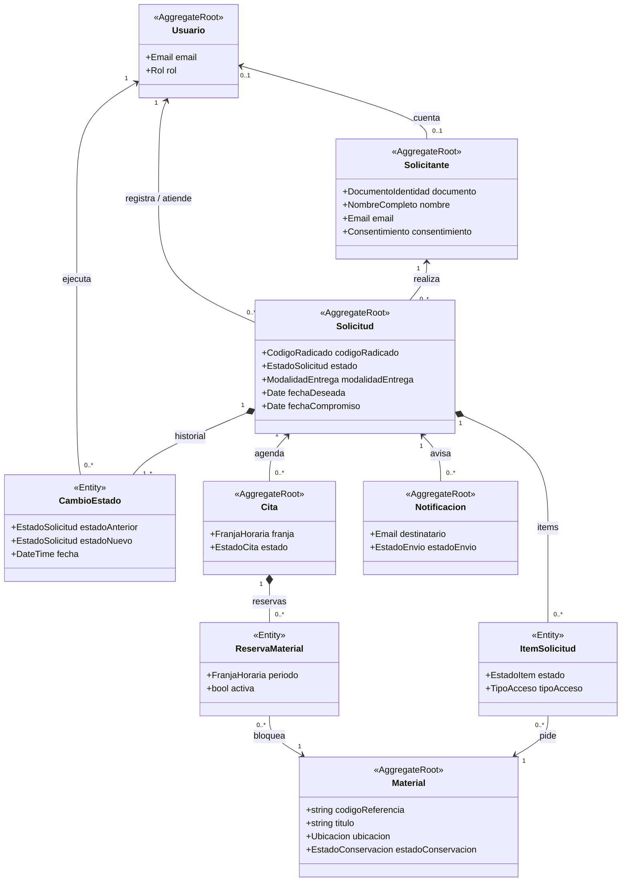
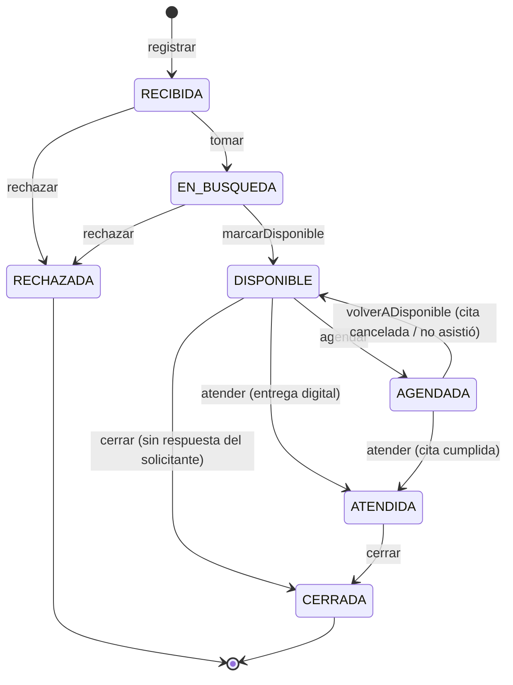
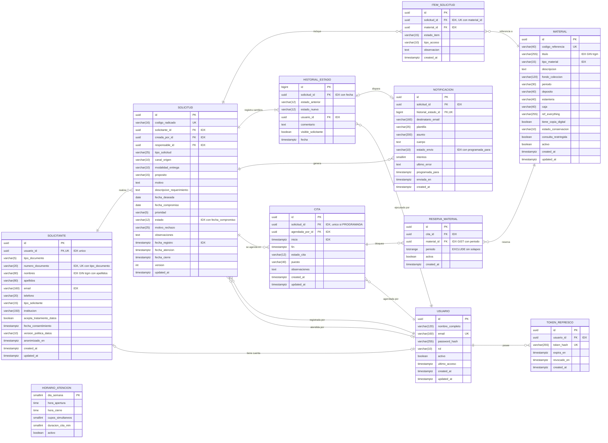

# Modelo de datos

## 1. Modelo de dominio

Lenguaje común y reglas de negocio del módulo. Es la base de la capa de dominio del backend. Las secciones 2 a 6 describen cómo se guarda en PostgreSQL.

### 1.1 Entidades y objetos de valor

Notación: `<<AggregateRoot>>` es la raíz de un agregado (se guarda completa) y `<<Entity>>` es una parte interna. El rombo indica composición y la flecha, una referencia por id. Solo se muestran los atributos clave.

| Entidad | Qué es | Tabla(s) |
|---|---|---|
| **Solicitud** | Pedido de consulta, búsqueda o copia, identificado por un radicado. Contiene sus **ítems** (materiales pedidos y el resultado de buscarlos) y su **historial** de cambios de estado. | `solicitud`, `item_solicitud`, `historial_estado` |
| **Solicitante** | Persona que pide. Puede no tener cuenta, si la solicitud la registró el personal. | `solicitante` |
| **Material** | Pieza del acervo (documento, expediente, periódico, fotografía…) con ubicación física y estado de conservación. | `material` |
| **Cita** | Franja para consultar el material en la sala. Contiene las **reservas** de cada material físico. | `cita`, `reserva_material` |
| **Usuario** | Cuenta con rol `ADMIN`, `PERSONAL` o `PUBLICO`. | `usuario`, `token_refresco` |
| **Notificación** | Correo que recibe el solicitante en cada cambio de estado. | `notificacion` |
| *(configuración)* | Horario de atención y cupos de la sala. | `horario_atencion` |

| Objeto de valor | Regla |
|---|---|
| `CodigoRadicado` | Formato `SOL-AAAA-NNNNN`. Lo genera el sistema y no cambia. |
| `FranjaHoraria` | `fin > inicio`. Dos franjas chocan si `a.inicio < b.fin` y `b.inicio < a.fin`. |
| `Ubicacion` | Depósito, estantería y caja. |
| `DocumentoIdentidad` | Tipo (CC, CE, TI, PAS, NIT) más número. Único por persona. |
| `NombreCompleto`, `Email` | Nombre no vacío y correo con formato válido. |
| `Consentimiento` | Aceptación del aviso de privacidad, con fecha y versión (Ley 1581). |

### 1.2 Relaciones

| Relación | Cardinalidad |
|---|---|
| Solicitante – Solicitud | 1 : N |
| Solicitud – Material (a través de los ítems) | N : M |
| Solicitud – CambioEstado | 1 : N (siempre al menos uno) |
| Solicitud – Cita | 1 : N (solo una cita `PROGRAMADA` a la vez) |
| Cita – Material (a través de las reservas) | N : M |
| Solicitud – Notificación | 1 : N |
| Usuario – Solicitud | 1 : N (quién la registra y quién es el responsable) |
| Usuario – CambioEstado / Cita | 1 : N (quién ejecuta el cambio y quién agenda la cita) |
| Usuario – Solicitante | 0..1 : 0..1 |

### 1.3 Estados de la solicitud y transiciones

| Transición | Condición |
|---|---|
| → `RECIBIDA` | El solicitante dio su consentimiento. La fecha deseada es ≥ hoy + el plazo mínimo. |
| `RECIBIDA` → `EN_BUSQUEDA` | Se asignan un responsable y una fecha compromiso. |
| `RECIBIDA` / `EN_BUSQUEDA` → `RECHAZADA` | Motivo obligatorio. |
| `EN_BUSQUEDA` → `DISPONIBLE` | Al menos un material, y todos localizados. |
| `DISPONIBLE` → `AGENDADA` | La entrega es presencial y hay una cita programada. |
| `DISPONIBLE` → `ATENDIDA` | La entrega es digital. |
| `AGENDADA` → `ATENDIDA` | La cita se cumplió. |
| `AGENDADA` → `DISPONIBLE` | La cita se canceló o el solicitante no asistió. Se liberan las reservas. |
| `DISPONIBLE` / `ATENDIDA` → `CERRADA` | Cierre manual, o automático después de N días. |

- Cualquier otra transición se rechaza (HTTP 409). `CERRADA` y `RECHAZADA` son estados finales.
- Cada transición deja un **cambio de estado inmutable** (quién, cuándo y comentario) y genera una **notificación** al solicitante.

### 1.4 Sin dobles reservas de material

Un material físico **no puede tener dos reservas activas con franjas que se solapen**. Se controla en tres niveles:

1. **Dominio:** `FranjaHoraria.seSolapaCon()` define qué es un choque.
2. **Caso de uso `AgendarCita`:** antes de guardar, revisa las reservas existentes. Si hay choque, lanza `MaterialNoDisponible` (HTTP 409).
3. **Base de datos:** `EXCLUDE USING gist (material_id WITH =, periodo WITH &&) WHERE (activa)` frena las peticiones simultáneas.

Además:

- Solo se reserva el material de acceso físico.
- No se reserva material restringido ni en estado `CRITICO`.
- Cancelar la cita o registrar una inasistencia libera las reservas.

### 1.5 Otras reglas

- Las citas deben caer dentro del horario de atención y no pueden superar los cupos de la sala.
- Los datos de una solicitud solo se pueden editar mientras está en `RECIBIDA`.
- Una solicitud está **vencida** si pasó su fecha compromiso y no está atendida, cerrada ni rechazada.
- El usuario público solo ve sus propias solicitudes.
- El solicitante debe tener correo **o** teléfono. Eliminar su cuenta anonimiza sus datos, pero no borra sus solicitudes.

## 2. Diagrama entidad-relación

Leyenda: `PK` clave primaria · `FK` clave foránea · `UK` valor único · `IDX` columna con índice (ver §4).

Decisiones principales:

- Las enumeraciones son `varchar` con `CHECK`. Las PK son `uuid`, salvo el historial, que usa `bigint`.
- `historial_estado` solo admite `INSERT`. Es la auditoría y la base del reporte de tiempos de atención.
- `reserva_material.periodo` tiene una restricción `EXCLUDE USING gist`, así que la base de datos impide las dobles reservas.
- Ninguna FK borra en cascada. Las solicitudes nunca se borran; los datos personales se anonimizan (§6).

## 3. Descripción de tablas

Todas las columnas son `NOT NULL` salvo las marcadas `NULL`. Las tablas de negocio tienen además `created_at` y `updated_at` (`timestamptz DEFAULT now()`), que no se listan.

### usuario

| Columna | Tipo | Restricciones | Descripción |
|---|---|---|---|
| id | uuid | PK | |
| nombre_completo | varchar(120) | | |
| email | varchar(160) | UK | Correo de inicio de sesión |
| password_hash | varchar(255) | | Hash bcrypt o argon2 |
| rol | varchar(10) | CHECK | `ADMIN`, `PERSONAL`, `PUBLICO` |
| activo | boolean | DEFAULT true | `false` = cuenta desactivada o eliminada |
| ultimo_acceso | timestamptz | NULL | |

### token_refresco

| Columna | Tipo | Restricciones | Descripción |
|---|---|---|---|
| id | uuid | PK | |
| usuario_id | uuid | FK → usuario, IDX | |
| token_hash | varchar(255) | UK | Hash del refresh token, nunca el token en claro |
| expira_en | timestamptz | | |
| revocado_en | timestamptz | NULL | `NULL` = vigente |

### solicitante

| Columna | Tipo | Restricciones | Descripción |
|---|---|---|---|
| id | uuid | PK | |
| usuario_id | uuid | FK → usuario, UK, NULL | Cuenta, si tiene |
| tipo_documento | varchar(5) | CHECK, UK con número | `CC`, `CE`, `TI`, `PAS`, `NIT` |
| numero_documento | varchar(20) | UK con tipo, IDX | Sin puntos ni espacios |
| nombres, apellidos | varchar(80) | IDX trigram | |
| email | varchar(160) | NULL, IDX | Para las notificaciones |
| telefono | varchar(20) | NULL | `CHECK (email IS NOT NULL OR telefono IS NOT NULL)` |
| tipo_solicitante | varchar(15) | CHECK | `INVESTIGADOR`, `ESTUDIANTE`, `DOCENTE`, `CIUDADANO`, `ENTIDAD` |
| institucion | varchar(150) | NULL | |
| acepta_tratamiento_datos | boolean | CHECK = true | Consentimiento (Ley 1581) |
| fecha_consentimiento | timestamptz | | |
| version_politica_datos | varchar(10) | | Versión del aviso aceptado |
| anonimizado_en | timestamptz | NULL | Fecha en que se anonimizó (§6) |

### material

| Columna | Tipo | Restricciones | Descripción |
|---|---|---|---|
| id | uuid | PK | |
| codigo_referencia | varchar(40) | UK | Signatura topográfica |
| titulo | varchar(255) | IDX trigram | |
| tipo_material | varchar(15) | CHECK, IDX | `DOCUMENTO`, `EXPEDIENTE`, `PERIODICO`, `FOTOGRAFIA`, `LIBRO`, `MAPA`, `OTRO` |
| descripcion, fondo_coleccion, periodo | text / varchar | NULL | Datos descriptivos |
| deposito, estanteria, caja | varchar(40) | NULL | Ubicación física |
| ref_everything | varchar(255) | NULL | Ruta o identificador del documento en *Everything* |
| tiene_copia_digital | boolean | DEFAULT false | |
| estado_conservacion | varchar(10) | CHECK | `OPTIMO`, `REGULAR`, `CRITICO` (con `CRITICO` no se consulta físicamente) |
| consulta_restringida | boolean | DEFAULT false | Con `true` no se consulta físicamente |
| activo | boolean | DEFAULT true | Baja lógica |

### solicitud

| Columna | Tipo | Restricciones | Descripción |
|---|---|---|---|
| id | uuid | PK | |
| codigo_radicado | varchar(16) | UK | `SOL-AAAA-NNNNN` |
| solicitante_id | uuid | FK → solicitante, IDX | |
| creada_por_id | uuid | FK → usuario, IDX | Quién la registró |
| responsable_id | uuid | FK → usuario, NULL, IDX | Funcionario asignado |
| tipo_solicitud | varchar(25) | CHECK | `CONSULTA_SALA`, `BUSQUEDA_INFORMACION`, `REPRODUCCION` |
| canal_origen | varchar(10) | CHECK | `WEB`, `PRESENCIAL`, `CORREO` |
| modalidad_entrega | varchar(10) | CHECK | `PRESENCIAL`, `DIGITAL` |
| proposito | varchar(15) | CHECK | Investigación, académico, trámite, genealogía… |
| motivo | text | NULL | |
| descripcion_requerimiento | text | | Lo que busca, en palabras del solicitante |
| fecha_deseada | date | | |
| fecha_compromiso | date | NULL, IDX con estado | La fija el personal |
| prioridad | varchar(5) | CHECK, DEFAULT 'MEDIA' | `BAJA`, `MEDIA`, `ALTA` |
| estado | varchar(12) | CHECK, IDX con fecha_compromiso | `RECIBIDA` … `RECHAZADA` (ver §1.3) |
| motivo_rechazo | varchar(25) | NULL, CHECK | Obligatorio solo si `estado = 'RECHAZADA'` |
| observaciones | text | NULL | Notas internas |
| fecha_registro | timestamptz | IDX | Fecha de radicación |
| fecha_atencion, fecha_cierre | timestamptz | NULL | |
| version | int | DEFAULT 1 | Bloqueo optimista |

### item_solicitud

| Columna | Tipo | Restricciones | Descripción |
|---|---|---|---|
| id | uuid | PK | |
| solicitud_id | uuid | FK → solicitud, UK con material_id | |
| material_id | uuid | FK → material, IDX | Base del reporte de material más solicitado |
| estado_item | varchar(15) | CHECK | `PENDIENTE`, `LOCALIZADO`, `NO_LOCALIZADO`, `NO_APTO` |
| tipo_acceso | varchar(10) | CHECK | `FISICO`, `DIGITAL` (solo `FISICO` se reserva) |
| observacion | text | NULL | |

### historial_estado

| Columna | Tipo | Restricciones | Descripción |
|---|---|---|---|
| id | bigint | PK (identity) | |
| solicitud_id | uuid | FK → solicitud, IDX con fecha | |
| estado_anterior | varchar(12) | NULL | `NULL` en la creación |
| estado_nuevo | varchar(12) | CHECK | |
| usuario_id | uuid | FK → usuario, IDX | Quién hizo el cambio |
| comentario | text | NULL | Obligatorio al rechazar |
| visible_solicitante | boolean | DEFAULT true | |
| fecha | timestamptz | DEFAULT now() | |

### cita

| Columna | Tipo | Restricciones | Descripción |
|---|---|---|---|
| id | uuid | PK | |
| solicitud_id | uuid | FK → solicitud, IDX | Único entre las citas `PROGRAMADA` |
| agendada_por_id | uuid | FK → usuario, IDX | |
| inicio | timestamptz | IDX | Vista de calendario |
| fin | timestamptz | CHECK fin > inicio | |
| estado_cita | varchar(12) | CHECK | `PROGRAMADA`, `CUMPLIDA`, `CANCELADA`, `NO_ASISTIO` |
| puesto, observaciones | varchar / text | NULL | |

### reserva_material

| Columna | Tipo | Restricciones | Descripción |
|---|---|---|---|
| id | uuid | PK | |
| cita_id | uuid | FK → cita, IDX | |
| material_id | uuid | FK → material | |
| periodo | tstzrange | EXCLUDE gist con material_id | Franja de la cita. **Impide las dobles reservas** |
| activa | boolean | DEFAULT true | `false` al cancelar la cita o si el solicitante no asiste |

### notificacion

| Columna | Tipo | Restricciones | Descripción |
|---|---|---|---|
| id | uuid | PK | |
| solicitud_id | uuid | FK → solicitud, IDX | |
| historial_estado_id | bigint | FK → historial_estado, UK, NULL | Cambio que la disparó |
| destinatario_email | varchar(160) | | |
| plantilla, asunto, cuerpo | varchar / text | | Contenido del correo |
| estado_envio | varchar(10) | CHECK, IDX con programada_para | `PENDIENTE`, `ENVIADA`, `FALLIDA` |
| intentos | smallint | DEFAULT 0 | Reintentos |
| ultimo_error | text | NULL | |
| programada_para | timestamptz | | |
| enviada_en | timestamptz | NULL | |

### horario_atencion

| Columna | Tipo | Restricciones | Descripción |
|---|---|---|---|
| dia_semana | smallint | PK, CHECK 1–7 | 1 = lunes |
| hora_apertura, hora_cierre | time | CHECK cierre > apertura | |
| cupos_simultaneos | smallint | CHECK > 0 | Citas a la misma hora |
| duracion_cita_min | smallint | DEFAULT 60 | |
| activo | boolean | DEFAULT true | |

## 4. Índices

Las PK y las UK crean su índice automáticamente. Las FK se indexan a mano.

| Tabla | Columna(s) | Motivo (búsqueda, filtro, etc.) |
|---|---|---|
| usuario | email (UK) | Inicio de sesión |
| token_refresco | usuario_id | Revocar las sesiones de un usuario |
| solicitante | (tipo_documento, numero_documento) (UK), numero_documento, email | Buscar a la persona en el registro asistido sin duplicarla |
| solicitante | GIN trigram (nombres, apellidos) | Búsqueda por nombre con errores de escritura |
| material | codigo_referencia (UK), GIN trigram (titulo), tipo_material | Buscar material para agregarlo a una solicitud |
| solicitud | codigo_radicado (UK) | Consulta por radicado |
| solicitud | (estado, fecha_compromiso) | Bandeja de trabajo y solicitudes vencidas |
| solicitud | solicitante_id, responsable_id, creada_por_id | «Mis solicitudes», «asignadas a mí» |
| solicitud | fecha_registro | Listados y reportes por periodo |
| item_solicitud | material_id | Reporte de material más solicitado |
| historial_estado | (solicitud_id, fecha), usuario_id | Línea de tiempo y tiempos de atención |
| cita | inicio | Calendario por rango de fechas |
| cita | solicitud_id (único parcial `WHERE estado_cita = 'PROGRAMADA'`), agendada_por_id | Una sola cita vigente por solicitud |
| reserva_material | GiST (material_id, periodo), cita_id | Disponibilidad del material y liberar reservas |
| notificacion | (estado_envio, programada_para), solicitud_id | Proceso de envío de correos |

## 5. Migraciones y datos semilla

- **Migraciones:**
  - Van en `backend/src/infrastructure/persistence/migrations/` y se nombran `<timestamp>-<Accion>.ts` (CLI de TypeORM). Cada una tiene su `down()`.
  - `synchronize: false` fuera del entorno local. Una migración que ya está en `main` no se edita: se crea otra.
  - El contenedor del backend corre `migration:run` al arrancar.
  - Orden: extensiones → usuario y token → solicitante → material → solicitud e ítems → historial → cita y reservas → notificación → horario → vistas de reportes.
- **Semillas:**
  - Van en `backend/src/infrastructure/persistence/seeds/` y se ejecutan con `npm run seed`. Son idempotentes.
  - Contenido: 1 admin, 2 funcionarios, 4 usuarios públicos, 10 solicitantes, 30 materiales, 20 solicitudes repartidas en todos los estados y 8 citas.
  - Las contraseñas salen de variables de entorno.
  - Datos **ficticios**, con correos `@example.com`. No usar datos reales del CLENA sin autorización escrita.

## 6. Datos personales (Ley 1581 de 2012)

| Dato | Por qué se guarda |
|---|---|
| Documento (tipo y número) | Identificar a la persona en la atención presencial y evitar duplicados |
| Nombres y apellidos | Atender al solicitante |
| Correo **o** teléfono (al menos uno) | Avisar los cambios de estado y contactar a la persona |
| Tipo de solicitante e institución | Estadísticas del servicio (la institución es opcional) |
| Contraseña (solo el hash) | Acceso al sistema |
| Consentimiento (fecha y versión) | Prueba de la autorización del titular |

No se piden datos sensibles.

**Protección:**

- Aviso de privacidad y casilla de aceptación sin marcar.
- Acceso según el rol.
- Contraseñas y tokens guardados como hash.
- Logs sin datos personales.
- HTTPS.

**Eliminar la cuenta:** `DELETE /api/v1/me` anonimiza en una sola transacción:

1. Cierra las solicitudes en curso y libera sus reservas.
2. Reemplaza nombre, documento, correo y teléfono por valores neutros y marca `anonimizado_en`.
3. Desactiva el usuario y revoca sus tokens.
4. Borra el correo y el cuerpo de sus notificaciones.

Las solicitudes se conservan sin datos que identifiquen a la persona, para no perder las estadísticas.
