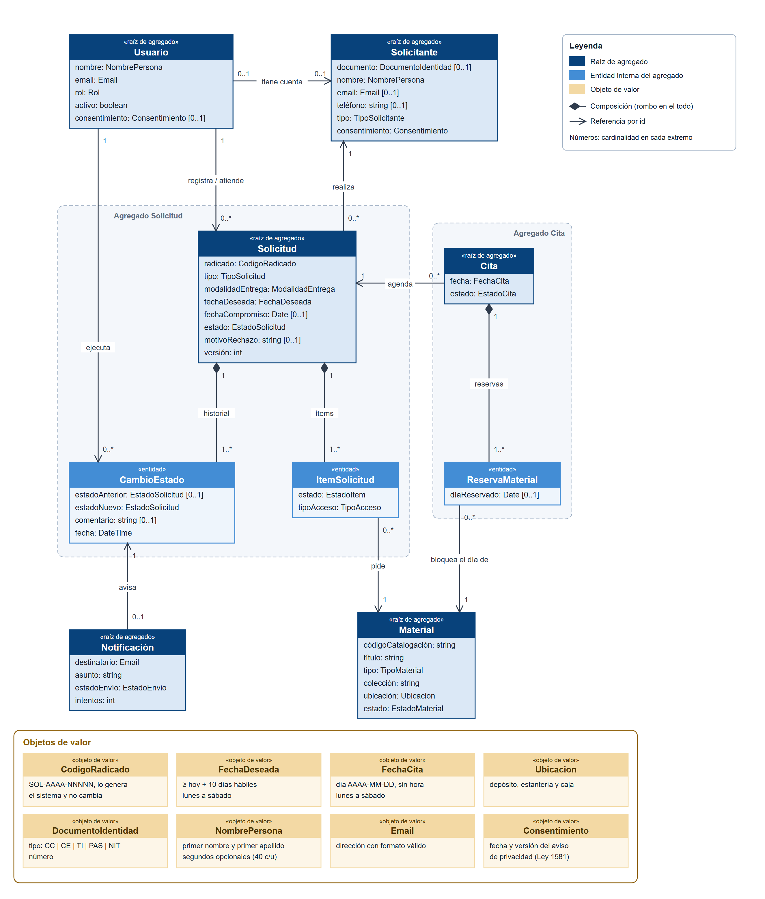
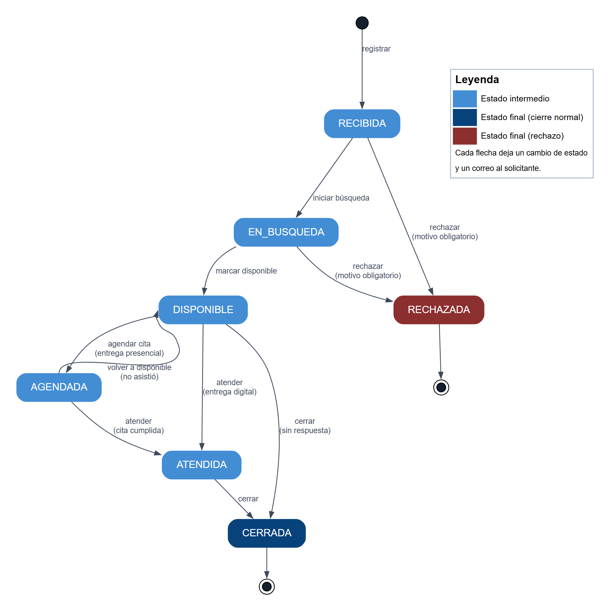

# Modelo de dominio

> La versión entregable de este documento es `docs/modelo-dominio.pdf`, con portada, índice y páginas numeradas. Las tablas que guardan este modelo están en `docs/modelo-datos.md`.

## 1. Introducción

Trackhive es el sistema con el que el CLENA recibe las solicitudes de consulta de su archivo, sigue su estado, controla la disponibilidad del material y agenda las citas de consulta.

Este documento fija el lenguaje común del equipo y del CLENA: qué entidades existen, qué reglas cumplen, qué palabras usamos y qué acciones del negocio hace el sistema. Es la base de la capa de dominio del backend (`backend/src/*/domain/`).

Las figuras son imágenes exportadas a `docs/img/`. Cada regla y cada caso de uso indican la historia de usuario (HU) que los cubre y si ya están implementados o siguen previstos.

## 2. Diagrama de clases

**Figura 1.** Diagrama de clases del dominio de Trackhive.

Leyenda: azul oscuro, raíz de agregado; azul, entidad interna de un agregado; ocre, objeto de valor; recuadro punteado, límite del agregado. El rombo relleno indica composición (la parte no existe sin el todo y se guarda con él). La flecha abierta indica una referencia por id entre agregados. Los números en los extremos son las cardinalidades. Solo se muestran los atributos que importan al negocio.

### 2.1 Entidades

| Entidad | Qué es | Agregado |
|---|---|---|
| **Solicitud** | Pedido de consulta de material del archivo, identificado por un radicado. Guarda la modalidad de entrega, la fecha deseada, la fecha compromiso, el estado y, si se rechazó, el motivo. | Solicitud (raíz) |
| **ItemSolicitud** | Cada material pedido en una solicitud, con el resultado de buscarlo y su tipo de acceso (físico o digital). | Solicitud |
| **CambioEstado** | Registro inmutable de un cambio de estado de la solicitud: estado anterior, estado nuevo, quién lo hizo, cuándo y comentario. | Solicitud |
| **Solicitante** | Persona que pide la consulta. Puede no tener cuenta, si la solicitud la registró el personal. | Solicitante (raíz) |
| **Material** | Pieza del acervo (documento, periódico, protocolo notarial u otro) con su ubicación física y su estado de disponibilidad. | Material (raíz) |
| **Cita** | Día completo en que el solicitante consulta el material en la sala, sin hora. | Cita (raíz) |
| **ReservaMaterial** | Reserva de un material para el día de la cita. Se libera al cumplirse la cita o al registrar la inasistencia. | Cita |
| **Usuario** | Cuenta para entrar al sistema, con rol `ADMIN`, `PERSONAL` o `PUBLICO`. | Usuario (raíz) |
| **Notificación** | Correo al solicitante que dispara un cambio de estado. Se envía y reintenta aparte del cambio. | Notificación (raíz) |

### 2.2 Objetos de valor

Un objeto de valor no tiene identidad propia: vale por su contenido y es inmutable.

| Objeto de valor | Regla |
|---|---|
| `CodigoRadicado` | Formato `SOL-AAAA-NNNNN`. Lo genera el sistema al registrar la solicitud y no cambia. |
| `FechaDeseada` | Día `AAAA-MM-DD` al menos 10 días hábiles después de hoy (hora de Bogotá), de lunes a sábado. Los festivos cuentan como hábiles. |
| `FechaCita` | Día `AAAA-MM-DD` de lunes a sábado. La cita es por día completo, sin hora: lunes a viernes de 8:00 a 17:00 y sábados de 9:00 a 13:00. |
| `Ubicacion` | Depósito, estantería y caja donde está el material. |
| `DocumentoIdentidad` | Tipo (`CC`, `CE`, `TI`, `PAS`, `NIT`) más número. Único por persona. |
| `NombrePersona` | Primer nombre y primer apellido obligatorios; segundo nombre y segundo apellido opcionales. Máximo 40 caracteres cada uno. Igual en `Usuario` y `Solicitante`. |
| `Email` | Correo con formato válido. |
| `Consentimiento` | Aceptación del aviso de privacidad, con fecha y versión (Ley 1581 de 2012). |

Los estados (`EstadoSolicitud`, `EstadoMaterial`, `EstadoCita`, `EstadoItem`, `EstadoEnvio`) y los tipos (`Rol`, `TipoMaterial`, `TipoSolicitud`, `ModalidadEntrega`, `TipoAcceso`, `TipoSolicitante`) son enumeraciones con valores cerrados.

## 3. Relaciones

| Relación | Cardinalidad |
|---|---|
| Solicitante – Solicitud | 1 : N |
| Solicitud – ItemSolicitud (composición) | 1 : 1..N |
| Material – ItemSolicitud | 1 : N (así una solicitud pide N materiales y un material está en N solicitudes) |
| Solicitud – CambioEstado (composición) | 1 : 1..N (el registro inicial cuenta) |
| Solicitud – Cita | 1 : N (solo una cita `PROGRAMADA` a la vez) |
| Cita – ReservaMaterial (composición) | 1 : 1..N |
| Material – ReservaMaterial | 1 : N (como máximo una reserva por material y día) |
| CambioEstado – Notificación | 1 : 0..1 |
| Usuario – Solicitante | 0..1 : 0..1 |
| Usuario – Solicitud | 1 : N (quién la registra y quién la atiende) |
| Usuario – CambioEstado | 1 : N (quién hizo el cambio) |

## 4. Estados de la solicitud

**Figura 2.** Diagrama de estados de la solicitud.

Leyenda: azul, estado intermedio; azul oscuro, cierre normal; rojo, rechazo; círculo negro, inicio; círculo con borde, fin. Cada flecha es una acción del personal, salvo «registrar», que hace el solicitante o el personal.

| Transición | Condición |
|---|---|
| → `RECIBIDA` | Se pidió al menos un material y la fecha deseada cumple su regla. El usuario público ya aceptó el aviso de privacidad al crear su cuenta. |
| `RECIBIDA` → `EN_BUSQUEDA` | El personal empieza a buscar el material. |
| `RECIBIDA` / `EN_BUSQUEDA` → `RECHAZADA` | Motivo obligatorio, que el solicitante lee en «Mis solicitudes» y en el correo. |
| `EN_BUSQUEDA` → `DISPONIBLE` | El personal localizó el material. |
| `DISPONIBLE` → `AGENDADA` | La entrega es presencial. Solo se llega agendando la cita, no desde «Cambiar estado». |
| `DISPONIBLE` → `ATENDIDA` | La entrega es digital. |
| `AGENDADA` → `ATENDIDA` | La cita se cumplió: pasa a `CUMPLIDA` y el material queda libre ese día. |
| `AGENDADA` → `DISPONIBLE` | El solicitante no asistió: la cita pasa a `NO_ASISTIO` y el material queda libre ese día. |
| `DISPONIBLE` / `ATENDIDA` → `CERRADA` | Cierre manual por el personal. |

Cualquier otra transición se rechaza con HTTP 409. `CERRADA` y `RECHAZADA` son estados finales. La regla vive en la entidad `Request` (`backend/src/requests/domain/entities/request.entity.ts`).

## 5. Reglas de negocio

Escritas como las diría el CLENA. «Vigente» significa que el sistema ya la hace cumplir; «prevista», que está en el backlog.

### 5.1 Solicitudes

| # | Regla | HU | Estado |
|---|---|---|---|
| RN-01 | Toda solicitud recibe un número de radicado que no cambia y sirve para consultarla. | HU-09 | Vigente |
| RN-02 | Nadie crea una cuenta sin aceptar el aviso de privacidad. Cuando el personal registra a alguien sin cuenta, hoy el sistema guarda la aceptación sin preguntarle: recogerla está pendiente. | HU-31 | Vigente |
| RN-03 | La fecha en que se quiere consultar el material debe estar al menos 10 días hábiles adelante y no puede ser domingo. | HU-09 | Vigente |
| RN-04 | Una solicitud debe pedir al menos un material del catálogo. | HU-09 | Vigente |
| RN-05 | El personal puede registrar una solicitud a nombre de quien llega en persona o escribe por correo; el solicitante debe tener un correo para recibir los avisos. | HU-10 | Vigente |
| RN-06 | Una solicitud solo avanza por los pasos de la figura 2; no se puede saltar ni devolver a un paso anterior, salvo volver a disponible cuando el solicitante no asiste. | HU-14 | Vigente |
| RN-07 | Una solicitud rechazada siempre lleva el motivo, porque el solicitante lo lee. | HU-16 | Vigente |
| RN-08 | Las solicitudes cerradas o rechazadas ya no cambian. | HU-14 | Vigente |
| RN-09 | Cada cambio de estado queda en el historial con quién lo hizo, cuándo y su comentario, y ese historial no se puede borrar ni corregir. | HU-15 | Vigente |
| RN-10 | En cada cambio de estado el solicitante recibe un correo. Si el correo falla, el cambio no se pierde y el correo se reintenta. | HU-23 | Vigente |
| RN-11 | El usuario público solo ve sus propias solicitudes. | HU-11 | Vigente |

### 5.2 Material y citas

| # | Regla | HU | Estado |
|---|---|---|---|
| RN-12 | La ubicación física del material (depósito, estantería y caja) solo la ve el personal. | HU-07 | Vigente |
| RN-13 | Un material en restauración o no consultable no puede agendarse. | HU-20 | Vigente |
| RN-14 | Un material no puede reservarse dos veces el mismo día. | HU-20 | Vigente |
| RN-15 | Solo se agenda cita a una solicitud disponible con entrega presencial, y solo puede tener una cita programada a la vez. | HU-18 | Vigente |
| RN-16 | La cita es por día completo, de lunes a sábado: el CLENA no atiende los domingos. | HU-18 | Vigente |
| RN-17 | Cuando la cita se cumple o el solicitante no asiste, el material queda libre para ese día. | HU-20 | Vigente |
| RN-18 | Que un material esté en uso no impide agendarlo para otro día: «en uso» solo aplica el día en que está en la sala. Registrar cuándo sale a la sala y cuándo vuelve llega con HU-72. | HU-20 | Vigente |
| RN-19 | La sala no recibe más citas en un día que su capacidad diaria. | HU-20.1 | Prevista |
| RN-20 | Una cita se puede reprogramar o cancelar; al cancelarla, el material queda libre. | HU-21 | Prevista |

### 5.3 Usuarios y datos personales

| # | Regla | HU | Estado |
|---|---|---|---|
| RN-21 | Cada persona entra con su correo y su contraseña; la contraseña nunca se guarda en claro. | HU-01, HU-02 | Vigente |
| RN-22 | Solo el personal y el administrador atienden solicitudes, cambian estados y agendan citas. | HU-04 | Vigente |
| RN-23 | El solicitante debe dejar un correo o un teléfono para contactarlo. | HU-10 | Vigente |
| RN-24 | Quien elimina su cuenta deja de ser identificable, pero sus solicitudes se conservan para las estadísticas. | HU-33 | Prevista |

## 6. Glosario

| Término | Significado |
|---|---|
| **Acervo** | Conjunto del material que custodia el archivo del CLENA. |
| **Agendar** | Fijar el día en que el solicitante consulta el material en la sala. Lleva la solicitud a `AGENDADA`. |
| **Aviso de privacidad** | Texto que explica qué datos personales se piden y para qué. Aceptarlo es el consentimiento de la Ley 1581. |
| **Bandeja de solicitudes** | Pantalla del personal con todas las solicitudes, sus filtros y su orden. |
| **Cita** | Día completo reservado para que el solicitante consulte el material en la sala, sin hora. |
| **Código de catalogación** | Identificador único del material en el catálogo del archivo. |
| **Doble reserva** | Dos citas del mismo material el mismo día. El sistema la impide. |
| **Entrega digital** | Modalidad en que el material se entrega sin cita, fuera del sistema, por correo. |
| **Entrega presencial** | Modalidad en que el solicitante consulta el material en la sala, con cita. |
| **Estado de la solicitud** | Paso en que va la solicitud: recibida, en búsqueda, disponible, agendada, atendida, cerrada o rechazada. |
| **Estado del material** | Disponibilidad del material: disponible, en uso, en restauración o no consultable. |
| **Fecha compromiso** | Fecha en que el personal se compromete a responder la solicitud. |
| **Fecha deseada** | Fecha en que el solicitante quiere consultar el material. |
| **Historial de estados** | Lista inmutable de los cambios de estado de una solicitud, con quién y cuándo. |
| **Inasistencia** | El solicitante no fue a su cita. La solicitud vuelve a `DISPONIBLE`. |
| **Material** | Documento, periódico, protocolo notarial u otra pieza del acervo que se puede pedir. |
| **Motivo de rechazo** | Explicación obligatoria que el solicitante lee cuando su solicitud se rechaza. |
| **Personal del CLENA** | Funcionarios que atienden las solicitudes (rol `PERSONAL`). |
| **Radicado** | Número único de la solicitud (`SOL-AAAA-NNNNN`) para consultarla. |
| **Sala de consulta** | Lugar del CLENA donde el solicitante revisa el material el día de su cita. |
| **Solicitante** | Persona que pide la consulta: investigador, estudiante, docente, ciudadano o entidad. |
| **Solicitud** | Pedido de consulta de uno o más materiales del archivo. |
| **Ubicación** | Depósito, estantería y caja donde se guarda el material. |
| **Usuario público** | Persona registrada que hace sus propias solicitudes (rol `PUBLICO`). |

## 7. Casos de uso

Uno por acción del negocio. Cada caso de uso es una clase con un método `execute` en la capa de aplicación (`backend/src/*/application/use-cases/`). La columna «Clase» indica la clase que lo implementa hoy.

### 7.1 Implementados

| Caso de uso | Acción del negocio | Actor | HU | Clase |
|---|---|---|---|---|
| `RegistrarUsuario` | Crear una cuenta pública aceptando el aviso de privacidad | Usuario público | HU-01 | `CreateUserUseCase` |
| `IniciarSesion` | Entrar con correo y contraseña | Todos | HU-02 | `LoginUseCase` |
| `RenovarSesion` | Obtener un token nuevo sin volver a escribir la contraseña | Todos | HU-03 | `RefreshSessionUseCase` |
| `CerrarSesion` | Salir y revocar la sesión | Todos | HU-03 | `LogoutUseCase` |
| `BuscarMaterial` | Buscar material por texto, tipo, colección y estado | Todos | HU-07 | `SearchMaterialsUseCase` |
| `CambiarEstadoMaterial` | Marcar un material como disponible, en uso, en restauración o no consultable | Personal | HU-08 | `ChangeMaterialStatusUseCase` |
| `RegistrarSolicitud` | Pedir la consulta de uno o más materiales | Usuario público | HU-09 | `CreateRequestUseCase` |
| `BuscarSolicitante` | Encontrar al solicitante por su correo antes de registrar a su nombre | Personal | HU-10 | `FindRequesterByEmailUseCase` |
| `RegistrarSolicitudANombreDe` | Registrar una solicitud por quien llega en persona o por correo | Personal | HU-10 | `CreateRequestOnBehalfUseCase` |
| `ConsultarMisSolicitudes` | Ver mis solicitudes y su estado | Usuario público | HU-11 | `ListMyRequestsUseCase` |
| `ListarSolicitudes` | Ver la bandeja con filtros, orden y paginación | Personal | HU-12 | `ListRequestsUseCase` |
| `VerDetalleSolicitud` | Ver una solicitud con sus materiales y las transiciones permitidas | Personal | HU-13 | `GetRequestDetailUseCase` |
| `CambiarEstadoSolicitud` | Avanzar la solicitud, o rechazarla con motivo | Personal | HU-15, HU-16 | `ChangeRequestStatusUseCase` |
| `AgendarCita` | Reservar el día de consulta sin dobles reservas | Personal | HU-18, HU-20 | `ScheduleAppointmentUseCase` |
| `ConsultarCalendario` | Ver las citas por mes y filtrar por material | Personal | HU-19 | `ListAppointmentsUseCase` |
| `NotificarCambioEstado` | Enviar y reintentar los correos de cambio de estado | Sistema | HU-23 | `SendPendingNotificationsUseCase` |
| `EnviarCorreoPrueba` | Comprobar la configuración del correo | Administrador | HU-22 | `SendTestEmailUseCase` |

Hay dos casos de uso técnicos que no son acciones del negocio: `GetHealthUseCase` (estado del servicio, HU-38) y `PurgeExpiredTokensUseCase` (limpieza diaria de sesiones vencidas, HU-3.1).

### 7.2 Previstos

| Caso de uso | Acción del negocio | Actor | HU |
|---|---|---|---|
| `GestionarFuncionarios` | Crear, editar y desactivar cuentas del personal | Administrador | HU-05 |
| `RegistrarMaterial` | Agregar material consultable al catálogo | Personal | HU-06 |
| `ConsultarHistorialEstados` | Ver la línea de tiempo de los cambios de una solicitud | Personal, usuario público | HU-17 |
| `ConfigurarCapacidadSala` | Fijar cuántas citas recibe la sala por día | Administrador | HU-20.1 |
| `ReprogramarCita` | Mover la cita a otro día, sin dobles reservas | Personal | HU-21 |
| `CancelarCita` | Cancelar la cita y liberar el material | Personal | HU-21 |
| `GenerarReporteTiemposAtencion` | Medir cuánto tarda cada estado de la solicitud | Personal | HU-25 |
| `GenerarReporteMaterialMasSolicitado` | Ver qué material se pide más | Personal | HU-26 |
| `ExportarReporte` | Descargar un reporte | Personal | HU-27 |
| `EliminarMiCuenta` | Borrar la cuenta y anonimizar los datos personales | Usuario público | HU-33 |
| `RegistrarEntregaMaterial` | Anotar que el material salió a la sala | Personal | HU-72 |
| `RegistrarDevolucionMaterial` | Anotar que el material volvió a su ubicación | Personal | HU-72 |
