# Pantallas principales de Trackhive

**HU-152 · Segunda entrega de HU-46 · Revisión documental 3.0 · 19 de noviembre de 2026**

**Estado: borradores preparados; revisión y validación de G6 pendientes.** El
equipo indicó que todavía no hay comentarios de G6 sobre estas pantallas. No
se registra aprobación, reunión ni firma que no haya ocurrido.

Estos wireframes son referencias de estructura, navegación, campos y estados;
no son diseños visuales finales ni bloquean ninguna HU. Las pantallas existentes
se pueden contrastar con ellos y las futuras ajustarse después de la revisión.
Esta entrega no agrega rutas, endpoints, permisos ni funciones a la aplicación.
Todos los nombres, correos, radicados, fechas y cantidades son ficticios.

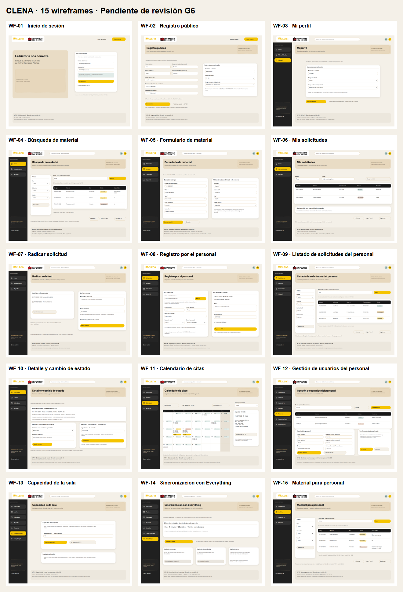

La vista general sirve como índice visual. Más abajo se incluye cada boceto a
tamaño completo, junto con sus archivos importables en Figma.

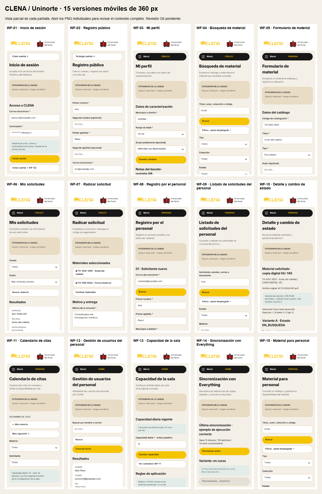

El índice móvil recorta las miniaturas por altura. Cada PNG individual incluye todo el contenido desplazable.

## Cómo ver y editar los bocetos

Cada pantalla incluye un PNG y un SVG vectorial de escritorio (1920 px), y otro par de archivos con una composición móvil independiente de **360 px**. La altura móvil varía para representar el desplazamiento vertical; no se reduce el escritorio. Los SVG son bocetos estáticos, no prototipos interactivos.
Para revisarla, abrir el PNG; para trabajar en Figma, arrastrar el SVG al lienzo
o usar la opción de importar. El archivo original de referencia se conserva en
[Figma: CLENA – Dashboard (paleta adaptada)](https://www.figma.com/design/2ZPymk8udllKrGQ9J16jui/Sin-t%C3%ADtulo?node-id=5-2).

### Identidad visual adoptada

Los quince bocetos usan la referencia confirmada por el equipo: fondo crema
`#F4F0E8`, superficies blancas, texto carbón `#171717`, amarillo `#F5C400`,
ocre `#D8B477`, verde azulado `#A9C7C5` y terracota `#A96F55`. Se emplea
Inter, navegación lateral oscura, selección amarilla, tarjetas redondeadas,
sombras suaves, campos con borde ocre y encabezados oscuros de tabla. Login y
registro conservan una composición sin navegación de sesión.

La identidad visual se adapta a los procesos de consulta actuales de Trackhive:
no se sustituyen sus estados por el proceso de adquisiciones de la referencia.
Las fotografías de la ciudad **todavía no se han proporcionado**. Hay espacios
reservados claramente rotulados en cabeceras, acceso y navegación; no se usan
fotografías de terceros ni imágenes inventadas como sustituto.

Los PNG se renderizan con Inter local. La fuente y su licencia oficial se
incluyen en `wireframes/assets/`; los SVG la referencian y declaran Arial como
alternativa cuando un visor no carga fuentes externas.

Para regenerar: `node docs/tools/generar-wireframes.mjs`, seguido de
`node docs/tools/verificar-wireframes.mjs --render`. El inventario está en
[`wireframes/manifest.json`](wireframes/manifest.json). Las modificaciones
reproducibles se hacen en el generador, `wireframe-theme.mjs` y `wireframe-mobile.mjs`; conservar
aparte las ediciones manuales de Figma antes de regenerar las vistas locales.

## Cambios respecto a la primera entrega (HU-46)

La numeración documental anterior era 2.0 por la adaptación a la paleta. **HU-152 es la segunda entrega funcional de los wireframes**, con revisión documental 3.0; no reemplaza ni invalida el alcance cumplido de HU-46.

| Pantallas | Cambio de esta entrega |
|---|---|
| WF-01 a WF-15 | Logos proporcionados de CLENA y Universidad del Norte en cabecera clara, con proporciones y colores conservados. Se sustituyó el rótulo CLENA de texto por su marca. Versiones independientes de escritorio y móvil. |
| WF-01, WF-02 | Coidentidad institucional también en acceso y registro; formulario móvil de una columna y acciones completas. Aviso de privacidad desplegable y aceptación sin marcar antes de crear la cuenta. |
| WF-03 | Datos precargados en una columna y botón Guardar de ancho completo. No se agregan datos personales. |
| WF-04, WF-15 | Buscador, botón de filtros (mostrado abierto para revisar campos), resultados en tarjetas y selección táctil. Se conserva la diferencia público/personal de copia digital. |
| WF-05, WF-07, WF-08 | Paneles apilados en orden de lectura; campos y acciones de ancho completo. Primer nombre y primer apellido separados en WF-08. Modalidad en opciones separadas. Se conserva la reutilización de caracterización. |
| WF-06, WF-09 | Tablas transformadas en tarjetas con etiquetas por dato, estado en texto y paginación; comentarios internos siguen excluidos del público. Polling documentado sin cambios de lógica. |
| WF-10 | Material, copia digital y variantes de estado se presentan una debajo de otra. Las variantes siguen siendo alternativas, no acciones simultáneas. |
| WF-11 | Se actualiza el escritorio a HU-142: tres citas y «+N más», filas iguales y ocupación. En 360 px se dibuja una agenda con todas las citas del día, en vez de un mes reducido. Ejemplos de cercanía y límite separados como leyenda. |
| WF-12 | Se alinea con HU-05 ya implementada: cuatro campos de nombre, correo, contraseña inicial solo al crear y rol PERSONAL fijo. Se completan Guardar y Cancelar edición. No desactivar la propia cuenta ni borrar historial. Formulario y confirmación apilados en móvil. |
| WF-13 | Se alinea con HU-74 ya implementada: capacidad vigente, valor inicial 15, entero positivo y conservación de reservas al reducir el límite. |
| WF-14 | Resultado y variantes de Everything apilados; acción inactiva en curso o desactivada, error con motivo. Solo ADMIN, sin rutas ni credenciales internas. |

### Aplicación de marca y adaptación móvil

Los PNG originales recibidos se conservan en [assets](wireframes/assets/LOGOS.md). La cabecera de escritorio usa las firmas horizontales; la móvil combina CLENA horizontal con el símbolo UN y el nombre de la universidad, sobre fondo blanco. No se recolorean, estiran ni redibujan los logos. Se ajustan composición, escala y márgenes a cada ancho. No se considera aprobada su aplicación institucional hasta la revisión real de G6.

A 360 px: márgenes de 16 px, texto base de 14 px, controles de al menos 44 px, sin desplazamiento horizontal. El menú de sesión se representa cerrado; al implementarlo abrirá un panel con las opciones del rol que ya muestra el escritorio, cierre accesible y retorno de foco. En los buscadores se muestra el filtro desplegado para revisar sus campos. Las notas técnicas y los estados alternativos están separados al final del lienzo; no se convierten en instrucciones para los usuarios de la aplicación. Login y registro no muestran navegación de una sesión iniciada.

Las fotografías de la ciudad siguen pendientes. Se mantienen huecos identificados, sin añadir fotografías inventadas ni de terceros. No se modifica código de la aplicación ni se publica el diseño en Figma. La importación de los SVG es manual.

## Mapa de pantallas y roles

`Sin sesión` significa acceso a registro/login; las pantallas de material
requieren sesión. `PERSONAL / ADMIN` expresa las funciones compartidas del
personal. **Propuesta** identifica una ruta todavía no implementada: su nombre
es orientativo y no constituye un contrato de API o de navegación.

| ID | Pantalla | Quién la ve | Ruta actual o propuesta | HU / estado | Boceto |
|---|---|---|---|---|---|
| WF-01 | Inicio de sesión | Sin sesión | `/login` | HU-02, HU-48 · existente | [Escritorio](wireframes/wf-01-inicio-sesion.png) · [Móvil 360 px](wireframes/wf-01-inicio-sesion-movil.png) |
| WF-02 | Registro público | Sin sesión | `/registro` | HU-01, HU-31, HU-47, HU-73 · existente | [Escritorio](wireframes/wf-02-registro.png) · [Móvil 360 px](wireframes/wf-02-registro-movil.png) |
| WF-03 | Mi perfil | PUBLICO, PERSONAL, ADMIN | `/mi-perfil` | HU-73 · existente | [Escritorio](wireframes/wf-03-mi-perfil.png) · [Móvil 360 px](wireframes/wf-03-mi-perfil-movil.png) |
| WF-04 | Búsqueda de material pública | PUBLICO | `/materiales` | HU-07, HU-50 · existente; indicador HU-140 propuesto | [Escritorio](wireframes/wf-04-busqueda-material.png) · [Móvil 360 px](wireframes/wf-04-busqueda-material-movil.png) |
| WF-05 | Formulario de material | PERSONAL, ADMIN | `/personal/materiales/nuevo` **propuesta** | HU-06, HU-49 · propuesta | [Escritorio](wireframes/wf-05-formulario-material.png) · [Móvil 360 px](wireframes/wf-05-formulario-material-movil.png) |
| WF-06 | Mis solicitudes | PUBLICO | `/mis-solicitudes` | HU-11 · existente | [Escritorio](wireframes/wf-06-mis-solicitudes.png) · [Móvil 360 px](wireframes/wf-06-mis-solicitudes-movil.png) |
| WF-07 | Radicar solicitud | PUBLICO | `/solicitudes/nueva?materiales=…` | HU-09 · existente | [Escritorio](wireframes/wf-07-radicar-solicitud.png) · [Móvil 360 px](wireframes/wf-07-radicar-solicitud-movil.png) |
| WF-08 | Registro de solicitud por personal | PERSONAL, ADMIN | `/personal/solicitudes/nueva?materiales=…` | HU-10, HU-93, HU-73 · existente | [Escritorio](wireframes/wf-08-solicitud-personal.png) · [Móvil 360 px](wireframes/wf-08-solicitud-personal-movil.png) |
| WF-09 | Listado de solicitudes del personal | PERSONAL, ADMIN | `/solicitudes` | HU-12, HU-141 · existente | [Escritorio](wireframes/wf-09-listado-personal.png) · [Móvil 360 px](wireframes/wf-09-listado-personal-movil.png) |
| WF-10 | Detalle y cambio de estado | PERSONAL, ADMIN | `/solicitudes/:id` | HU-13, HU-15, HU-16, HU-18 · existente; HU-140 propuesto | [Escritorio](wireframes/wf-10-detalle-solicitud.png) · [Móvil 360 px](wireframes/wf-10-detalle-solicitud-movil.png) |
| WF-11 | Calendario | PERSONAL, ADMIN | `/calendario` | HU-19, HU-142, HU-74 · existente | [Escritorio](wireframes/wf-11-calendario.png) · [Móvil 360 px](wireframes/wf-11-calendario-movil.png) |
| WF-12 | Gestión de usuarios del personal | ADMIN | `/admin/usuarios` | HU-05 · existente | [Escritorio](wireframes/wf-12-gestion-usuarios.png) · [Móvil 360 px](wireframes/wf-12-gestion-usuarios-movil.png) |
| WF-13 | Capacidad de la sala | ADMIN | `/admin/capacidad-sala` | HU-20.1 / HU-74 · existente | [Escritorio](wireframes/wf-13-capacidad-sala.png) · [Móvil 360 px](wireframes/wf-13-capacidad-sala-movil.png) |
| WF-14 | Sincronización con Everything | ADMIN | `/admin/sincronizacion` **propuesta** | HU-138; depende de HU-137 · propuesta | [Escritorio](wireframes/wf-14-sincronizacion-everything.png) · [Móvil 360 px](wireframes/wf-14-sincronizacion-everything-movil.png) |
| WF-15 | Material para el personal | PERSONAL, ADMIN | `/personal/materiales` | HU-08, HU-109 · existente; HU-06 y HU-140 propuestos | [Escritorio](wireframes/wf-15-material-personal.png) · [Móvil 360 px](wireframes/wf-15-material-personal-movil.png) |

Las rutas existentes se contrastaron con
[`routes.ts`](../frontend/src/routes.ts), [`App.tsx`](../frontend/src/App.tsx)
y [`sections.ts`](../frontend/src/features/navigation/sections.ts). La gestión
de personal y la capacidad se proponen para ADMIN según los casos de uso del
[`modelo de dominio`](modelo-dominio.md). Las rutas de administración se
incorporarán al menú cuando se implementen sus HU; en los bocetos se marcan con
asterisco. Un menú oculto no sustituye a los permisos del backend.

## Navegación

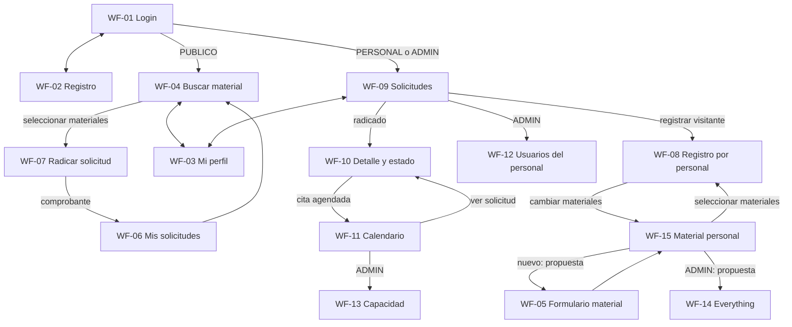

- Al iniciar sesión, PUBLICO llega al buscador y PERSONAL/ADMIN a la bandeja.
- «Mi perfil» está en el menú de cualquier rol autenticado. Tras guardar se
  permanece en el perfil; no se vuelve a pedir caracterización al radicar.
- El buscador público lleva a la solicitud propia; el de personal al registro
  por un visitante. Los materiales elegidos viajan con la navegación.
- PUBLICO no entra al detalle del personal ni al calendario: consulta sus
  solicitudes en WF-06. El backend limita la consulta a su propia cuenta.
- Desde el calendario se abre el detalle; el agendamiento se hace desde una
  solicitud disponible con modalidad presencial.
- La administración de usuarios, capacidad y la propuesta de Everything no se ofrecen a
  PUBLICO ni PERSONAL. Para HU-138, el endpoint declara `@Roles('ADMIN')` y
  responde 403 a esos dos roles, conforme al criterio suministrado.
- Cerrar sesión lleva a WF-01. Una sesión rechazada muestra un enlace al login.

## Bocetos por pantalla

### WF-01 Inicio de sesión

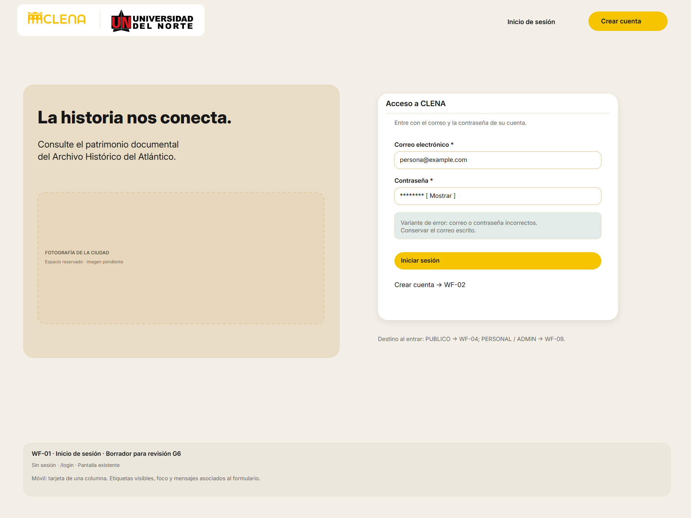

[Escritorio · SVG para Figma](wireframes/wf-01-inicio-sesion.svg) · [Móvil · SVG para Figma](wireframes/wf-01-inicio-sesion-movil.svg).

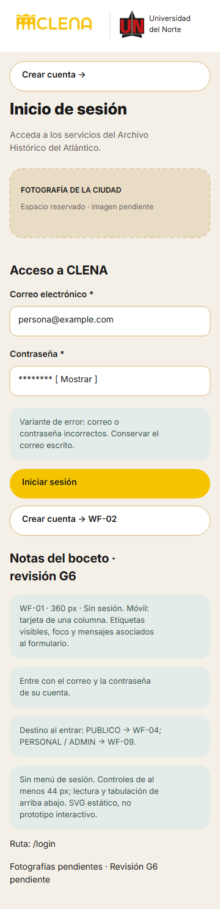

Correo, contraseña con mostrar/ocultar, error de credenciales, acceso a registro
y destino según rol. El error conserva el correo y devuelve el foco al mensaje.

### WF-02 Registro público

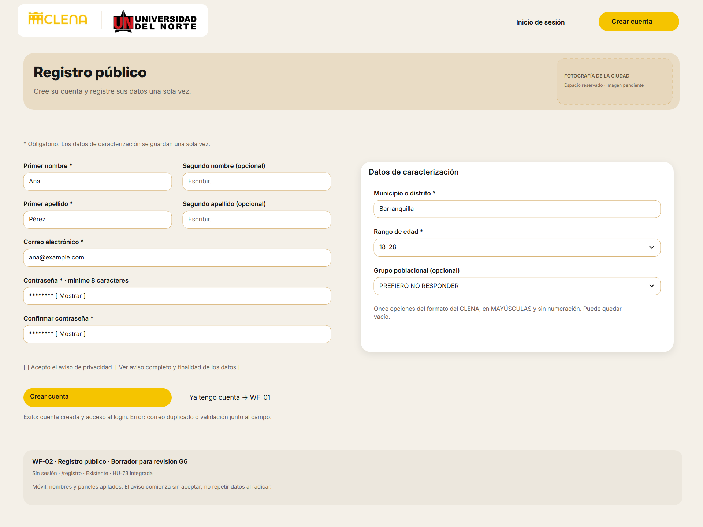

[Escritorio · SVG para Figma](wireframes/wf-02-registro.svg) · [Móvil · SVG para Figma](wireframes/wf-02-registro-movil.svg).

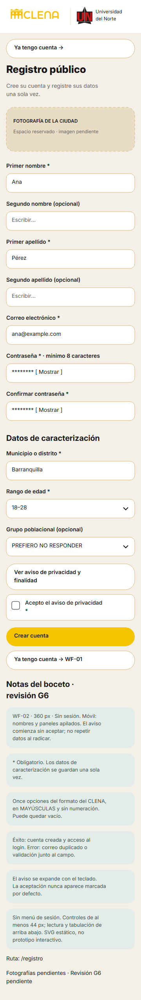

Cuatro campos de nombre, correo, contraseña y confirmación. Municipio/distrito y
rango de edad obligatorios; grupo poblacional opcional, con las once opciones
en mayúsculas y sin numeración, incluida «PREFIERO NO RESPONDER». Aviso de
privacidad desplegable, casilla sin marcar, validaciones y confirmación de cuenta.
La finalidad pendiente de confirmar con CLENA se mantiene en
[`datos-personales.md`](datos-personales.md).

### WF-03 Mi perfil

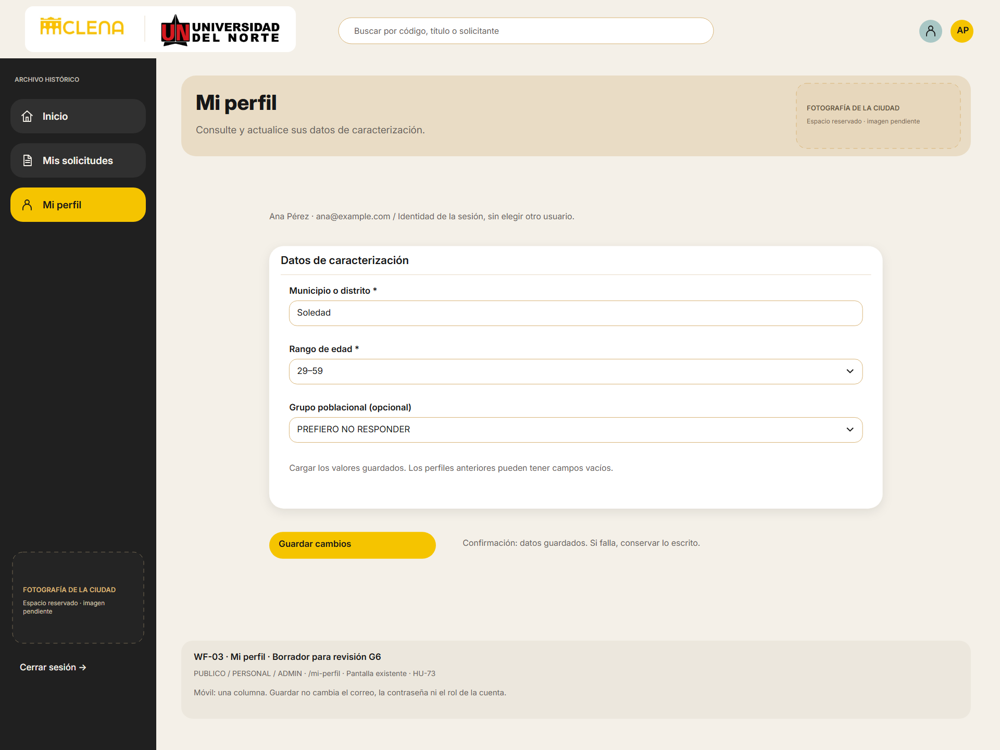

[Escritorio · SVG para Figma](wireframes/wf-03-mi-perfil.svg) · [Móvil · SVG para Figma](wireframes/wf-03-mi-perfil-movil.svg).

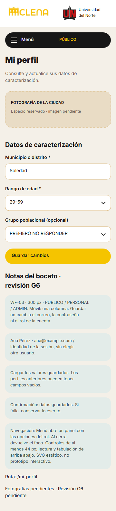

Identidad de la cuenta en lectura y caracterización precargada editable.
Municipio, rango y grupo se guardan con confirmación; si falla, no se borra lo
escrito. Los valores históricos vacíos pueden completarse aquí. No se propone
cambiar rol, contraseña o correo desde esta pantalla.

### WF-04 Búsqueda de material pública

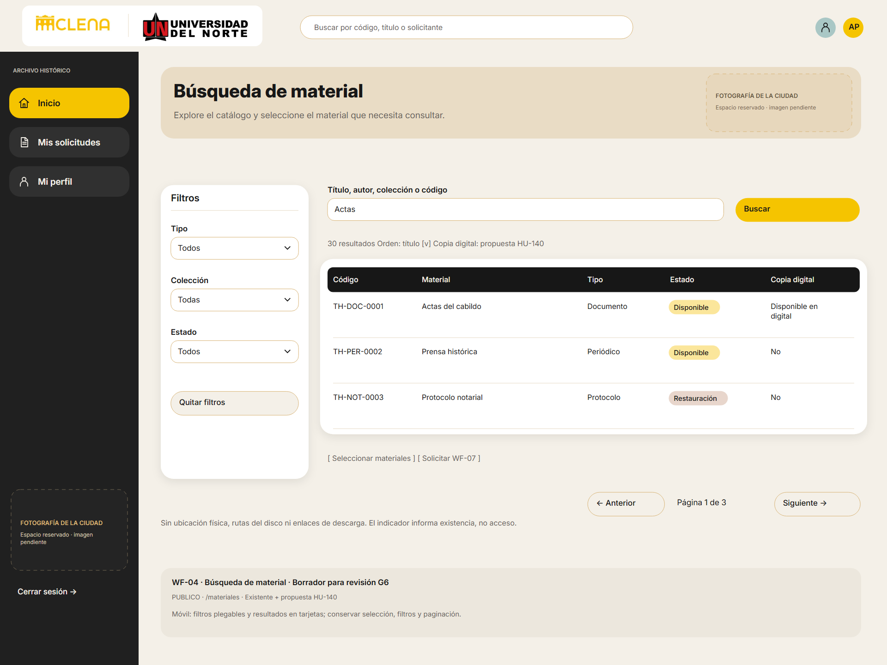

[Escritorio · SVG para Figma](wireframes/wf-04-busqueda-material.svg) · [Móvil · SVG para Figma](wireframes/wf-04-busqueda-material-movil.svg).

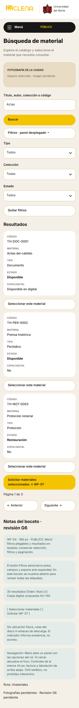

Buscador, filtros por tipo/colección/estado, orden, paginación y selección de
materiales para WF-07. HU-140 agrega el indicador: con copia, el público solo
ve **«DISPONIBLE EN DIGITAL»**, sin nombre de archivo. Sin copia, se indica
«No». No hay rutas del disco, ubicación física ni acciones de apertura/descarga.

### WF-05 Formulario de material

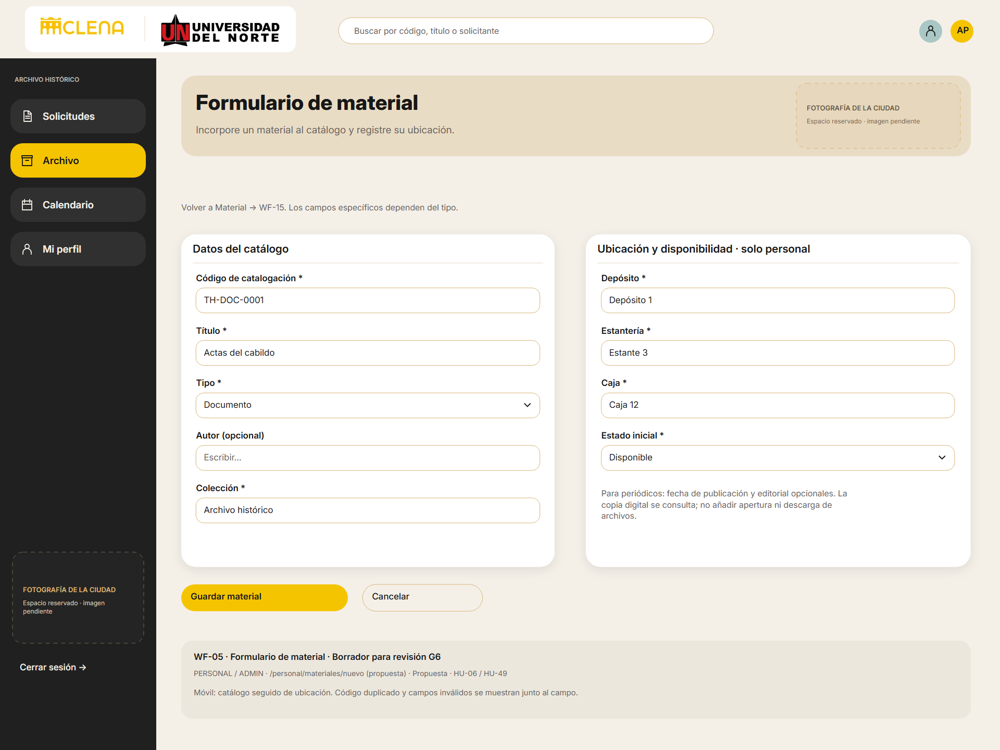

[Escritorio · SVG para Figma](wireframes/wf-05-formulario-material.svg) · [Móvil · SVG para Figma](wireframes/wf-05-formulario-material-movil.svg).

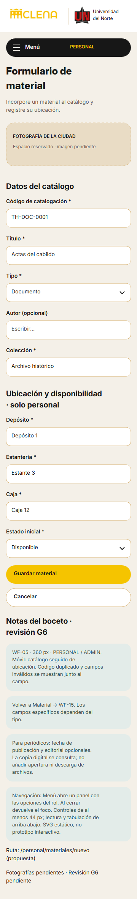

Propuesta de alta: código, título, tipo, autor opcional, colección, depósito,
estantería, caja y estado inicial. Para periódicos, publicación y editorial
opcionales. Guardar vuelve a WF-15; cancelar no guarda. Mostrar código duplicado
y campos inválidos. La definición final de campos y edición depende de HU-06/49.

### WF-06 Mis solicitudes

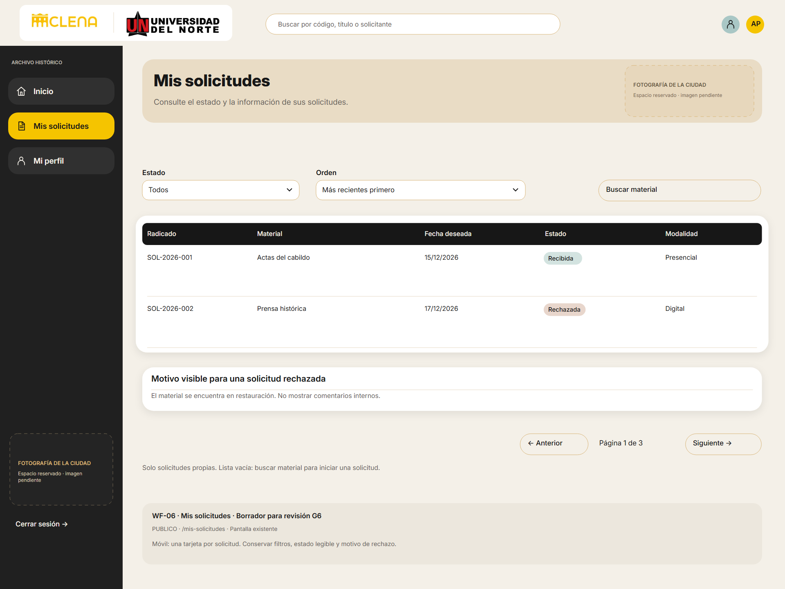

[Escritorio · SVG para Figma](wireframes/wf-06-mis-solicitudes.svg) · [Móvil · SVG para Figma](wireframes/wf-06-mis-solicitudes-movil.svg).

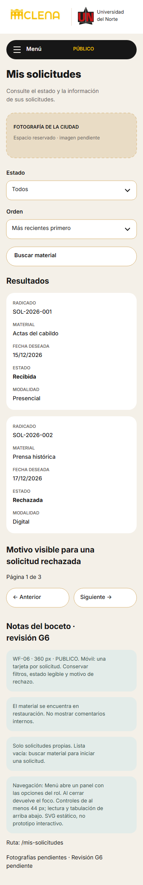

Radicado, material, fecha deseada, estado, modalidad, filtros y páginas. El motivo
de rechazo es visible al solicitante; no se muestran notas internas. La lista
vacía ofrece buscar material. No enlaza al detalle reservado al personal.

### WF-07 Radicar solicitud

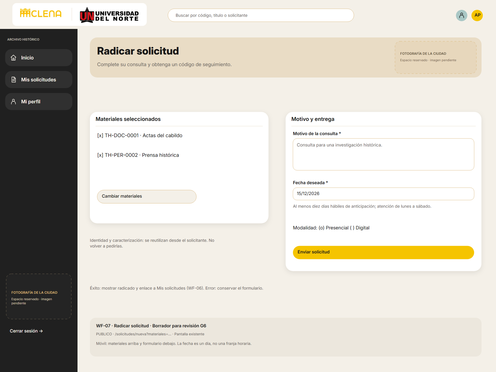

[Escritorio · SVG para Figma](wireframes/wf-07-radicar-solicitud.svg) · [Móvil · SVG para Figma](wireframes/wf-07-radicar-solicitud-movil.svg).

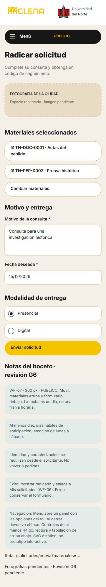

Resumen de materiales, motivo, fecha deseada y modalidad presencial/digital.
La fecha exige diez días hábiles de anticipación y atención de lunes a sábado.
El comprobante muestra el radicado y acceso a WF-06. No se repiten los datos del
perfil; un error conserva el formulario.

### WF-08 Registro de solicitud por personal

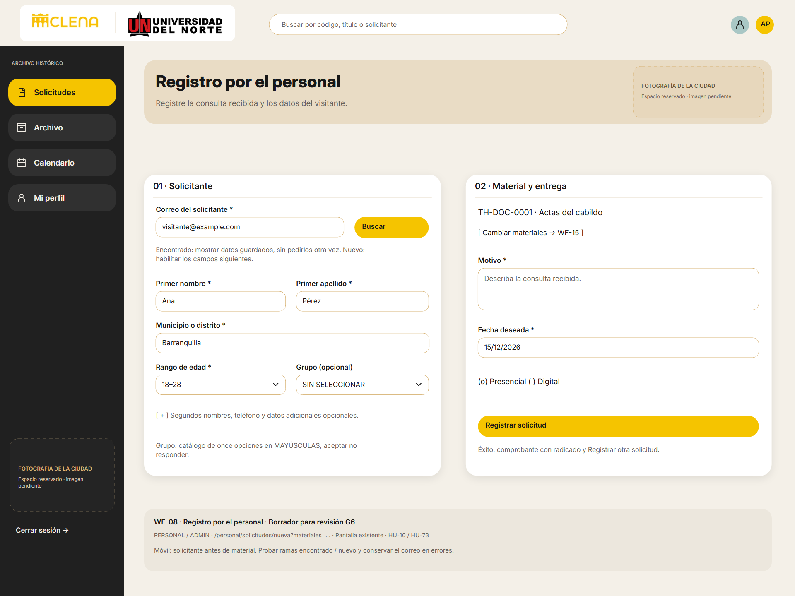

[Escritorio · SVG para Figma](wireframes/wf-08-solicitud-personal.svg) · [Móvil · SVG para Figma](wireframes/wf-08-solicitud-personal-movil.svg).

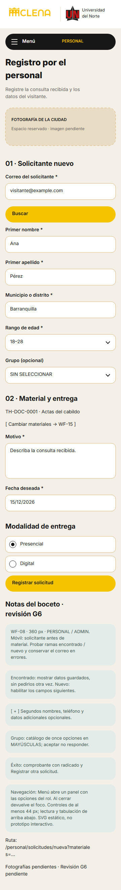

Dos pasos en la misma pantalla: buscar al solicitante por correo y completar la
solicitud. Encontrado: reutilizar sus datos. Nuevo: recoger nombres y
caracterización una sola vez; los datos adicionales siguen siendo opcionales.
Seleccionar/cambiar material remite a WF-15. Tras guardar, entregar el radicado
y permitir registrar otra solicitud sin perder la selección de material.

### WF-09 Listado de solicitudes del personal


[Escritorio · SVG para Figma](wireframes/wf-09-listado-personal.svg) · [Móvil · SVG para Figma](wireframes/wf-09-listado-personal-movil.svg).

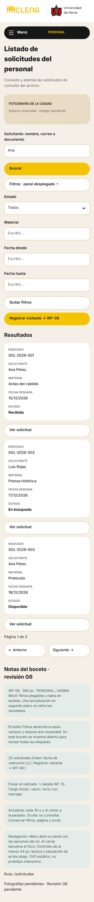

Filtros por estado, material, solicitante y fechas; orden, páginas y radicado
enlazado a WF-10. El acceso de visitante lleva a WF-08. HU-141: consulta cada
30 segundos y al volver a la pestaña; no consulta oculta, conserva filtros,
página y scroll y mantiene la tabla durante la actualización. Prever carga
inicial, error, sin resultados y recuperación de la conexión.

### WF-10 Detalle y cambio de estado

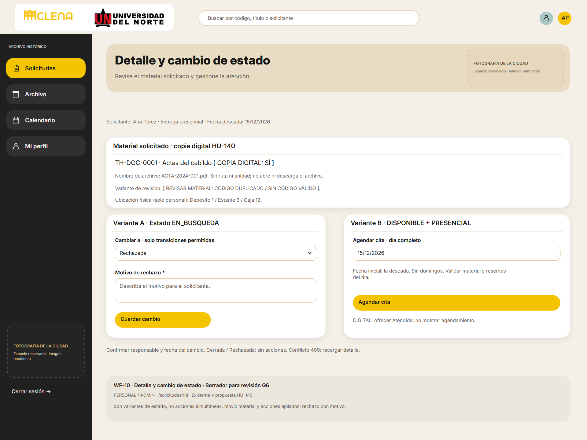

[Escritorio · SVG para Figma](wireframes/wf-10-detalle-solicitud.svg) · [Móvil · SVG para Figma](wireframes/wf-10-detalle-solicitud-movil.svg).

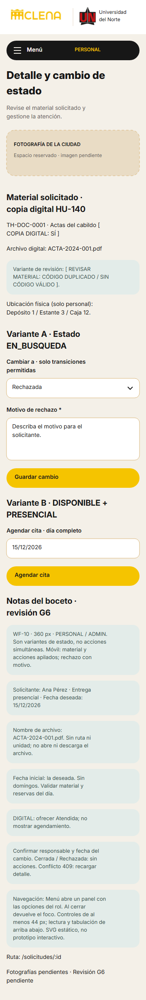

Solicitante, material, fechas, modalidad y acciones permitidas. Se muestran
**dos variantes separadas**: EN_BUSQUEDA con rechazo motivado y DISPONIBLE
presencial con agendamiento. No son acciones simultáneas de una solicitud.
AGENDADA solo se alcanza al agendar; una solicitud digital puede pasar a
ATENDIDA sin cita; los estados finales no ofrecen acciones.

HU-140 agrega **«COPIA DIGITAL: SÍ / NO»** por material. El personal ve solo el
nombre de archivo, por ejemplo `ACTA-2024-001.pdf`, nunca ruta ni unidad.
Si hay código duplicado o sin código válido se muestra **«REVISAR MATERIAL»**.
La API tampoco debe enviar rutas completas. No hay enlaces para abrir o descargar
archivos. La confirmación del cambio conserva responsable/fecha y comunica un
409 si el estado cambió mientras se editaba.

### WF-11 Calendario

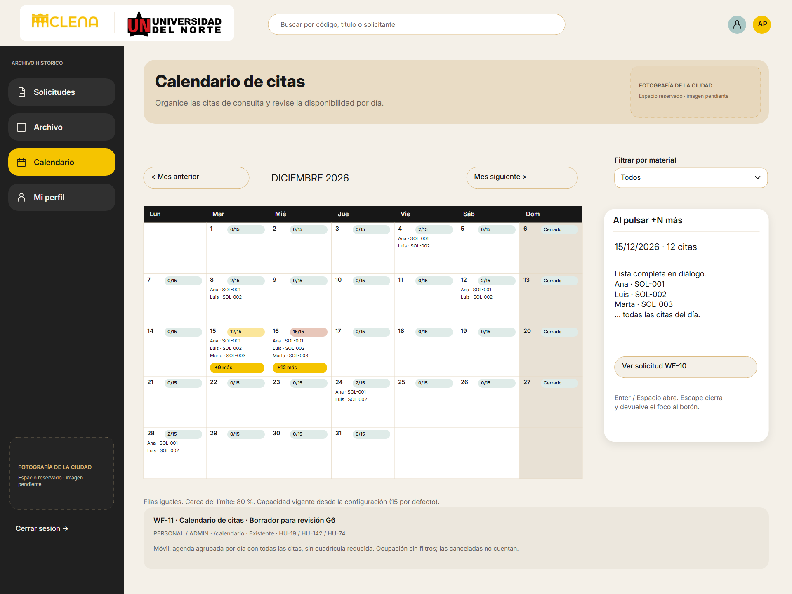

[Escritorio · SVG para Figma](wireframes/wf-11-calendario.svg) · [Móvil · SVG para Figma](wireframes/wf-11-calendario-movil.svg).

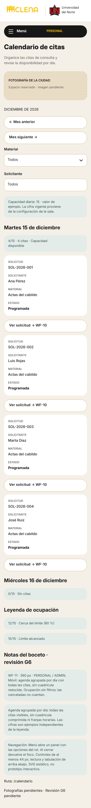

Navegación mensual, filtro por material y listado del día con enlace a WF-10.
Las citas son por día completo; domingos cerrados. El horario depende del día,
sin selector de franja horaria. Reprogramar/cancelar corresponde a HU-21 y no
se presenta como acción ya implementada.

### WF-12 Gestión de usuarios del personal

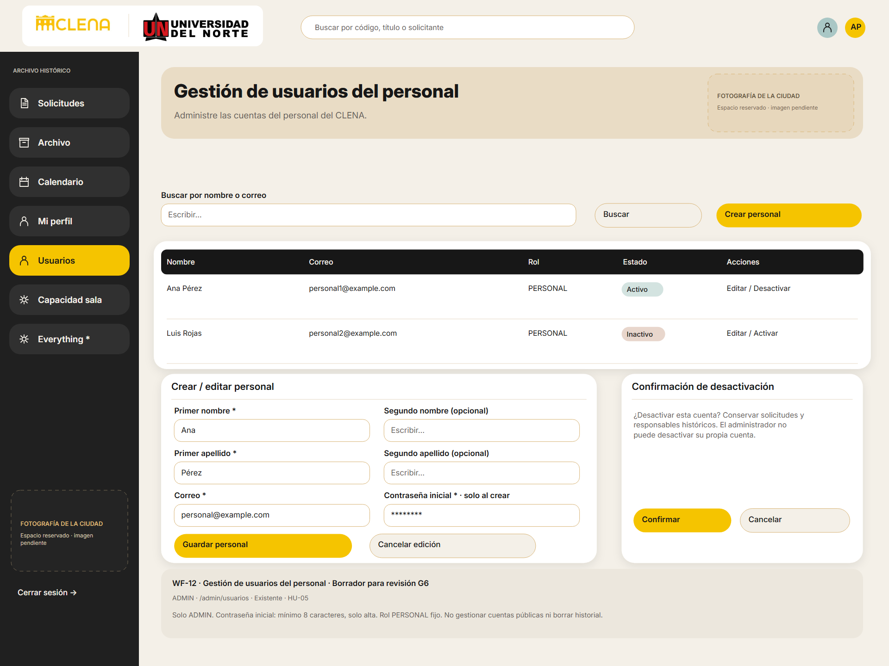

[Escritorio · SVG para Figma](wireframes/wf-12-gestion-usuarios.svg) · [Móvil · SVG para Figma](wireframes/wf-12-gestion-usuarios-movil.svg).

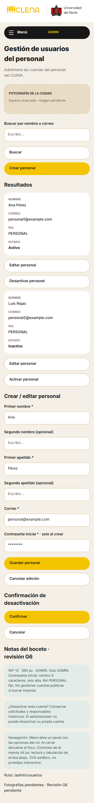

Pantalla existente para ADMIN: buscar, crear, editar, activar y desactivar personal.
Mostrar nombre, correo, rol y estado; confirmar la desactivación sin borrar el
historial de solicitudes. La credencial inicial y los campos definitivos deben
acordarse en HU-05; el boceto no autoriza promocionar roles arbitrariamente.

**Implementada en HU-05.** El administrador define una contraseña inicial
(mínimo 8 caracteres) y se la entrega a la persona. Los campos son los cuatro
del nombre y el correo; la contraseña no se edita después. Las cuentas nuevas
siempre tienen rol `PERSONAL` y el rol no se edita, así que ninguna cuenta pasa
a `ADMIN`. Una cuenta pública no se gestiona aquí. El administrador no puede
desactivar su propia cuenta. La desactivación se confirma y conserva las
solicitudes y el historial.

### WF-13 Capacidad de la sala

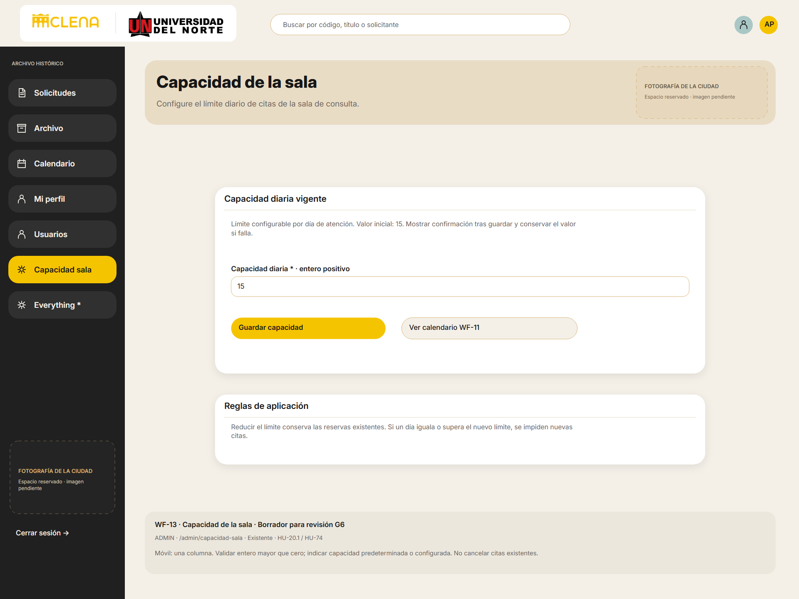

[Escritorio · SVG para Figma](wireframes/wf-13-capacidad-sala.svg) · [Móvil · SVG para Figma](wireframes/wf-13-capacidad-sala-movil.svg).

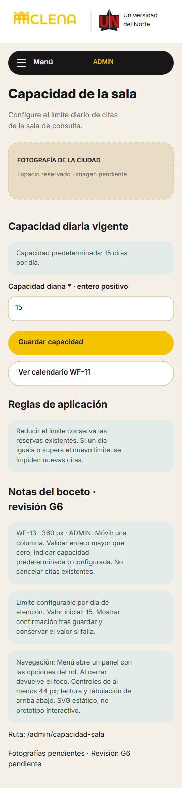

Propuesta para ADMIN: límite diario positivo, guardar y enlace a calendario.
El valor 20 es ilustrativo. Falta acordar capacidad real, si hay excepciones por
fecha y la regla ante reservas existentes. No cancelar citas silenciosamente
al cambiar la capacidad. Estas decisiones se validan con G6 y en HU-20.1.

### WF-14 Sincronización con Everything

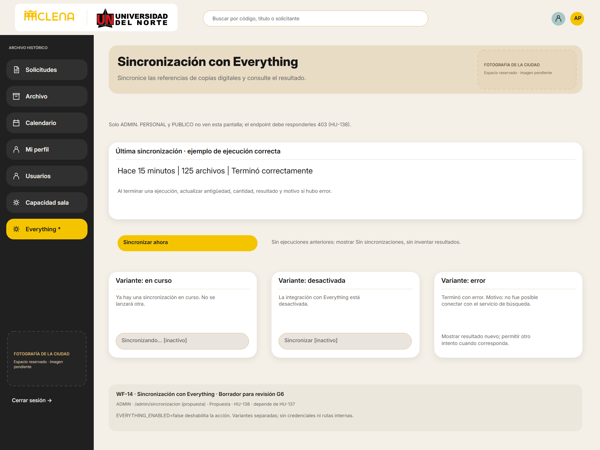

[Escritorio · SVG para Figma](wireframes/wf-14-sincronizacion-everything.svg) · [Móvil · SVG para Figma](wireframes/wf-14-sincronizacion-everything-movil.svg).

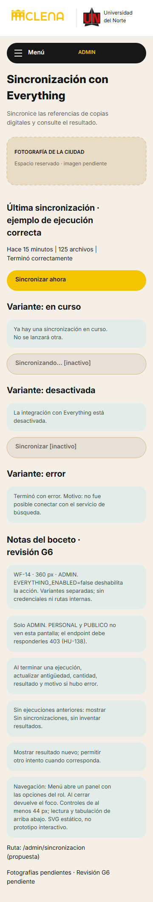

Según los criterios de HU-138 suministrados para esta tarea:

- Solo ADMIN; PERSONAL y PUBLICO reciben 403 al llamar al endpoint.
- Última sincronización: hace cuánto, cantidad de archivos, éxito/error y motivo.
- «Sincronizar ahora» actualiza esos datos cuando termina.
- Si ya corre una sincronización, se avisa y no se inicia otra.
- Con `EVERYTHING_ENABLED=false`, indicar integración desactivada y botón inactivo.
- Sin ejecuciones previas, indicar que todavía no hay sincronizaciones.
- Presentar errores comprensibles, sin credenciales, rutas internas o trazas.

Las tarjetas inferiores representan variantes, no estados simultáneos. La HU
depende de #137 y debe verificarse con Nginx/Docker cuando se implemente. Este
issue de wireframes no implementa la integración ni cambia D-17 de arquitectura.

### WF-15 Material para el personal

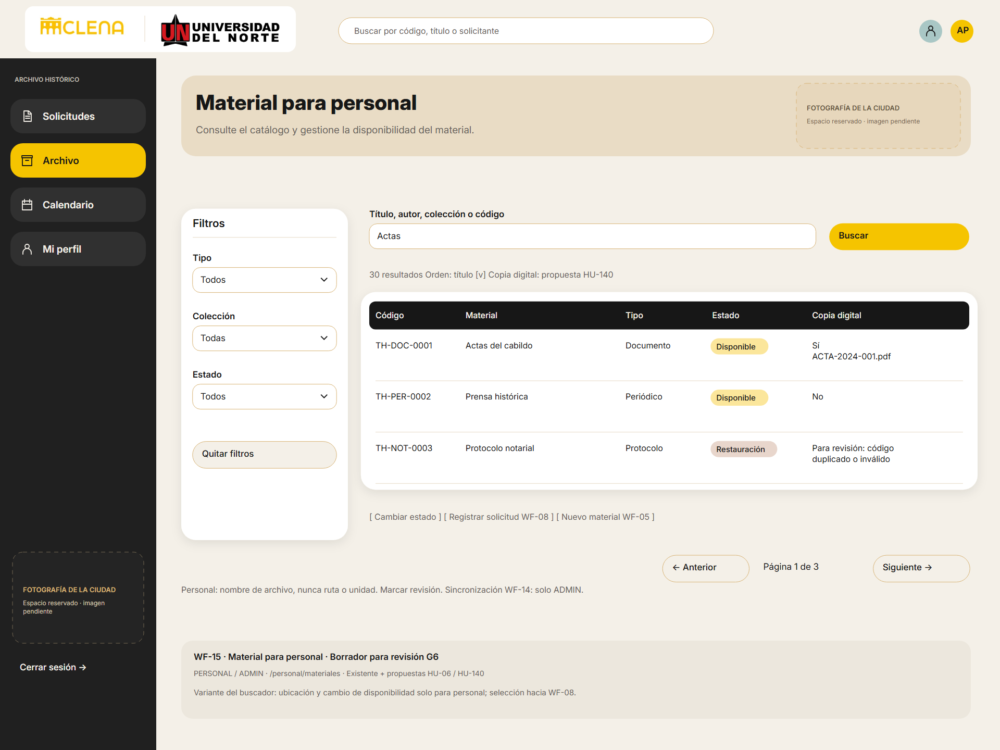

[Escritorio · SVG para Figma](wireframes/wf-15-material-personal.svg) · [Móvil · SVG para Figma](wireframes/wf-15-material-personal-movil.svg).

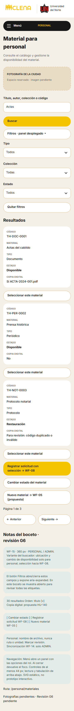

Variante de WF-04: controles de disponibilidad y selección hacia WF-08; alta
de material propuesta hacia WF-05. HU-140 muestra **«COPIA DIGITAL: SÍ / NO»**,
solo el nombre del archivo cuando existe y avisos de código duplicado o inválido.
Nunca envía ni muestra rutas completas o unidad del disco; tampoco abre/descarga
archivos. El acceso propuesto a WF-14 solo es visible para ADMIN.

## Criterios transversales para revisar

- Etiquetas visibles, foco con teclado, mensajes asociados a los campos y
  confirmación al guardar. Estado, disponibilidad y revisión también en texto.
- A 360 px: una columna en formularios, filtros plegables y tablas en tarjetas.
  El calendario pasa a una agenda agrupada por fecha, con todas las citas visibles.
  Son directrices para implementación; los bocetos incluyen composiciones móviles de 360 px para todas las pantallas.
- Mantener lo escrito ante errores. Solo pedir los datos necesarios y reutilizar
  la caracterización ya registrada; no inferir información personal.
- No confundir disponibilidad física con existencia de copia digital. HU-140
  depende de #134; el público no recibe nombres de archivo, el personal no
  recibe rutas completas y nadie abre/descarga archivos desde Trackhive.
- Las decisiones de diseño no sustituyen autorización en el backend ni crean
  contratos nuevos. Las HU funcionales deben probarse a través de `/api` con
  frontend servido por Nginx en `http://localhost:8080` cuando se implementen.

## Revisión y validación con G6

**Aún no realizada / sin comentarios recibidos**, según lo indicado por el
equipo al preparar esta versión. Los bocetos están disponibles para revisar,
pero el criterio de validación externa permanece pendiente.

Para registrar la revisión, recorrer los flujos de público, personal y
administrador; revisar estados alternativos y completar esta tabla con los
comentarios reales. Cada observación debe identificar el WF y su decisión.

| Fecha de revisión | Integrante G6 | Pantalla | Comentario recibido | Decisión / ajuste / issue | Estado y evidencia |
|---|---|---|---|---|---|
| Pendiente | — | WF-01 a WF-15 | Sin comentarios recibidos | Pendiente de revisión | Sin aprobación registrada |

Preguntas propuestas para la sesión:

1. ¿Los menús y recorridos corresponden a cada rol y al trabajo del CLENA?
2. ¿Los formularios incluyen los datos necesarios sin volver a pedirlos?
3. ¿Quedan claros el motivo de rechazo, la cita por día y sus restricciones?
4. ¿El personal distingue el nombre del archivo, el indicador y la revisión,
   sin esperar abrir o descargar copias desde Trackhive?
5. ¿Everything comunica cantidad, antigüedad, error, ejecución en curso y
   desactivación de forma comprensible?
6. ¿La presentación de la capacidad vigente y la conservación de reservas existentes resulta clara?
7. ¿Se aprueban las posiciones y tamaños de ambos logos y los recorridos a 360 px?

Al recibir comentarios: registrar fecha, autor y texto o enlace al comentario
del issue; ajustar los SVG o la versión en Figma y sus vistas PNG; indicar versión y decisión.
Solo registrar «validado por G6» cuando exista evidencia explícita.

## Comprobación de los archivos

```bash
node docs/tools/generar-wireframes.mjs
node docs/tools/verificar-wireframes.mjs
```

La comprobación valida 15 pantallas con 30 variantes, los enlaces, la presencia de ambos logos y las vistas SVG y PNG. Con las dependencias habituales del frontend y Chromium instalados,
también renderiza las 30 variantes, revisa textos y logos cargados, verifica controles de al menos 44 px y ausencia de desbordamiento horizontal a 360 px. Deja dos hojas de contacto:

```bash
node docs/tools/verificar-wireframes.mjs --render
```

Esta comprobación técnica verifica los artefactos. La aprobación de G6 se
registra por separado y no puede sustituirse por una prueba automática.
